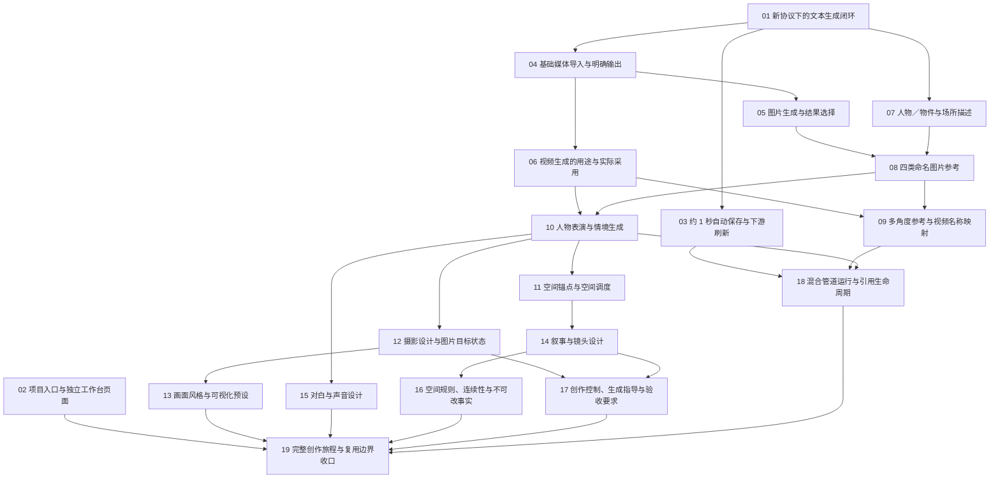

# 画布生成优化：任务索引

日期：2026-10-28

依据[实现规格](spec.md)及已确认的 Q16–Q23 共识，用户已确认以下 19 张纵向票据和阻塞关系，并于 2026-10-28 授权使用 implement-spec 在 codex-generation-canvas 分支完成全部实现。ready-for-agent 表示分诊状态，不表示票据已完成。规格及票据中此前“本轮不开始实现”等表述记录规格发布阶段，现由本次实现授权接续；不扩大原有业务范围。

每张票据覆盖一个可观察的完整行为：数据契约、后端处理、前端操作及相应行为验证共同交付，优先复用已有生成、任务、历史和恢复能力。01 在既有文本生成路径中完成必要公共重构；02 在真实独立页面中完成必要外壳提取，不另设仅搭底层框架的票据。

## 任务与阻塞关系

编号表示依赖顺序，不要求严格串行执行。01、02、03、04、05、06、07、08、09、10、11、12、15 共十三票已实现并集成；13 可开始，14／18 进行中，验证证据在下方实施记录及相应票据中维护。

| 票据 | Blocked by | 目录负责内容 |
| --- | --- | --- |
| [01 新协议下的文本生成闭环](issues/01-text-protocol-flow.md) | 无 | 通用文本、原文／创作依据、文本生成 |
| [02 项目入口与独立工作台页面](issues/02-standalone-workbench-page.md) | 无 | 跨类型行为，见票据完成条件 |
| [03 约 1 秒自动保存与下游刷新](issues/03-autosave-output-refresh.md) | 01 | 跨类型行为，见票据完成条件 |
| [04 基础媒体导入与明确输出](issues/04-media-content-outputs.md) | 01 | 通用图片、通用视频、通用音频 |
| [05 图片生成与结果选择](issues/05-image-generation-adoption.md) | 04 | 图片生成 |
| [06 视频生成的用途与实际采用](issues/06-video-generation-inputs.md) | 04 | 视频生成 |
| [07 人物／物件与场所描述](issues/07-object-description-identity.md) | 01 | 人物／物件、场所 |
| [08 四类命名图片参考](issues/08-named-image-references.md) | 05、07 | 角色参考、场所参考、道具参考、服装参考 |
| [09 多角度参考与视频名称映射](issues/09-multi-view-video-mapping.md) | 06、08 | 跨类型行为，见票据完成条件 |
| [10 人物表演与情境生成](issues/10-performance-direction.md) | 06、08 | 角色情境、人物表演、表演规则 |
| [11 空间锚点与空间调度](issues/11-spatial-direction.md) | 10 | 空间锚点、站位与走位、镜内活动、环境活动与留白 |
| [12 摄影设计与图片目标状态](issues/12-photography-and-image-target.md) | 10 | 景别与构图、机位与视角、运镜、光影与色彩、焦点与成像 |
| [13 画面风格与可视化预设](issues/13-visual-style-presets.md) | 12 | 画面风格 |
| [14 叙事与镜头设计](issues/14-narrative-shot-design.md) | 11 | 叙事概览、叙事节拍、事件与刺激、镜头设计 |
| [15 对白与声音设计](issues/15-dialogue-sound-design.md) | 10 | 对白、声音安排 |
| [16 空间规则、连续性与不可改事实](issues/16-continuity-facts.md) | 14 | 空间规则、连续性设计、不可改事实 |
| [17 创作控制、生成指导与验收要求](issues/17-creative-guidance-acceptance.md) | 12、14 | 创作控制、生成指导、验收要求 |
| [18 混合管道运行与引用生命周期](issues/18-mixed-pipeline-lifecycle.md) | 03、09、10 | 跨类型行为，见票据完成条件 |
| [19 完整创作旅程与复用边界收口](issues/19-integrated-creation-journey.md) | 02、13、15、16、17、18 | 跨类型行为，见票据完成条件 |

## 依赖图

- 初始可开始的票据是 01、02；01 完成后，03、04、07 可独立推进。
- 04 提供导入媒体后，05 图片与 06 视频可并行；视频不依赖图片生成。
- 06、08 完成后，09 多角度与 10 表演可独立推进；表演不要求先具备多角度参考。
- 10 完成后，11 空间、12 摄影、15 声音可独立推进。14 需要 11 的真实调度来源；16 通过 14 已依赖 11，不重复列阻塞边。
- 18 只依赖其混合链路所需的保存、参考和表演能力，不等待全部导演目录。19 汇合页面、各内容分支与混合执行。
- 依赖只表达功能上必须先具备的能力；修改相同公共契约时仍须协调集成，不由本索引授权新建其他任务会话。

## 目录覆盖

39 行目录分配如下。功能入口不等于独立物理卡片、表或处理器；摄影的五项入口仍维护同一张摄影内容卡。

| 分组 | 数量 | 负责票据 |
| --- | --- | --- |
| 基础内容 | 11 | 01：通用文本、原文／创作依据；04：图片、视频、音频；07：人物／物件、场所；08：四类命名图片参考。 |
| 模型生成 | 3 | 01：文本；05：图片；06：视频。 |
| 导演工具箱／画面设计 | 6 | 12：构图、机位、运镜、光影、焦点五入口；13：独立风格及可视化预设。 |
| 导演工具箱／表演与调度 | 7 | 10：角色情境、人物表演、表演规则；11：空间锚点、站位与走位、镜内活动、环境活动与留白。 |
| 导演工具箱／叙事与镜头 | 4 | 14：叙事概览、叙事节拍、事件与刺激、镜头设计。 |
| 导演工具箱／声音设计 | 2 | 15：对白、声音安排。 |
| 导演工具箱／连续性与约束 | 6 | 16：空间规则、连续性设计、不可改事实；17：创作控制、生成指导、验收要求。 |

## 端点与跨票关系责任

28 类输入端点沿规格的 7 类生成输入、17 类业务引用、4 类素材关联分配。来源与接收方可以先后交付：先交付方声明完整契约，已有来源即可形成真实可用闭环；后续来源或接收方接入时沿同一契约工作，不伪造候选、占位处理器或必填关系。可选的镜头、节拍等关系不成为独立工具生成的前置条件。

| 关系类别 | 端点 | 负责票据 |
| --- | --- | --- |
| 生成输入 | 文本依据 | 01；05、06 接入对应模型，10–17 扩展结构化来源 |
| 生成输入 | 参考图片 | 05；08、09 扩展命名参考 |
| 生成输入 | 首帧 | 06；09 扩展命名参考 |
| 生成输入 | 尾帧 | 06；09 扩展命名参考 |
| 生成输入 | 关键帧 | 06；09 扩展命名参考 |
| 生成输入 | 主体图片参考 | 06；09 扩展对象身份与多角度 |
| 生成输入 | 主体视频参考 | 06 |
| 业务引用 | 名称关联 | 08；09 扩展另一角度参考 |
| 业务引用 | 参与对象 | 10；11、14、16 扩展接收方 |
| 业务引用 | 说话对象 | 15 |
| 业务引用 | 覆盖节拍 | 14 |
| 业务引用 | 所属节拍 | 10 声明接收；14 提供来源并接通 |
| 业务引用 | 关联事件 | 14；16 扩展连续性接收 |
| 业务引用 | 变化事件 | 11 声明接收；14 提供来源并接通 |
| 业务引用 | 接收事件 | 10 声明接收；14 提供来源并接通 |
| 业务引用 | 触发事件 | 11 声明接收；14 提供来源并接通 |
| 业务引用 | 位置锚点 | 11 |
| 业务引用 | 区域锚点 | 11 |
| 业务引用 | 调度依据 | 11 提供来源；14 接收 |
| 业务引用 | 所属镜头 | 12 声明接收；14 提供来源；19 核对组合 |
| 业务引用 | 对白依据 | 10 声明接收；15 提供来源并接通 |
| 业务引用 | 验收依据 | 10、12、14 声明接收；17 提供来源并接通 |
| 业务引用 | 所属空间 | 11；16 扩展空间规则接收 |
| 业务引用 | 作用对象 | 10–17 按各类型字段资格分别接入 |
| 素材关联 | 图片来源 | 08 |
| 素材关联 | 图片素材 | 10；后续导演票据按字段声明扩展 |
| 素材关联 | 视频素材 | 10；12、15 等按字段声明扩展 |
| 素材关联 | 音频素材 | 15；其他类型仅按规格声明开放 |

所属镜头等双方可独立推进的关系，以及其他导演类型与图片目标选择的组合，在 19 核对双方实际可用；单票不能把尚未交付的组合记录为已验证。12 负责图片目标选择交互，其他类型按声明提供明确状态，保持完整采用，不为此复制目标选择逻辑或解析自由文本。

9 行输出目录由内容所属票据同步交付：01 提供通用文本及文本结果，07 提供描述与对象引用，04 提供普通媒体，05／06 提供相应模型结果，08 提供命名图片及对象引用，10–17 提供各自设计文本与声明的对象引用。19 按完整规格逐项核对输入、输出和 19 条连线规则，不能只比较目录总数。

## 各票共同完成边界

- 卡片自身内容、实际输入绑定和派生展示分别维护；连线只提供候选。三类候选关系统一无环，候选预览和实际处理都只消费直接出口的明确内容。
- 后端输出行为使用小型 Protocol，数据使用强类型契约；前端通过 OpenAPI generated client 使用公开接口，不重复定义另一份采用或名称映射权威。
- 每票同步保存、重开、候选／已采用展示、编译诊断及新增引用保护。基础无环、文件归属、失效绑定、删除保护与单卡运行随功能交付，不推迟到 18 或 19。
- 导演设计默认完整采用，人物表演不得拆项；摄影只开放契约声明的范围。对象引用逐对象、生成结果逐项选择，不因整卡采用扩选其他出口或结果集合。
- 选择阶段／状态只针对导演输出明确提供的结构，在图片端作为画面目标；完整设计仍被采用，不从普通文字推断阶段，不为目标选择新增导演字段。
- 编辑约每秒合并保存，成功后按修订刷新相关输出；无编辑不提交、在途串行、旧回执不覆盖新内容。保存和输出刷新不自动运行模型或采用候选。
- 预览、预设示例、素材关联、生成实际输入、历史结果与当前编辑分别表达；纯文本原样保留，不进行语义纠错或图像内容正确性检测。
- 既有运行、取消、幂等、恢复、文件保留与历史能力按新契约适配；内容复制／另存保持明确操作和只读来源，不新增回连或未来输出引用。
- 新增公共接口同步公开契约、OpenAPI 与前端生成类型，按仓库规则完成受影响检查；具体字段名、代码组织、路径及兼容迁移方案仍按规格在实现设计中确定，不因拆票默认执行迁移。
- 本期不改造章节、场次四画布或旧生产／剪辑业务，不新增音频生成、隐式转换、通用表单引擎或全场自动适用性系统。

## 完成条件与验证边界

票据中的未勾选条目是来自已确认规格的可观察完成条件，不是已经通过的验收证据。每个切片需要验证自己的外部行为，不能用其他类型的旧检查替代新行为，也不能把全部验证拖到 19。

用户于实现阶段确认测试接缝：现有画布 HTTP 接口覆盖保存、输出、绑定、编译和运行，真实页面覆盖编辑、采用、自动保存和布局；生成供应商与外部存储使用受控替身。HTTP 不证明交互正确，页面不证明真实供应商质量。仓库既有检查要求仍适用，按影响范围运行并记录实际证据、限制和未完成项，不预填通过结果。

原版任务与交付记录仅作为已有能力的证据，不改写、重开或重复发布旧票据；本索引不把这 19 张新增票据标成已交付。

## 实施记录

- 集成分支：codex-generation-canvas；实现前基线：66f32c19b2bb68eb494a18db6f429a9c874d5bc8。
- 当前进展：01、02、03、04、05、06、07、08、09、10、11、12、15 共十三票已合并到集成分支。文本闭环、独立页面、一秒自动保存与已保存输出刷新、基础媒体、图片／视频生成与结果选择、对象描述、四类命名图片参考、多角度参考与视频名称映射及人物表演与情境设计、空间锚点与空间调度、摄影设计与图片目标、对白与声音设计已交付，完成证据见对应票据；13 可开始，14／18 进行中，其他票据尚未开始。
- implement-spec 要求实施子代理使用独立工作树并执行 TDD，合并后统一审查。用户已确认 HTTP 与真实页面接缝，生成供应商与外部存储使用受控替身；后续每票复用该确认执行 TDD，不重复询问。

- 2026-10-28：合并 codex-canvas-types-02（代码提交 9b14739，合并前分支 HEAD 6639d43），无冲突。复用票据中的真实页面验证证据，集成后 Node 24 前端 typecheck 与 git diff --check、git diff --cached --check 均通过；分诊 Status 保持不变。

- 2026-10-28：合并 codex-canvas-types-01（分支 HEAD 938a8607，集成提交 ce816fb0），无冲突，01 Completion 更新为 integrated，分诊 Status 保持不变。核实主区 8000 已加载新绑定／创作依据／schema v2 后执行完整 openapi:update，结果与交付契约一致；剔除 361 处纯尾空行漂移。Node 24 前端 typecheck、git diff --check 和 git diff --cached --check 均通过；复用 01 票据中同一实现的后端及真实页面检查。当前前沿为 03、04、07。

- 2026-10-28：03 在 codex-canvas-types-03 实现一秒周期合并保存、失败暂停与已保存 revision 的来源／正式输出／诊断刷新，等待集成。真实页面 autosave、既有 save、工作台六用例及前端 typecheck 通过，证据与限制见 03 票据；未改变公开 HTTP 契约。

- 2026-10-28：合并 codex-canvas-types-04（分支 HEAD `7d4ed6ad`，集成提交 `436691a2`），无冲突；04 Completion 更新为 integrated，分诊 Status 保持不变。复用 91 passed／27 skipped、Pylint 10.00/10 和真实 Chrome 媒体页面证据；主区 Node 24 typecheck 与差异检查通过。04 公开 schema 精确一致；本次 8000 无响应，未重复执行标准 OpenAPI 生成，复用 01 集成后已验证结果，不声称本次请求通过。当前前沿为 03、05、06、07，其中 03、07 进行中。

- 2026-10-28：依次合并03（分支HEAD `1b7d67a3`，合并 `edcea6fe`）及07（分支HEAD `9450b58d`，合并 `15fafb5a`），均无冲突，两票Completion更新为integrated，分诊Status保持不变。主区HTTP相关回归50 passed／7 deselected、Pylint10.00/10（缓存stats写入提示不影响exit0）、Node24.22.1 typecheck及真实autosave页面19.5s通过；证据 `/private/tmp/canvas0307-integrated`。07对象真实页面及workbench既有证据复用，未新增冲突不扩大验证。主区app导入路径已核实，独立8274导出OpenAPI与已提交schema精确一致，重新生成client仅365处尾空行漂移并已剔除；8000无响应且未操作，不声称本次标准openapi:update成功。MySQL专用7项未运行，外部供应商受控替身限制继续保留。当前05进行中、06可开始、08待05；不触碰05独立工作树。

- 2026-10-28：05在 `codex-canvas-types-05` 实现图片模型文本／图片独立采用、取消和顺序，预检显示真实有序图片，复用原有执行、当前输出、历史、固定文件另存与保护。已合入最新集成 `8c67ef51`；全部画布后端103 passed／27 skipped（MySQL未运行），Pylint10/10、Node24 typecheck、真实图片页面及1440px／390px截图验证通过。证据及受控供应商／外部存储限制见05票据；05待主区集成，08届时解除05阻塞，未自动开展其他票据。

- 2026-10-28：无冲突合并05（分支HEAD `a3e454ae`，合并提交 `2e1e93e9`），Completion 更新为 integrated，分诊Status保持不变。合并前05已包含主区 `8c67ef51`，集成后代码与其已验收实现一致；复用全部画布后端103 passed／27 skipped、Pylint10.00/10、真实图片页面及1440px／390px截图证据。主区Node24.22.1 typecheck、工作区／暂存区及合并差异检查通过。复核05隔离8277导出（去除测试控制路径）与当前 `front/openapi.json` 精确一致，没有schema或generated client变更；8000无响应，未停止、重载或从其生成，复用01标准更新及07独立导出验证，不声称本次标准openapi:update成功。受控供应商／外部存储和27项MySQL未运行限制保留。当前共六票集成，06进行中，08可开始；未触碰06工作树。

- 2026-10-28：06 在 `codex-canvas-types-06` 实现视频用途明确采用、统一binding分组与有序编译、定位诊断、固定视频用途历史、完整音轨及下游主体视频；代码 `d5b3827a`，无冲突合并最新集成 `07e7ab7e` 得 `418b759b` 后复验。全部画布后端110 passed／27 skipped、Pylint10.00/10、Node24 typecheck及图片／视频真实页面通过；旧07e7ab7e文本／图片实际成果跨版本读取保持依据有效，独立8279生产schema与OpenAPI精确一致。06 Completion为implemented待主区集成，分诊Status不变；详细红绿、截图与受控供应商／外部存储及MySQL限制见06票据。未提前实现08／09命名图片，不操作主区8000。

- 2026-10-28：无冲突合并06（分支HEAD `39800559`，合并提交 `63a028ac`），Completion 更新为 integrated，分诊Status保持不变。主区Node24.22.1 typecheck、视频及API HTTP回归61 passed／2 skipped与差异检查通过；已核实 `PYTHONPATH=. uv run --no-sync` 导入主区app。复用同一代码的全部画布110 passed／27 skipped、Pylint10.00/10、图片／视频真实页面及旧版文本／图片实际成果basis_current兼容证据。隔离8286生产OpenAPI与提交schema精确一致，无测试控制路径；重新gen仅365处纯尾空行并已剔除，证据 `/private/tmp/canvas06-integrated/openapi-8286.json`。8000隔离环境内探测无响应，提升权限复核健康检查已响应，但未核实其代码归属，未操作或从其生成schema，不声称标准openapi:update本次成功；MySQL及受控外部服务限制保留。当前共七票集成，08独立工作树进行中，09／10待08；未触碰08工作树。

- 后续主区复核：8000 已恢复响应，PID61721／73854 工作目录均为本工作区 backend；生产 OpenAPI 与集成 b64ce5e5 的 schema 精确一致（含 subject_name）。标准 openapi:update 已通过；生成器纯尾空行漂移已剔除，不引入无关文件变化。此前超时记录为当时事实，不再作为当前限制。

- 2026-10-28：无冲突合并08（分支HEAD `d8fa8a69`，合并提交 `71a007c8`），Completion 更新为 integrated，分诊Status保持不变。主区Node24.22.1 typecheck及08／视频／API HTTP回归 `74 passed, 2 skipped`（6.84s）通过；合并前分支已含主区 `60dba6df`，复用同一实现全部画布 `123 passed, 27 skipped`、Pylint `10.00/10`、08／06真实页面和共享工作台1440px／390px布局证据。已核实主区app导入路径，8000实际HTTP、主区生产导出与提交OpenAPI精确一致，含命名参考卡和稳定 `object_id` 选择器；标准 `openapi:update` 成功，371处纯尾空行漂移已剔除。工作区差异检查通过，backend／front／site与08验收分支精确一致；主区证据 `/private/tmp/canvas08-integrated`；MySQL及受控供应商／存储限制保留。当前共八票集成，09／10可开始；未推送、未修改其他工作树。

- 2026-10-28：10 在 `codex-canvas-types-10` 实现角色情境、人物表演与表演规则三类专用编辑及强类型完整设计输出；直接对象按身份／资格选择，示例文件／区间与模型输入分离，空与不适用／否定／开放提议／事实保留含义。HTTP 与真实 Worker／Chrome 证据、公开契约同步及验证限制见10票据；Completion 为 implemented 待主区集成，分诊 Status 保持不变。不接后续票据来源或摄影图片目标选择。

- 2026-10-28：无冲突合并10（分支 HEAD `7961350b`，显式合并提交 `f13e5ccd`），Completion 更新为 integrated，分诊 Status 保持不变。主区本票 HTTP／真实文本与视频 Worker `23 passed`（1.94s）、Node24.22.1 typecheck 通过；复用同一实现全画布 `141 passed, 27 skipped`、Pylint `10.00/10`、真实 Chrome 1440px／390px和共享工作台证据，受控供应商／存储与 MySQL 跳过限制保留。已核实主区 app 导入及8000父进程73854的主区 backend cwd，新导演 schema 与提交生产 OpenAPI 精确一致；标准 `openapi:update` 成功，379处纯尾空行漂移经与 HEAD 精确核对后剔除。当前共九票集成，09进行中，11／12／15可开始，18待09；未推送、未修改09工作树或接其他票据。
- 2026-10-28：09 在 `codex-canvas-types-09` 基于 `acdbf7be` 实施明确的另一角度参考动作与图／视频多参考名称映射；按所选对象类别创建新参考，直接复用 `object_id`，不复制图片或自动采用。视频映射使用实际用途和显式主体组内图片顺序，保留06绑定权威及旧图片映射序列化。全部画布后端126 passed／28 skipped、Pylint10.00/10、Node24 typecheck、真实多角度页面／Vidu请求顺序及共享工作台六项通过。隔离8283生产OpenAPI已同步generated client；09 Completion为implemented待集成，Status保持不变，详见09票据与 `/private/tmp/canvas09-page-ordered` 证据。MySQL与受控外部服务限制保留。

- 2026-10-28：接续合并09（分支 HEAD `228cab72`，显式合并提交 `d20271fb`）。README、共享契约、OpenAPI、浏览器注册及当前架构的冲突已保留双方：10三类完整导演设计、09 `NamedImageMapping` 用途／分组／用途内序号及空值兼容 serializer、实际视频媒体组内顺序均保留。09 Completion 更新为 integrated；01–10共十票完成集成，11／12／15／18可开始。主区设计／命名参考／视频 HTTP 与真实 Worker回归 `64 passed, 2 skipped`（7.32s）、合后标准生成后的Node24.22.1 typecheck、Pylint `10.00/10`（缓存stats权限提示，exit0）及差异检查通过。主区生产导出与8000实际HTTP schema精确一致，核对同时包含09映射字段与10设计契约后标准 `openapi:update` 成功，379处纯尾空行漂移已剔除。真实09／10页面与共享工作台验证复用各票相同实现证据；受控供应商／存储与MySQL跳过限制保留。未推送、未触碰其他工作树或开展后续票据。

- 2026-10-28：无冲突合入10服装参与资格修正（分支 HEAD `9be95e5a`，显式合并提交 `6fc0eac2`）。参与对象允许直接人物／服装／道具，后端资格与前端过滤一致；四项 HTTP 回归先红后绿，本票 `27 passed`，合入前已包含主区 `567b3e04`，合后代码与已验证分支一致。复用组合 HTTP／Worker `68 passed, 2 skipped`、Pylint `10.00/10` 和 Node24.22.1 typecheck；主区合并差异检查通过。09 映射三字段及 serializer 保留；无公开 schema 变化，无需重新生成 OpenAPI。01–10 仍共十票集成，其他票据进度不变；未推送、未操作11／12工作树。

- 2026-10-28：11在 `codex-canvas-types-11` 实现四类完整空间设计、稳定锚点／调度引用、直接关系与固定媒体标记保护；已合入集成 `c8e88301`，Completion为implemented待主区集成，分诊Status不变。全部画布173 passed／28 skipped（MySQL未运行）、Pylint10、Node24 typecheck、真实空间Chrome页面及工作台六例通过。首轮工作台环境失败与独立缓存复验记录、截图及外部服务限制见11票据；未自动开展14或操作主区8000。

- 2026-10-28：无冲突合并11（分支 HEAD `58f19865`，显式合并提交 `9cb75002`），Completion 更新为 integrated，分诊 Status 保持不变。分支已含主区 `c8e88301`；集成后空间／表演 HTTP 与真实文本／视频 Worker **47 passed**（4.14s）、Node24.22.1 typecheck 通过。复用同一实现全部画布 **173 passed／28 skipped**、Pylint **10.00/10**、真实空间页面及共享工作台六例证据；首轮白页／tooltip失败与隔离复测记录保留，不断言缓存根因。已核实 `PYTHONPATH=. uv run --no-sync` 导入主区 app，主区生产导出、已提交 OpenAPI 与8000实际HTTP schema精确一致且含 `SpatialReferencePayload`；标准 `openapi:update` 成功，390处纯尾空行漂移经精确核对后剔除。主区导出证据 `/private/tmp/canvas11-integrated-production.json`、HTTP证据 `/private/tmp/canvas11-integrated-http.json`；28项MySQL跳过及受控供应商／存储限制保留。01–11共十一票集成，12／15进行中，14／18可开始；未推送、未触碰其他工作树或接续其他票据。
- 2026-10-28：15在独立 `codex-canvas-types-15` 从 `c8e88301` 实现对白与声音安排强类型卡、稳定对白身份／版本、直接说话／声源对象、表演对白依据、固定音视频示例及完整设计编译。实现 `942abdd0`、共享字段尾空行修正 `8c5f6995`；本票HTTP25 passed、全部画布后端178 passed／28 skipped、Pylint10.00/10、Node24 typecheck及对白声音／既有表演真实页面通过。独立8291公开schema与提交OpenAPI精确一致（剔除测试控制路径）；公共工作台组件未改动，按实际影响范围复用10／11检查，详情、证据及MySQL／外部服务替身限制见15票据。Completion为implemented待主区集成，分诊Status不变；完成前最新集成仍为`c8e88301`，合并核对Already up to date。

- 2026-10-28：合并15（分支 HEAD `f5d07353`，显式合并提交 `101b99f9`）。共享契约、编译、关系校验、前端注册及生成类型冲突已保留11空间与15声音双方：`DesignTextPayload` 同时提供空间字段／关系／引用和声音字段／对白身份／版本／对白依据；空间与声音关系校验均执行，表演服装参与资格及09名称映射三字段继续保留。15 Completion 更新为 integrated，分诊 Status 不变；01–11及15共十二票集成，12／14进行中，18可开始。主区空间／声音／表演 HTTP及真实文本／视频Worker **72 passed**（6.47s），扩大至全部画布 **198 passed／28 skipped**（23.29s）；Pylint **10.00/10**（stats缓存写入受限，exit0）、Node24.22.1 typecheck及工作区／暂存区差异检查通过。已核实 `PYTHONPATH=. uv run --no-sync` 导入主区app及8000父进程73854的backend cwd；主区生产导出、8000实际HTTP与提交OpenAPI精确一致，核对双方设计契约及09映射字段后标准 `openapi:update` 成功，剔除纯尾空行漂移。证据 `/private/tmp/canvas15-integrated-production.json`、`/private/tmp/canvas15-integrated-http.json`。真实声音／受影响表演页面与1440px／390px截图复用15同一实现证据；空间编辑字段改为直接使用已验收的共享 `DesignFieldEditor`，控件行为不变，公共工作台按实际影响范围复用10／11检查。28项MySQL／可选环境跳过及受控供应商／存储限制保留，不证明真实供应商质量或生成声音。未推送、未操作12／14工作树或接续其他票据。

- 2026-10-29：18 在 `codex-canvas-types-18` 完成混合管道生命周期核对，新增真实图片→固定命名参考→表演→视频 HTTP／TaskWorker 与真实页面验证；修复撤回模型媒体仍被预检当作可用输出的问题，保留原位置及绑定并阻断未来输出承诺。后端200 passed／28 skipped、Pylint10、Node24 typecheck、mixed真实Chrome／桌面及窄屏截图通过；独立8295生产OpenAPI精确一致，generated无实质差异。18 Completion为implemented待主区集成，分诊Status不变；证据和边界见18票据，不操作其他票据或主区服务。
- 2026-10-28：12在独立分支 `codex-canvas-types-12` 完成摄影单卡五区、声明范围投影与图片画面目标，Completion 为 implemented 待集成，Status 保持不变。工作树已依次合入最新10服装修正、11空间与15对白声音集成事实。最终全部画布HTTP／真实Worker `215 passed, 28 skipped`，Pylint10.00/10、Node24 typecheck、摄影／表演／声音真实页面及规定工作台六项通过；生产8289 OpenAPI精确核对并同步generated client，09映射optional兼容保留。详情与限制见12 Comments；MySQL跳过及外部供应商／存储替身不扩大为生产验收。

- 2026-10-29：无冲突合并12（分支 HEAD `3ec454a0`，显式合并提交 `e8b55d61`），Completion 更新为 integrated，分诊 Status 保持不变。分支已包含主区 `1b353bf7`；主区摄影／空间／声音／表演 HTTP 与真实文本／图片／视频 Worker **89 passed**（7.97s），Node24.22.1 typecheck 通过。复用相同实现全部画布 **215 passed／28 skipped**、Pylint **10.00/10**、摄影／表演／声音三项真实页面及共享工作台六项证据；合并无冲突，产品代码与验收分支精确一致。已核实主区 app 导入路径、8000父进程73854的backend cwd；生产导出、8000实际HTTP与提交OpenAPI精确一致，含摄影、图片目标、空间、声音及09可选名称映射字段。标准 `openapi:update` 成功，406处纯尾空行漂移经精确核对后剔除；证据 `/private/tmp/canvas12-integrated-production.json`、`/private/tmp/canvas12-integrated-http.json`。28项MySQL／可选环境跳过及受控供应商／存储限制保留。01–12及15共十三票集成，13可开始，14／18进行中；未推送、未操作其他工作树或接续其他票据。

- 2026-10-29：14在独立 `codex-canvas-types-14` 实现叙事概览、节拍、事件与刺激、镜头设计，Completion为implemented待主区集成，Status保持不变。已合入11／15与12最终提交核对共享强类型字段；节拍／事件四种接收用途、镜头→摄影所属镜头、镜头可见结果→图片明确目标、覆盖节拍实际采用顺序上下移动均通过HTTP与真实页面验证。全画布232 passed／28 MySQL skipped，Pylint10.00/10、Node24 typecheck通过；文本／图片／视频真实Worker验证整卡且不穿透正文／媒体；独立8293／4293的Chrome桌面／窄屏、保存重开与组合交互通过。生产schema与generated同步，主区8000标准更新在集成后执行；复用未改共享控件的12六项工作台证据。具体路径、红绿记录与受控供应商／存储边界见14 Comments，不声称17验收来源或真实供应商视觉质量已验收。
- 18完成前已合入12集成 `e00192ac`，保留双方README实施记录，合后mixed／摄影scope真实HTTP与Worker **19 passed**、Node24 typecheck及mixed真实Chrome **8.1s**通过；独立8295最新生产OpenAPI精确一致。18仍为implemented等待主区集成，具体证据见18 Comments。

- 2026-10-29：主区依次集成14（`9678a1f0`）及18（`99659847`），仅README和浏览器套件列表冲突，保留双方新增记录及入口；Completion更新为integrated。合后叙事／混合／摄影／空间／声音／表演HTTP与真实Worker组合 **108 passed**（10.76s），Node24.22.1 typecheck通过，`git diff --check`通过；复用14全画布232 passed／28 MySQL skipped、Pylint10.00/10及两票真实页面证据。主区 `app.__file__` 已确认，当前生产app导出与提交OpenAPI精确一致（`/private/tmp/canvas14-18-integrated-production.json`）。8000父进程73854仍属当前主backend，但升级权限的urllib20／30秒与绕过代理curl10秒均无响应；未终止用户服务，标准 `openapi:update` 留待该服务恢复后复验，不从旧进程覆盖已同步契约。供应商／存储替身和MySQL缺环境边界保留。 当前01–12、14、15、18共十五票已集成，13／16／17可按依赖推进；未推送。
