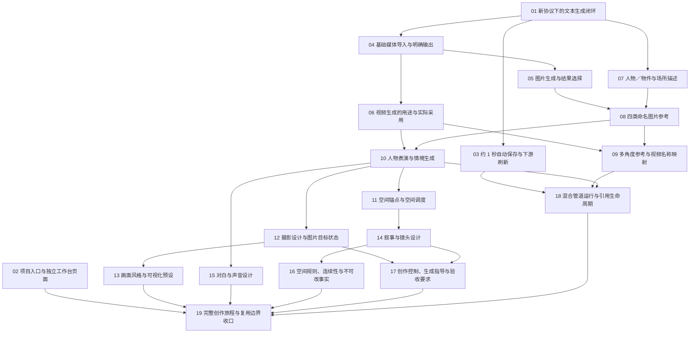

# 画布生成优化：任务索引

日期：2026-10-28

依据[实现规格](spec.md)及已确认的 Q16–Q23 共识，用户已确认以下 19 张纵向票据和阻塞关系，并于 2026-10-28 授权使用 implement-spec 在 codex-generation-canvas 分支完成全部实现。ready-for-agent 表示分诊状态，不表示票据已完成。规格及票据中此前“本轮不开始实现”等表述记录规格发布阶段，现由本次实现授权接续；不扩大原有业务范围。

每张票据覆盖一个可观察的完整行为：数据契约、后端处理、前端操作及相应行为验证共同交付，优先复用已有生成、任务、历史和恢复能力。01 在既有文本生成路径中完成必要公共重构；02 在真实独立页面中完成必要外壳提取，不另设仅搭底层框架的票据。

## 任务与阻塞关系

编号表示依赖顺序，不要求严格串行执行。01、02 已实现并集成；当前可推进前沿为 03、04、07，验证证据在下方实施记录及相应票据中维护。

| 票据 | Blocked by | 目录负责内容 |
| --- | --- | --- |
| [01 新协议下的文本生成闭环](issues/01-text-protocol-flow.md) | 无 | 通用文本、原文／创作依据、文本生成 |
| [02 项目入口与独立工作台页面](issues/02-standalone-workbench-page.md) | 无 | 跨类型行为，见票据完成条件 |
| [03 约 1 秒自动保存与下游刷新](issues/03-autosave-output-refresh.md) | 01 | 跨类型行为，见票据完成条件 |
| [04 基础媒体导入与明确输出](issues/04-media-content-outputs.md) | 01 | 通用图片、通用视频、通用音频 |
| [05 图片生成与结果选择](issues/05-image-generation-adoption.md) | 04 | 图片生成 |
| [06 视频生成的用途与实际采用](issues/06-video-generation-inputs.md) | 04 | 视频生成 |
| [07 人物／物件与场所描述](issues/07-object-description-identity.md) | 01 | 人物／物件、场所 |
| [08 四类命名图片参考](issues/08-named-image-references.md) | 05、07 | 角色参考、场所参考、道具参考、服装参考 |
| [09 多角度参考与视频名称映射](issues/09-multi-view-video-mapping.md) | 06、08 | 跨类型行为，见票据完成条件 |
| [10 人物表演与情境生成](issues/10-performance-direction.md) | 06、08 | 角色情境、人物表演、表演规则 |
| [11 空间锚点与空间调度](issues/11-spatial-direction.md) | 10 | 空间锚点、站位与走位、镜内活动、环境活动与留白 |
| [12 摄影设计与图片目标状态](issues/12-photography-and-image-target.md) | 10 | 景别与构图、机位与视角、运镜、光影与色彩、焦点与成像 |
| [13 画面风格与可视化预设](issues/13-visual-style-presets.md) | 12 | 画面风格 |
| [14 叙事与镜头设计](issues/14-narrative-shot-design.md) | 11 | 叙事概览、叙事节拍、事件与刺激、镜头设计 |
| [15 对白与声音设计](issues/15-dialogue-sound-design.md) | 10 | 对白、声音安排 |
| [16 空间规则、连续性与不可改事实](issues/16-continuity-facts.md) | 14 | 空间规则、连续性设计、不可改事实 |
| [17 创作控制、生成指导与验收要求](issues/17-creative-guidance-acceptance.md) | 12、14 | 创作控制、生成指导、验收要求 |
| [18 混合管道运行与引用生命周期](issues/18-mixed-pipeline-lifecycle.md) | 03、09、10 | 跨类型行为，见票据完成条件 |
| [19 完整创作旅程与复用边界收口](issues/19-integrated-creation-journey.md) | 02、13、15、16、17、18 | 跨类型行为，见票据完成条件 |

## 依赖图

- 初始可开始的票据是 01、02；01 完成后，03、04、07 可独立推进。
- 04 提供导入媒体后，05 图片与 06 视频可并行；视频不依赖图片生成。
- 06、08 完成后，09 多角度与 10 表演可独立推进；表演不要求先具备多角度参考。
- 10 完成后，11 空间、12 摄影、15 声音可独立推进。14 需要 11 的真实调度来源；16 通过 14 已依赖 11，不重复列阻塞边。
- 18 只依赖其混合链路所需的保存、参考和表演能力，不等待全部导演目录。19 汇合页面、各内容分支与混合执行。
- 依赖只表达功能上必须先具备的能力；修改相同公共契约时仍须协调集成，不由本索引授权新建其他任务会话。

## 目录覆盖

39 行目录分配如下。功能入口不等于独立物理卡片、表或处理器；摄影的五项入口仍维护同一张摄影内容卡。

| 分组 | 数量 | 负责票据 |
| --- | --- | --- |
| 基础内容 | 11 | 01：通用文本、原文／创作依据；04：图片、视频、音频；07：人物／物件、场所；08：四类命名图片参考。 |
| 模型生成 | 3 | 01：文本；05：图片；06：视频。 |
| 导演工具箱／画面设计 | 6 | 12：构图、机位、运镜、光影、焦点五入口；13：独立风格及可视化预设。 |
| 导演工具箱／表演与调度 | 7 | 10：角色情境、人物表演、表演规则；11：空间锚点、站位与走位、镜内活动、环境活动与留白。 |
| 导演工具箱／叙事与镜头 | 4 | 14：叙事概览、叙事节拍、事件与刺激、镜头设计。 |
| 导演工具箱／声音设计 | 2 | 15：对白、声音安排。 |
| 导演工具箱／连续性与约束 | 6 | 16：空间规则、连续性设计、不可改事实；17：创作控制、生成指导、验收要求。 |

## 端点与跨票关系责任

28 类输入端点沿规格的 7 类生成输入、17 类业务引用、4 类素材关联分配。来源与接收方可以先后交付：先交付方声明完整契约，已有来源即可形成真实可用闭环；后续来源或接收方接入时沿同一契约工作，不伪造候选、占位处理器或必填关系。可选的镜头、节拍等关系不成为独立工具生成的前置条件。

| 关系类别 | 端点 | 负责票据 |
| --- | --- | --- |
| 生成输入 | 文本依据 | 01；05、06 接入对应模型，10–17 扩展结构化来源 |
| 生成输入 | 参考图片 | 05；08、09 扩展命名参考 |
| 生成输入 | 首帧 | 06；09 扩展命名参考 |
| 生成输入 | 尾帧 | 06；09 扩展命名参考 |
| 生成输入 | 关键帧 | 06；09 扩展命名参考 |
| 生成输入 | 主体图片参考 | 06；09 扩展对象身份与多角度 |
| 生成输入 | 主体视频参考 | 06 |
| 业务引用 | 名称关联 | 08；09 扩展另一角度参考 |
| 业务引用 | 参与对象 | 10；11、14、16 扩展接收方 |
| 业务引用 | 说话对象 | 15 |
| 业务引用 | 覆盖节拍 | 14 |
| 业务引用 | 所属节拍 | 10 声明接收；14 提供来源并接通 |
| 业务引用 | 关联事件 | 14；16 扩展连续性接收 |
| 业务引用 | 变化事件 | 11 声明接收；14 提供来源并接通 |
| 业务引用 | 接收事件 | 10 声明接收；14 提供来源并接通 |
| 业务引用 | 触发事件 | 11 声明接收；14 提供来源并接通 |
| 业务引用 | 位置锚点 | 11 |
| 业务引用 | 区域锚点 | 11 |
| 业务引用 | 调度依据 | 11 提供来源；14 接收 |
| 业务引用 | 所属镜头 | 12 声明接收；14 提供来源；19 核对组合 |
| 业务引用 | 对白依据 | 10 声明接收；15 提供来源并接通 |
| 业务引用 | 验收依据 | 10、12、14 声明接收；17 提供来源并接通 |
| 业务引用 | 所属空间 | 11；16 扩展空间规则接收 |
| 业务引用 | 作用对象 | 10–17 按各类型字段资格分别接入 |
| 素材关联 | 图片来源 | 08 |
| 素材关联 | 图片素材 | 10；后续导演票据按字段声明扩展 |
| 素材关联 | 视频素材 | 10；12、15 等按字段声明扩展 |
| 素材关联 | 音频素材 | 15；其他类型仅按规格声明开放 |

所属镜头等双方可独立推进的关系，以及其他导演类型与图片目标选择的组合，在 19 核对双方实际可用；单票不能把尚未交付的组合记录为已验证。12 负责图片目标选择交互，其他类型按声明提供明确状态，保持完整采用，不为此复制目标选择逻辑或解析自由文本。

9 行输出目录由内容所属票据同步交付：01 提供通用文本及文本结果，07 提供描述与对象引用，04 提供普通媒体，05／06 提供相应模型结果，08 提供命名图片及对象引用，10–17 提供各自设计文本与声明的对象引用。19 按完整规格逐项核对输入、输出和 19 条连线规则，不能只比较目录总数。

## 各票共同完成边界

- 卡片自身内容、实际输入绑定和派生展示分别维护；连线只提供候选。三类候选关系统一无环，候选预览和实际处理都只消费直接出口的明确内容。
- 后端输出行为使用小型 Protocol，数据使用强类型契约；前端通过 OpenAPI generated client 使用公开接口，不重复定义另一份采用或名称映射权威。
- 每票同步保存、重开、候选／已采用展示、编译诊断及新增引用保护。基础无环、文件归属、失效绑定、删除保护与单卡运行随功能交付，不推迟到 18 或 19。
- 导演设计默认完整采用，人物表演不得拆项；摄影只开放契约声明的范围。对象引用逐对象、生成结果逐项选择，不因整卡采用扩选其他出口或结果集合。
- 选择阶段／状态只针对导演输出明确提供的结构，在图片端作为画面目标；完整设计仍被采用，不从普通文字推断阶段，不为目标选择新增导演字段。
- 编辑约每秒合并保存，成功后按修订刷新相关输出；无编辑不提交、在途串行、旧回执不覆盖新内容。保存和输出刷新不自动运行模型或采用候选。
- 预览、预设示例、素材关联、生成实际输入、历史结果与当前编辑分别表达；纯文本原样保留，不进行语义纠错或图像内容正确性检测。
- 既有运行、取消、幂等、恢复、文件保留与历史能力按新契约适配；内容复制／另存保持明确操作和只读来源，不新增回连或未来输出引用。
- 新增公共接口同步公开契约、OpenAPI 与前端生成类型，按仓库规则完成受影响检查；具体字段名、代码组织、路径及兼容迁移方案仍按规格在实现设计中确定，不因拆票默认执行迁移。
- 本期不改造章节、场次四画布或旧生产／剪辑业务，不新增音频生成、隐式转换、通用表单引擎或全场自动适用性系统。

## 完成条件与验证边界

票据中的未勾选条目是来自已确认规格的可观察完成条件，不是已经通过的验收证据。每个切片需要验证自己的外部行为，不能用其他类型的旧检查替代新行为，也不能把全部验证拖到 19。

用户于实现阶段确认测试接缝：现有画布 HTTP 接口覆盖保存、输出、绑定、编译和运行，真实页面覆盖编辑、采用、自动保存和布局；生成供应商与外部存储使用受控替身。HTTP 不证明交互正确，页面不证明真实供应商质量。仓库既有检查要求仍适用，按影响范围运行并记录实际证据、限制和未完成项，不预填通过结果。

原版任务与交付记录仅作为已有能力的证据，不改写、重开或重复发布旧票据；本索引不把这 19 张新增票据标成已交付。

## 实施记录

- 集成分支：codex-generation-canvas；实现前基线：66f32c19b2bb68eb494a18db6f429a9c874d5bc8。
- 当前进展：01、02 已合并到集成分支。01 的新协议文本闭环及 02 的独立页面、布局和编辑交互已交付，完成证据见对应票据；03、04、07 已解除阻塞，其他票据尚未开始。
- implement-spec 要求实施子代理使用独立工作树并执行 TDD，合并后统一审查。用户已确认 HTTP 与真实页面接缝，生成供应商与外部存储使用受控替身；后续每票复用该确认执行 TDD，不重复询问。

- 2026-10-28：合并 codex-canvas-types-02（代码提交 9b14739，合并前分支 HEAD 6639d43），无冲突。复用票据中的真实页面验证证据，集成后 Node 24 前端 typecheck 与 git diff --check、git diff --cached --check 均通过；分诊 Status 保持不变。

- 2026-10-28：合并 codex-canvas-types-01（分支 HEAD 938a8607，集成提交 ce816fb0），无冲突，01 Completion 更新为 integrated，分诊 Status 保持不变。核实主区 8000 已加载新绑定／创作依据／schema v2 后执行完整 openapi:update，结果与交付契约一致；剔除 361 处纯尾空行漂移。Node 24 前端 typecheck、git diff --check 和 git diff --cached --check 均通过；复用 01 票据中同一实现的后端及真实页面检查。当前前沿为 03、04、07。

- 2026-10-28：03 在 codex-canvas-types-03 实现一秒周期合并保存、失败暂停与已保存 revision 的来源／正式输出／诊断刷新，等待集成。真实页面 autosave、既有 save、工作台六用例及前端 typecheck 通过，证据与限制见 03 票据；未改变公开 HTTP 契约。
