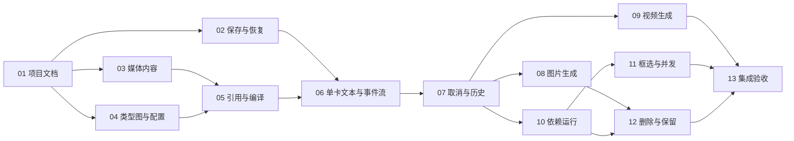

# 画布生成：任务索引

日期：2026-10-23

[实现规格](spec.md)依据已确认的术语表及 ADR 整理，分为 13 张可独立验证的实现票据。票据的 `Status` 保留分诊状态；实现完成情况由验收勾选、`Completion` 和 Comments 中的验证证据记录，`Blocked by` 决定依赖顺序。用户已授权按本依赖图实现全部票据，当前进展见下表。

拆分按用户可观察流程贯穿契约、后端、前端和验证，不按“先全部后端、再全部前端”分层。首个文本执行切片即包含真实 Task、预检、持久事件及恢复观察；图片、视频和范围执行随后沿同一协议扩充。

## 实施进展

集成分支：`codex-generation-canvas`。不调用付费模型；真实模型边界由受控替身验证。

| 票据 | 当前进展 |
| --- | --- |
| 01–04 | 已实现并集成；HTTP、隔离 MySQL、类型检查、Pylint 与适用浏览器验证见各票 Comments。02 布局验收已由 04 的真实图验证补齐。 |
| 05 | 已实现并集成；结构化引用、编译、剪贴板与 IME 浏览器验收通过，当前保存链路的隔离 MySQL 验证通过。 |
| 06 | 已实现并集成；真实 TaskWorker 文本增量、固定依据、持久 SSE、运行回执、活动保护及隔离 MySQL 竞争验收通过。 |
| 07 | 已实现并验证，待集成；明确取消意图／真实终态、安全历史、固定来源另存、SSE 故障恢复及删卡后的精确回跳通过真实生命周期、隔离 MySQL 与浏览器验收。 |
| 08–13 | 等待前置依赖，尚未实现。 |

## 任务与阻塞关系

| 票据 | Blocked by | 主要验收 |
| --- | --- | --- |
| [01 项目画布与文本内容的创建、保存、重开](issues/01-project-canvas-document.md) | 无 | A01、A02、A30 |
| [02 自动保存、恢复保护与独立布局](issues/02-save-recovery-layout.md) | 01 | A03、A04 |
| [03 四类内容卡与项目媒体导入](issues/03-media-content-files.md) | 01 | A05 |
| [04 类型化连线、分组与模型卡配置](issues/04-typed-graph-model-configuration.md) | 01 | A06、A15 |
| [05 结构化引用编辑、稳定代号与输入编译](issues/05-references-composer-compiler.md) | 03、04 | A07、A08、A09、A10、A11、A28、A30 |
| [06 单张文本模型的预检、执行与持久事件流](issues/06-single-text-run-stream.md) | 02、05 | A16、A17、A18、A19、A26、A27、A30、A31 |
| [07 取消、运行历史与断线后的观察恢复](issues/07-run-history-cancel-reconnect.md) | 06 | A22、A23、A25、A26 |
| [08 图片模型的实际输入、多结果与未完成成果](issues/08-image-model-results.md) | 07 | A12、A15、A18、A22、A23 |
| [09 视频模型的结构化用途指令与单视频生成](issues/09-video-model-directives.md) | 07 | A13、A14、A15、A18、A23 |
| [10 运行到目标与实际引用依赖编排](issues/10-run-to-target-dag.md) | 07 | A09、A19、A22、A24、A25、A29 |
| [11 严格框选与互不重叠的并行运行](issues/11-selection-concurrent-runs.md) | 10 | A20、A21、A26 |
| [12 引用保护、画布删除与文件保留的完整生命周期](issues/12-deletion-retention-lifecycle.md) | 08、10 | A28、A29 |
| [13 跨模态完整旅程、协议故障与既有功能回归](issues/13-integrated-acceptance.md) | 09、11、12 | A31、A32，并核对 A01–A30 |

## 执行顺序

- 初始前沿为 01；01 完成后，02、03、04 可独立推进。当前实施状态见上表。
- 07 完成后，08、09、10 可独立推进。视频使用导入媒体即可验收，不人为依赖图片生成。
- 10 完成后可推进 11；08 与 10 完成后可推进 12。13 汇合各条已完成路径。
- 并行关系表示实现票据的依赖；本轮已获全部票据的实现授权。相同公共契约的修改须协调并及时集成，不创建额外任务会话。
- 所有票据自带验收与相应故障场景；13 负责组合回归，不把前面缺少的保存、事件持久化或文件保护推迟到最终票。

## 已确认边界

1. 只支持四种内容卡、文本／图片／视频模型卡及组织分组；独立于场次业务。
2. 可预先连线，不可提前引用未来输出。首次先生成／填入内容，再建立引用；已有缺失引用先独立补齐来源。
3. 接收端决定实际使用；稳定输出身份与接收代号分开。未用候选不扩大依赖或阻止运行。
4. 单卡、运行到目标、严格框选表达范围，不引入首次／重跑／重试状态或整轮成功等级。
5. 内容保存、当前输出和运行记录分开。统一画布 SSE 不替代任务中心现有通道，不新增 Task 恢复保证。
6. 只做为本功能必要的复用／局部提取，不另建通用表单、插件平台或大范围 Task 重构。
7. 具体内部命名、路由路径、索引和编辑器依赖属于实现选择；若选择改变 ADR 行为，先提出具体问题并按 grill-with-docs 处理。

## 共同检查要求

实现时按实际影响范围执行下列检查；各票 Comments 记录实际命令、结果、证据与限制，不把检查要求本身当作已通过证据。

- 前端代码、类型或构建配置变化：从根目录执行 `pnpm --dir front run typecheck`。
- 对外契约变化：确认 `127.0.0.1:8000` 加载当前工作区后端后，从根目录执行 `pnpm --dir front run openapi:update`；普通调用使用 generated client，SSE 扩展公共传输层而非手写画布业务 service。
- 后端代码变化：在 backend 目录使用 `uv run pytest` 运行受影响的测试；Python 应用代码变化另执行 `uv run pylint app`。共享 Task／生成契约修改须包含任务生命周期与架构边界回归。
- 现有相关检查可从 `uv run pytest tests/services/test_task_service.py tests/services/test_task_worker.py tests/services/test_task_queries.py tests/services/test_task_files.py tests/architecture/test_generation_worker_boundaries.py -q` 选择受影响范围；新增画布测试同时运行。不要只运行旧测试证明新功能。
- 数据库竞争沿用隔离 MySQL 测试约束：显式测试环境及限定库名；相关入口为 `uv run pytest tests/services/test_task_mysql.py -q`，并新增本功能竞争用例。环境不可用或用例跳过须写明，不用 SQLite 代替竞争证据。
- 浏览器用例注册进现有统一 runner；新增生成画布用例使用隔离后端／浏览器和受控模型。原保存／图行为受影响时分别运行 `node front/tests/run-browser.mjs periodic-save` 和 `node front/tests/run-browser.mjs canvas-graph`；现有 runner 每次只接受一个 case 或 suite 名称。
- 修改场次共享工作台控件时，按 [工作台设计标准](../../site/content/docs/guide/workbench-design.md) 执行 `pnpm --dir front run test:workbench-ui` 等适用检查；只改生成画布时检查其真实页面，不机械要求无关工作台全套。
- 共享基础设施影响范围不清时扩展测试；同代码同环境已通过的结果可复用。截图验证布局，不能替代保存、任务、事件与文件数据验证。
- 完成票据时勾选实际通过的验收项，在 Comments 记录命令、结果、证据路径和未完成限制。不得为未运行的测试预填通过。

## 当前实现证据与复用起点

这些是 2026-10-23 的代码调查结果，不是新功能已经具备的声明；代码变更后按相关范围复核。

| 事实 | 当前入口 |
| --- | --- |
| 项目工作台已有项目级 URL tab，可承载独立功能入口 | [ProjectWorkbench](../../front/src/pages/aiStudio/project/ProjectWorkbench/index.tsx) |
| 保存行为含串行、迟到回包与恢复，但嵌在场次业务中 | [CanvasSequenceWorkbench](../../front/src/pages/aiStudio/directing/CanvasSequenceWorkbench.tsx) |
| 通用 Canvas 有视口与图元，缺完整类型端口连线编辑 | [Canvas](../../front/src/components/canvas/Canvas.tsx) |
| Composer 外壳可复用，现有正文为普通 textarea | [ExperimentComposer](../../front/src/pages/aiStudio/experiment/components/ExperimentComposer.tsx)、[ExperimentPromptEditor](../../front/src/pages/aiStudio/experiment/components/ExperimentPromptEditor.tsx) |
| generated response 目前整段读取；实验室流绑定自己的业务路径／结束语义 | [generated request](../../front/src/services/generated/core/request.ts)、[textLabStream](../../front/src/services/textLabStream.ts) |
| 浏览器 harness 已有保存与画布流程，无现成完整画布 SSE 验收 | [runner](../../front/tests/run-browser.mjs)、[suite 清单](../../front/tests/browser-suites.json) |
| 画布需接 target 矩阵、归属和交付，不能只增加枚举 | [生成 contracts](../../backend/app/core/contracts/generation.py)、[提交能力矩阵](../../backend/app/services/generation/submission/capabilities.py) |
| 文本 worker 当前一次性调用，媒体执行仍有当前配置读取 | [TaskWorker](../../backend/app/task_worker.py)、[媒体执行](../../backend/app/services/generation/media_execution.py) |
| 成功 deliver 与失败／取消路径不同，需同步所有画布节点终态 | [TaskService](../../backend/app/services/task_service.py) |
| 测试已有真实 HTTP／TaskWorker、受控模型、隔离 MySQL | [任务查询测试](../../backend/tests/services/test_task_queries.py)、[worker 测试](../../backend/tests/services/test_task_worker.py)、[MySQL 测试](../../backend/tests/services/test_task_mysql.py) |

## 产物与状态

- 规格：`spec.md`；一票一文件：`issues/01-...` 至 `issues/13-...`。
- 术语与架构决策继续以原 GLOSSARY 和 ADR 为准，本次未发现需要新增的领域决定。
- 实现进展以本页和各票 Comments 为准；不修改无关站点计划、既有场次票据或发布说明，没有发起付费生成。

