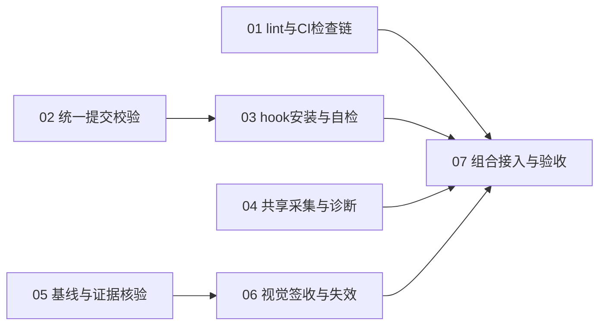

# 视觉验收与工程检查改进

日期：2026-10-30

## 当前实施阶段

2026-10-30：用户已调用 implement-spec 授权实施本目录01–07。集成分支为 `codex-visual-engineering-checks`，实施基线为 `cbf82d42`；下文“仅发布、未实施”为发布时的历史记录，各票实际结果在完成后追加。本轮不推送，不安装实际开发仓库hook，不改写旧01–60及既有环境检查记录。

实施顺序按依赖前沿推进；每票独立worktree实现并完成公共接缝验证，整合后更新完成状态。最终在统一版本执行组合验收、逐区域原图审阅及Standards／Spec双轴审查，再清理本轮worktree。

- [规格](spec.md)：Status 为 ready-for-agent；本轮已确认CLI、临时Git／worktree与真实页面验收接缝，规格与本轮01–07票据已发布，未实现、未执行新验收。
- 范围：retro 1–4，视觉目标与签收、lint／CI阻塞、现有提交检查、共享浏览器采集及失败诊断。
- 现有生成画布业务与[01–60完成记录](../canvas-card-types/README.md)保持原样；本目录独立维护后续任务，不接续或重编号旧票据。

## 已有依据

- [四类C视觉契约](../canvas-card-types/spec.md)与[60逐类图片验收](../canvas-card-types/visual-c60-four-card-acceptance.md)。
- [前期环境检查规格](../agent-environment-guardrails/spec.md)及[原实施记录](../agent-environment-guardrails/implementation.md)。
- [前期检查接入与预检交付](../agent-checks/spec.md)。

上述记录只作历史及复用依据，本轮没有修改其状态或通过结论。后续拆票和实现按用户另行授权推进。

## 已确认任务拆分：01–07

2026-10-30：用户已确认下述七票及依赖，仅授权发布任务。本目录独立从01编号，不接续或改写生成画布旧01–60。父规格“未拆票”保留其发布阶段语境，本次确认仅接续票据发布，不延伸为实施授权；父规格内容保持不变。

| 票据 | Blocked by | 可独立观察的交付 | 当前状态 |
| --- | --- | --- | --- |
| [01 恢复 lint 门禁与既有 CI 检查链](issues/01-restore-lint-ci-gate.md) | 无 | 两处effect行为正确、lint门禁恢复、原CI依赖保持 | ready-for-agent；Completion: integrated，详见各票保留验证与整合记录。 |
| [02 统一本地与 CI 提交标题校验](issues/02-unified-commit-subject-validation.md) | 无 | 本地／CI同规则，普通／合并／回滚与范围错误可验证 | ready-for-agent；Completion: integrated，详见各票保留验证与整合记录。 |
| [03 提供仓库 hook 安装与自检入口](issues/03-repository-hook-setup-and-check.md) | 02 | 仓库级显式安装、自检及worktree／自定义配置保护 | ready-for-agent；Completion: integrated，详见各票保留验证与整合记录。 |
| [04 共享浏览器采集准备与失败诊断](issues/04-shared-browser-capture-and-diagnostics.md) | 无 | 四类真实页面的可信采集、命中与失败根因证据 | ready-for-agent；Completion: integrated，详见各票保留验证与整合记录。 |
| [05 持久化视觉基线并核验证据完整性](issues/05-versioned-visual-baseline-and-evidence.md) | 无 | 干净检出可读基线、36组配对与明确证据核验结果 | ready-for-agent；Completion: integrated，详见各票保留验证与整合记录。 |
| [06 提供逐区域视觉签收与失效检查](issues/06-visual-review-verdict-and-invalidation.md) | 05 | 实际阅图签收、必须项阻断及证据变化后失效 | ready-for-agent；Completion: integrated，详见各票保留验证与整合记录。 |
| [07 检查链接入与组合验收收口](issues/07-integrated-checks-and-acceptance.md) | 01、03、04、06 | 统一版本CI归档／检查链、36组签收及组合旅程 | ready-for-agent；Completion: integrated；待最终双轴审查。 |

- 初始前沿为01、02、04、05；02完成后03解除阻塞，05完成后06解除阻塞；01／03／04／06完成后进入07。02和05通过各自后继传递至07，图中不重复列边。依赖不表示本轮已有实施或并行执行授权。
- 04与05没有先后阻塞：04保持现有产物索引兼容并增强准备／诊断，05可直接核验当前公开入口产物及临时输入。必要局部适配随各自完整行为完成，不另建纯重构或基础设施票。
- 02自行完成既有CI提交检查适配，05／06自行提供可调用、可验收的公开结果；07只处理跨票组合、现有CI证据接入与最终验收，不能替前置票完成其核心功能。
- 每票保留自身红绿／回归、实际命令及可观察产物。实现阶段根据相关代码、测试与环境变化决定重跑；用户明确复审仍独立检查，不将复用冒称新执行。

## 规格故事覆盖

| 票据 | User Stories |
| --- | --- |
| 01 | 17、18、19、20、21、22、23、24 |
| 02 | 25、26、27、28、29、30、31 |
| 03 | 32、33、34、35 |
| 04 | 36、37、38、39、40、41、42、43、44、45、46 |
| 05 | 1、2、3、4、5、6、7、8、9、10、11、12、15、16 |
| 06 | 13、14 |
| 07 | 47、48 |

48条故事均已覆盖；关键验收继续以各票和父规格为准。本轮没有创建任何实现提交、启用hook、修改CI／产品代码、改写历史或推送。

## 本轮组合验证当前结果

2026-10-30：01–06已按各票完成记录整合；07在其统一版本完成CI目标与归档接入、邻卡采集小修及完整36组组合验收，已通过 `4c2cd706` 整合，Completion为integrated。实际执行来源 `1c7769b9`，behavior passed／evidence reviewable／visual passed（36组192区域实际原图签收）；F10来源与390参数局部滚动的初始裁切、公开操作补证和允许差异均明确记录。[独立组合验收](acceptance.md)列出原图范围、命令、有效签收和失效负例，[07 handoff](07-handoff.md)列出工程检查与中间失败。以上是当前实施状态；前文发布阶段的未实施表述为历史语境，不改写旧01–60或环境检查记录。最终Standards／Spec双轴审查与清理另行记录。
