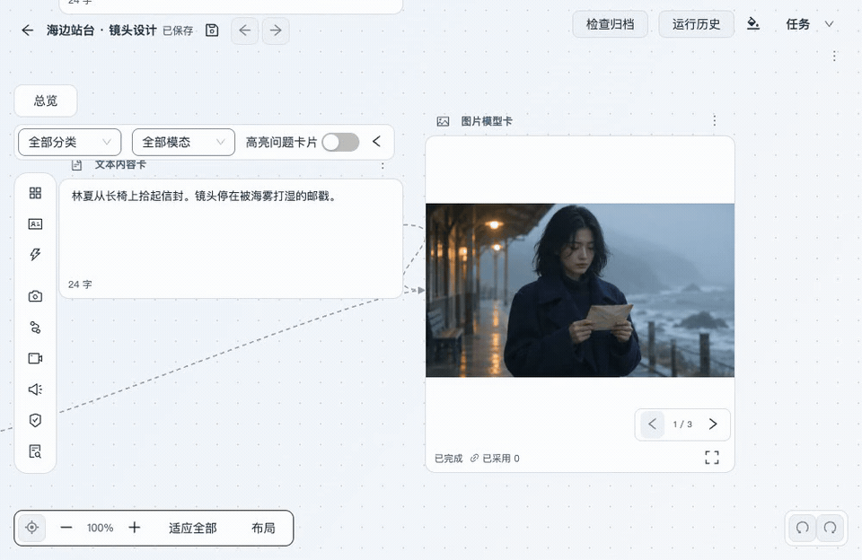
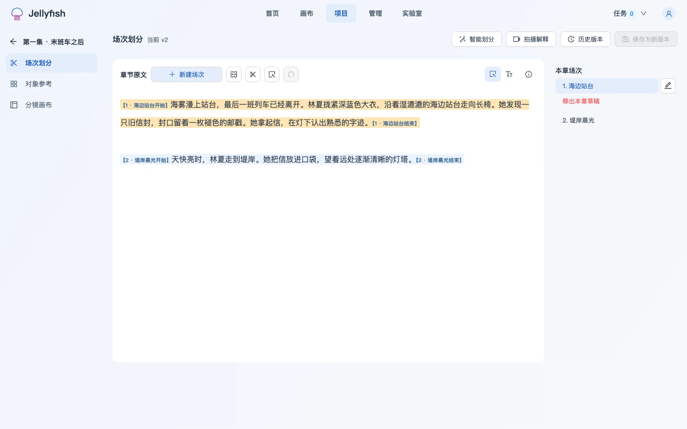
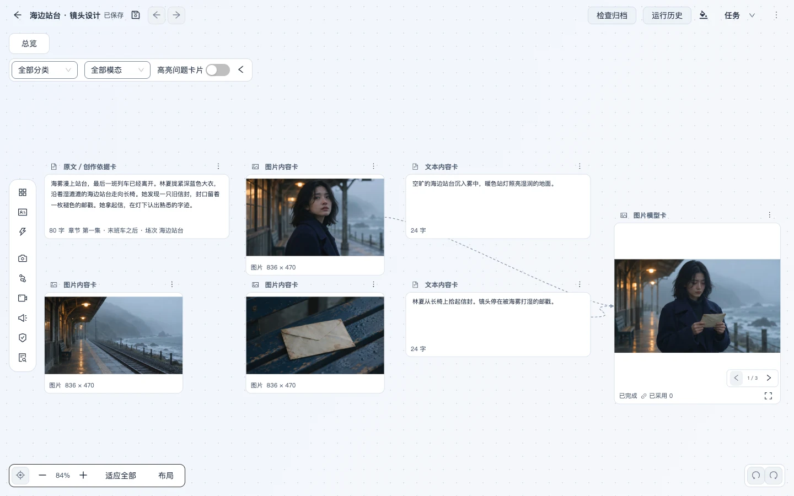
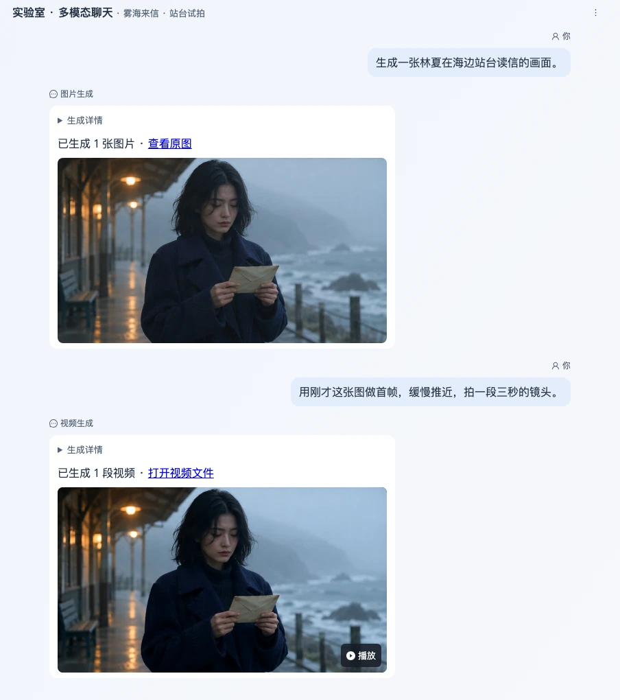
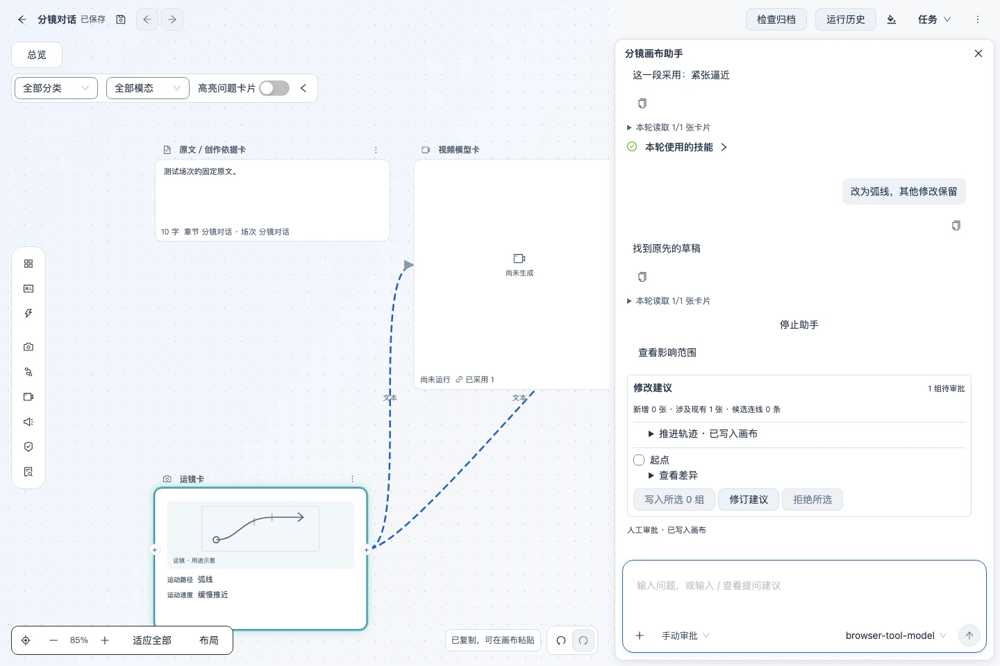
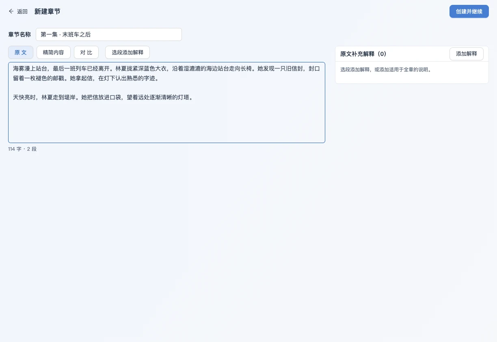

# Jellyfish — AI Short Drama Studio

<p align="center">
  
</p>

<p align="center">
  <a href="https://www.apache.org/licenses/LICENSE-2.0">
    
  </a>
  <a href="https://img.shields.io/badge/frontend-React%20%2B%20Vite-61DAFB">
    
  </a>
  <a href="https://img.shields.io/badge/backend-FastAPI-009688">
    
  </a>
  <a href="https://github.com/Forget-C/Jellyfish/actions/workflows/deploy-site.yml">
    
  </a>
  <a href="https://github.com/Forget-C/Jellyfish/actions/workflows/ghcr-images.yml">
    
  </a>
</p>

<p align="center">
  <a href="README.en.md">English</a> ·
  <a href="README.zh.md">简体中文</a> ·
  <a href="README.ja.md">日本語</a>
</p>

A production workspace for AI short dramas. Divide a chapter into scenes, prepare visual references and generate candidate frames on a storyboard canvas. The interface supports Chinese (default) and English.

[Quick start](#quick-start) · [Local development](development/guides/local-development.md)

## What is Jellyfish?

<p align="center">
  <a href="../site/static/images/sea-letter/canvas-walkthrough.mp4"></a>
</p>

Jellyfish helps short-drama creators turn a script into shots. Split a chapter into scenes, choose visual references for each scene, then generate and compare frames on the storyboard. Here, the shot description and references guide the image of Lin Xia reading a letter on the platform.

## Core Features

| From chapter to storyboard | Generate images and video in one chat |
| --- | --- |
| <a href="../site/static/images/screenshots/home/scene-division.webp"></a> <a href="../site/static/images/screenshots/home/storyboard.webp"></a> | <a href="img/chat-image-to-video.webp"></a> |
| Split a chapter into scenes, confirm the source passages and generate an editable storyboard for each scene. | The main model handles the conversation. Separate image and video models generate the media, so you can use an image from an earlier turn as the first frame of a video. |

| Canvas editor | Canvas assistant |
| --- | --- |
| <a href="../site/static/images/docs/canvas/graph.webp"></a> | <a href="img/canvas-assistant-proposal.webp"></a> |
| Connect shot descriptions, references and model cards. Adjust the inputs, run the canvas and compare candidate frames. | Select a shot card, describe the change you want and review the assistant’s proposed edit before applying it. |

| Project management | Shared asset library |
| --- | --- |
| <a href="../site/static/images/docs/chapter/chapter.webp"></a> | <a href="../site/static/images/screenshots/assets.png"></a> |
| Organize chapters and scenes by project and open the storyboard workspace from a chapter. | Reuse actors, locations, props and costumes across projects. |

### Connect via Canvas MCP

Read, edit and run a Jellyfish canvas from an external MCP client and retrieve the results. [Connection guide](../site/content/docs/tools/generation-canvas.md#从-mcp-客户端连接画布)

## Quick Start

For a first local run, install Git and start Docker with the Compose plugin. Then run:

```bash
git clone https://github.com/Forget-C/Jellyfish.git
cd Jellyfish
cp deploy/compose/.env.example deploy/compose/.env
docker compose --env-file deploy/compose/.env -f deploy/compose/docker-compose.yml up --build -d
```

Open [Jellyfish](http://localhost:7788), go to **Projects** and [create your first project](../site/content/docs/guide/first-project.md). [Configure a model](../site/content/docs/getting-started/model-setup.md) before generating media.

[Deployment guide](../site/content/docs/getting-started/docker.md) · [Canvas MCP](../site/content/docs/tools/generation-canvas.md#从-mcp-客户端连接画布) · [OpenAPI client](development/guides/openapi.md)

## Star History

[](https://www.star-history.com/?repos=Forget-C%2FJellyfish&type=date)

[Report an issue](https://github.com/Forget-C/Jellyfish/issues) · [Contribute](../site/content/docs/community/contributing.md) · [Apache 2.0 license](../LICENSE)
