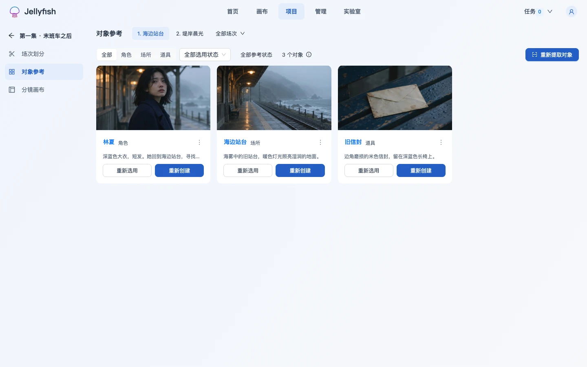

# Jellyfish — AI Short Drama Studio

<p align="center">
  
</p>

<p align="center">
  <a href="https://www.apache.org/licenses/LICENSE-2.0">
    
  </a>
  <a href="https://img.shields.io/badge/frontend-React%20%2B%20Vite-61DAFB">
    
  </a>
  <a href="https://img.shields.io/badge/backend-FastAPI-009688">
    
  </a>
  <a href="https://github.com/Forget-C/Jellyfish/actions/workflows/deploy-site.yml">
    
  </a>
  <a href="https://github.com/Forget-C/Jellyfish/actions/workflows/ghcr-images.yml">
    
  </a>
</p>

<p align="center">
  <a href="README.en.md">English</a> ·
  <a href="README.zh.md">简体中文</a> ·
  <a href="README.ja.md">日本語</a>
</p>

A production workspace for AI short dramas. Divide a chapter into scenes, prepare visual references and generate candidate frames on a storyboard canvas. The interface supports Chinese (default) and English.

[Quick start](#-docker-compose) · [Local development](development/guides/local-development.md)

## 📷 Screenshots

<a href="../site/static/images/screenshots/home/storyboard.webp"></a>

**How this shot was made**　The storyboard for a seaside station scene connects the shot description and three visual references to an image model. The creator picked a frame from its outputs for a slow push-in.

[Selected first frame](../site/static/images/docs/labs/letter-frame.jpg) · [▶ 3-second camera test (local demo)](../site/static/images/sea-letter/letter-push-in.mp4)

<details>
<summary>Scene references and screenshots</summary>

| Lin Xia | Seaside platform | Old envelope |
| --- | --- | --- |
| <a href="../site/static/images/docs/assets/samples/character.jpg"></a> | <a href="../site/static/images/docs/assets/samples/scene.jpg"></a> | <a href="../site/static/images/docs/assets/samples/prop.jpg"></a> |

| Scene division | Scene references |
| --- | --- |
| <a href="../site/static/images/screenshots/home/scene-division.webp"></a> | <a href="../site/static/images/screenshots/home/object-references.webp"></a> |

</details>

## ✨ Core Value

- Trace each scene back to the passage it adapts.
- Reuse the same character, location and prop references across shots.
- Inspect the inputs and results of a generation run before choosing a candidate.

## ✨ Core Capabilities

### 1. AI script understanding and storyboard breakdown

Save the chapter text, mark scene boundaries, then generate and edit a storyboard for a selected scene.

### 2. Shot preparation and confirmation workflow

Chapter text → scene division → reference selection → storyboard canvas → precheck → candidate review.

### 3. Asset consistency and reuse

Link characters, locations, props and costumes to project assets. Choose the reference images needed for each scene.

### 4. Shot-level image and video orchestration

On the canvas, connect shot descriptions and references to a model card, check its inputs and review the generated media.

### 5. Unified async task center

Track text, image and video jobs, inspect failures and cancel eligible tasks.

### 6. Model, prompt, and generation infrastructure

Configure providers and default models, manage prompt templates and access the backend through its OpenAPI contract.

## 🚀 Feature Overview

### Project and chapter management

Create a project, save chapter text and reopen earlier scene divisions.

### AI script processing

Use the text lab to explore alternate dialogue, actions and shot descriptions.

### Shot preparation workflow

Review the source passage alongside the scene references and refine each shot description.

### Asset and entity management

Maintain project assets and choose which reference images a scene uses.

### Shot generation workspace

Edit prompts and model parameters, run a precheck and preview candidate outputs.

### Task center

Monitor progress and open a task to inspect its result.

### Model and prompt infrastructure

Choose defaults for different generation tasks and maintain reusable prompt templates.

### File and media management

Preview uploaded and generated media and reuse them as references.

## 🎯 Use Cases

- Short-drama teams preparing storyboards and reviewing candidate frames together.
- Independent creators trying different shots for the same scene.
- Education, brand and e-commerce teams developing scripts into short videos.

## 🔁 Frontend OpenAPI client and type generation

With the API serving the current code at `http://127.0.0.1:8000`, run the following from the repository root to refresh `front/openapi.json` and `front/src/services/generated/`.

```bash
pnpm --dir front run openapi:update
```

## 🐳 Docker Compose

### Ports

- Frontend: `http://localhost:7788`
- API: `http://localhost:8000` (Swagger UI: `/docs`)
- MySQL: `localhost:${MYSQL_PORT:-3306}`
- RustFS: `http://localhost:${RUSTFS_PORT:-9000}`

### Start

From the repository root, create the environment file on first setup and start the services.

```bash
cp deploy/compose/.env.example deploy/compose/.env
docker compose --env-file deploy/compose/.env -f deploy/compose/docker-compose.yml up --build
```

Once the frontend opens, [create your first project](../site/content/docs/guide/first-project.md). Before generating media, [configure a model](../site/content/docs/getting-started/model-setup.md).

## 🧑‍💻 Local Development

Follow the [local development guide](development/guides/local-development.md) to start the API, task worker and Vite frontend. See the [developer documentation](development/README.md) for architecture and standards, or the [site guide](../site/README.md) to work on the website.

## 📄 License

This project is licensed under [Apache-2.0](../LICENSE).

## 💬 Community & Feedback

- [GitHub Issues](https://github.com/Forget-C/Jellyfish/issues)
