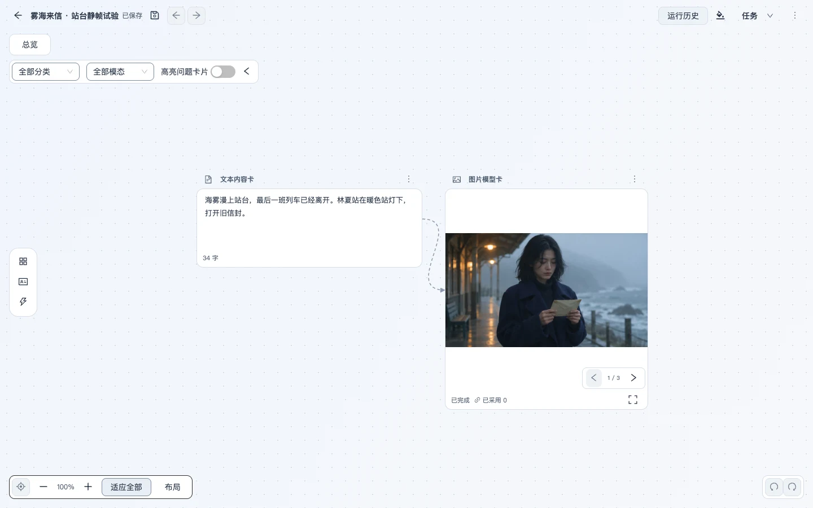
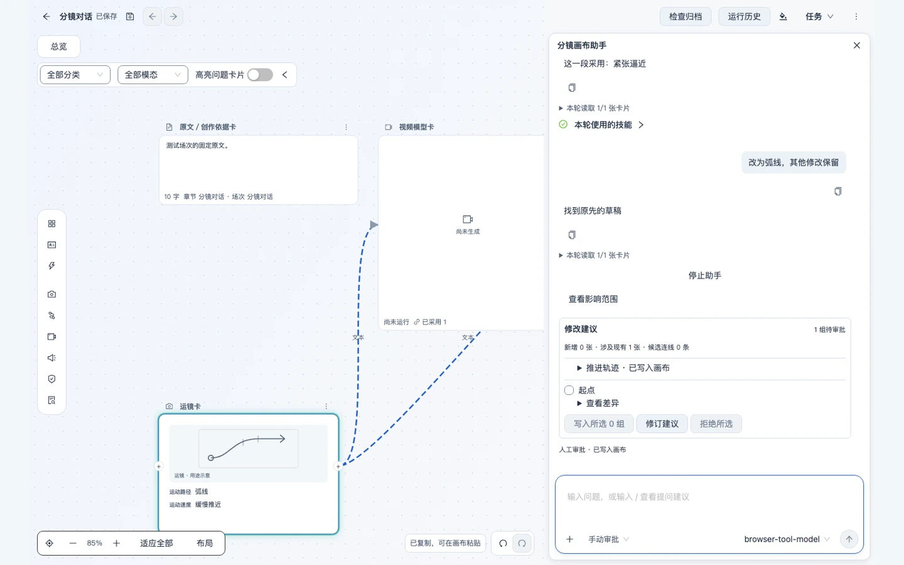

# Jellyfish — AI Short Drama Studio

<p align="center">
  
</p>

<p align="center">
  <a href="https://www.apache.org/licenses/LICENSE-2.0">
    
  </a>
  <a href="https://img.shields.io/badge/frontend-React%20%2B%20Vite-61DAFB">
    
  </a>
  <a href="https://img.shields.io/badge/backend-FastAPI-009688">
    
  </a>
  <a href="https://github.com/Forget-C/Jellyfish/actions/workflows/deploy-site.yml">
    
  </a>
  <a href="https://github.com/Forget-C/Jellyfish/actions/workflows/ghcr-images.yml">
    
  </a>
</p>

<p align="center">
  <a href="README.en.md">English</a> ·
  <a href="README.zh.md">简体中文</a> ·
  <a href="README.ja.md">日本語</a>
</p>

A production workspace for AI short dramas. Divide a chapter into scenes, prepare visual references and generate candidate frames on a storyboard canvas. The interface supports Chinese (default) and English.

[Quick start](#quick-start) · [Local development](development/guides/local-development.md)

## What is Jellyfish?

<p align="center">
  <a href="../site/static/images/sea-letter/canvas-walkthrough.mp4"></a>
</p>

Jellyfish helps short-drama creators turn a script into shots. Split a chapter into scenes, choose visual references for each scene, then generate and compare frames on the storyboard. Here, the shot description and references guide the image of Lin Xia reading a letter on the platform.

## Features

1. **Script breakdown.** Split a chapter into scenes and trace each scene back to its source passage.
2. **Shared asset library.** Reuse actors, locations, props and costumes across projects.
3. **Storyboard canvas.** Connect a shot description and reference images to an image model, then generate and compare candidate frames.
4. **Canvas assistant.** Describe a change to a shot in your own words and review the proposed edit before applying it.
5. **Image-to-video chat.** Generate a still and use it as the first frame of a video in the same conversation.
6. **MCP integration.** Read, edit and run a canvas from an external MCP client and retrieve the results.

## Core Features

### From chapter to storyboard

Split a chapter into scenes, check the passage for each scene and generate an editable storyboard. On the canvas, connect shot descriptions, references and model cards, then adjust the inputs to generate and compare candidate frames.

<p align="center">
  <a href="../site/static/images/screenshots/home/scene-division.webp"></a>
  <a href="../site/static/images/screenshots/home/storyboard.webp"></a>
  <a href="../site/static/images/docs/canvas/graph.webp"></a>
</p>

### Refine a shot and generate video

Select a shot card, describe the change you want and review the assistant’s proposal before applying it. Preview a generated frame on the canvas. In chat, the main model handles the conversation. Generate a still with your chosen image model, then use it as the first frame for your video model.

<p align="center">
  <a href="img/canvas-assistant-proposal.webp"></a>
  <a href="../site/static/images/screenshots/home/generation-preview.webp"></a>
  <a href="img/chat-image-to-video.webp"></a>
</p>

### Organize projects and visual references

Organize chapters and scenes within a project and open the storyboard from its chapter. Reuse actors, locations, props and costumes from the shared library. For each scene, choose the character, location and prop images to use as visual references.

<p align="center">
  <a href="../site/static/images/docs/chapter/chapter.webp"></a>
  <a href="img/previews/assets.webp"></a>
  <a href="../site/static/images/screenshots/home/object-references.webp"></a>
</p>

### Connect via Canvas MCP

Read, edit and run a Jellyfish canvas from an external MCP client and retrieve the results. [Connection guide](../site/content/docs/tools/generation-canvas.md#从-mcp-客户端连接画布)

## Quick Start

For a first local run, install Git and start Docker with the Compose plugin. Then run:

```bash
git clone https://github.com/Forget-C/Jellyfish.git
cd Jellyfish
cp deploy/compose/.env.example deploy/compose/.env
docker compose --env-file deploy/compose/.env -f deploy/compose/docker-compose.yml up --build -d
```

Open [Jellyfish](http://localhost:7788), go to **Projects** and [create your first project](../site/content/docs/guide/first-project.md). [Configure a model](../site/content/docs/getting-started/model-setup.md) before generating media.

[Deployment guide](../site/content/docs/getting-started/docker.md) · [Canvas MCP](../site/content/docs/tools/generation-canvas.md#从-mcp-客户端连接画布) · [OpenAPI client](development/guides/openapi.md)

## Star History

[](https://www.star-history.com/?repos=Forget-C%2FJellyfish&type=date)

[Report an issue](https://github.com/Forget-C/Jellyfish/issues) · [Contribute](../site/content/docs/community/contributing.md) · [Apache 2.0 license](../LICENSE)
