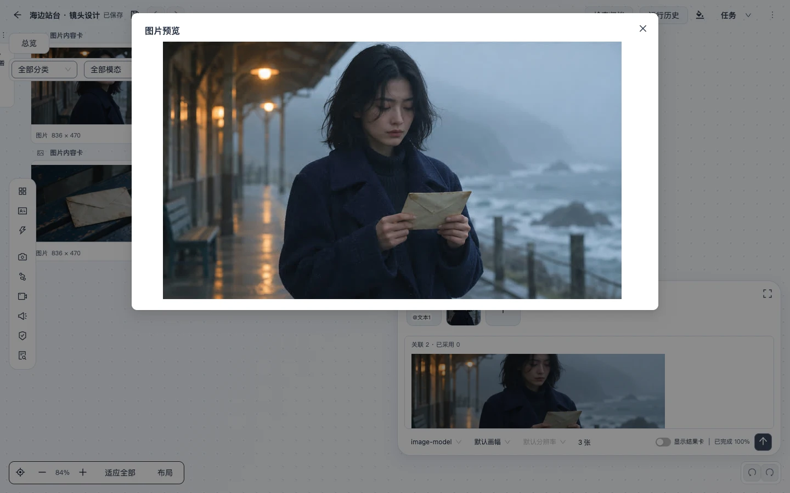

# Jellyfish — AI ショートドラマ制作スタジオ

<p align="center">
  
</p>

<p align="center">
  <a href="https://www.apache.org/licenses/LICENSE-2.0">
    
  </a>
  <a href="https://img.shields.io/badge/frontend-React%20%2B%20Vite-61DAFB">
    
  </a>
  <a href="https://img.shields.io/badge/backend-FastAPI-009688">
    
  </a>
  <a href="https://github.com/Forget-C/Jellyfish/actions/workflows/deploy-site.yml">
    
  </a>
  <a href="https://github.com/Forget-C/Jellyfish/actions/workflows/ghcr-images.yml">
    
  </a>
</p>

<p align="center">
  <a href="README.en.md">English</a> ·
  <a href="README.zh.md">简体中文</a> ·
  <a href="README.ja.md">日本語</a>
</p>

AI ショートドラマの制作ワークスペースです。章の本文をシーンに分け、参考素材をそろえ、絵コンテのキャンバスで候補画像を生成します。画面の表示言語は中国語（初期設定）と英語です。

[クイックスタート](#クイックスタート) · [ローカル開発](development/guides/local-development.md)

## Jellyfish とは？

<p align="center">
  <a href="../site/static/images/sea-letter/canvas-walkthrough.mp4"></a>
</p>

Jellyfish はショートドラマの脚本を絵コンテにする制作ツールです。章をシーンに分け、それぞれに人物や場所、小道具の参考画像を選び、絵コンテ上でフレームを生成して見比べられます。デモでは、カットの説明と参考画像をもとに、ホームで手紙を読む林夏の姿を描いています。

## 特長

1. **脚本のシーン分け**　章をシーンに分け、それぞれに対応する原文を確認できます。
2. **共有素材ライブラリ**　俳優、ロケ地、小道具、衣装を複数のプロジェクトで再利用できます。
3. **絵コンテのキャンバス**　カットの説明と参考画像を画像モデルにつなぎ、候補画像を生成して見比べられます。
4. **キャンバスアシスタント**　カットで変えたい箇所を自分の言葉で伝え、修正案を確認してから適用できます。
5. **画像から動画を生成**　同じチャットで静止画を生成し、動画の最初のフレームに使えます。
6. **MCP 連携**　外部の MCP クライアントからキャンバスを開いて編集・実行し、生成結果を取得できます。

## 主な機能

### 章の本文から絵コンテへ

章をシーンに分け、それぞれに対応する本文を確認してから、編集可能な絵コンテを生成します。キャンバスでカットの説明、参考画像、モデルカードをつなぎ、入力を調整しながら候補画像を生成して見比べられます。

<p align="center">
  <a href="../site/static/images/screenshots/home/scene-division.webp"></a>
  <a href="../site/static/images/screenshots/home/storyboard.webp"></a>
  <a href="../site/static/images/docs/canvas/graph.webp"></a>
</p>

### カットの修正と動画の生成

カットのカードを選んで変更したい箇所を伝え、アシスタントの修正案を確認してから適用します。生成した画像はキャンバスで拡大して確認できます。チャットではメインモデルが会話を担当し、画像モデルで生成した静止画を動画モデルの最初のフレームに使えます。

<p align="center">
  <a href="img/canvas-assistant-proposal.webp"></a>
  <a href="../site/static/images/screenshots/home/generation-preview.webp"></a>
  <a href="img/chat-image-to-video.webp"></a>
</p>

### プロジェクトと参考素材の管理

プロジェクトごとに章とシーンを整理し、章から絵コンテを開けます。共有ライブラリでは俳優、ロケ地、小道具、衣装の素材を複数のプロジェクトで再利用できます。各シーンには人物、場所、小道具の参考画像を選びます。

<p align="center">
  <a href="../site/static/images/docs/chapter/chapter.webp"></a>
  <a href="img/previews/assets.webp"></a>
  <a href="../site/static/images/screenshots/home/object-references.webp"></a>
</p>

### MCP でキャンバスに接続

外部の MCP クライアントからキャンバスを読み取り、編集・実行して生成結果を取得できます。 [接続ガイド](../site/content/docs/tools/generation-canvas.md#从-mcp-客户端连接画布)

## クイックスタート

初めてローカル環境で試す場合は、Git をインストールし、Compose プラグインを備えた Docker を起動してから、次のコマンドを実行します。

```bash
git clone https://github.com/Forget-C/Jellyfish.git
cd Jellyfish
cp deploy/compose/.env.example deploy/compose/.env
docker compose --env-file deploy/compose/.env -f deploy/compose/docker-compose.yml up --build -d
```

[Jellyfish](http://localhost:7788) を開き、プロジェクト一覧から[最初のプロジェクトを作成](../site/content/docs/guide/first-project.md)します。画像や動画を生成する前に[モデルを設定](../site/content/docs/getting-started/model-setup.md)してください。

[デプロイガイド](../site/content/docs/getting-started/docker.md) · [キャンバス MCP](../site/content/docs/tools/generation-canvas.md#从-mcp-客户端连接画布) · [OpenAPI クライアント](development/guides/openapi.md)

## 開発参加・スポンサー・広告掲載のご案内

Jellyfish では、脚本から絵コンテ、映像へと進むショートドラマの制作フローを改善しています。開発に参加したい方、プロジェクトへの協賛や広告掲載をご検討の方は、ぜひご連絡ください。

- **開発者の方**　フロントエンドやバックエンドの開発、絵コンテのキャンバスの改善、生成モデルの連携、テストやドキュメントの整備にご参加いただけます。取り組みたい課題や、これまでに手がけた関連作品などをお知らせください。
- **協賛をご検討の方**　資金、計算資源、モデル API の利用クレジット、テスト用のリソースなどを通じて、継続的な開発と保守をご支援いただけます。支援したい分野と方法を簡単にお知らせください。
- **広告主の方**　ショートドラマのクリエイター、映像制作チーム、AI ツールの開発者向けの製品やサービスについて、広告掲載のご相談を承ります。製品の概要、対象となる利用者層、ご希望の掲載形式をお知らせください。

お問い合わせは [jellyfishai@163.com](mailto:jellyfishai@163.com) までお寄せください。件名に「開発参加」「協賛」「広告掲載」のいずれかをご記入いただけると幸いです。

## Star History

[](https://www.star-history.com/?repos=Forget-C%2FJellyfish&type=date)

[問題を報告](https://github.com/Forget-C/Jellyfish/issues) · [開発に参加](../site/content/docs/community/contributing.md) · [Apache 2.0 ライセンス](../LICENSE)
