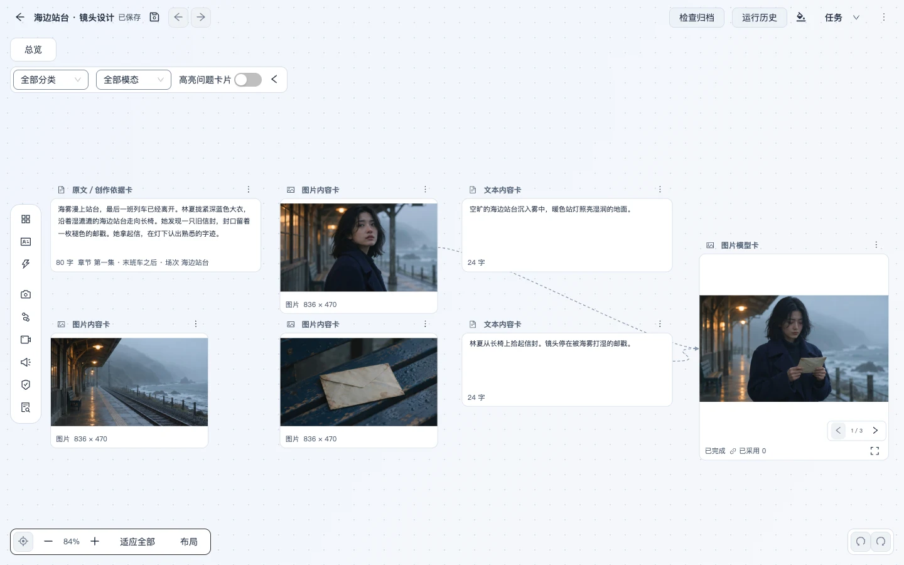
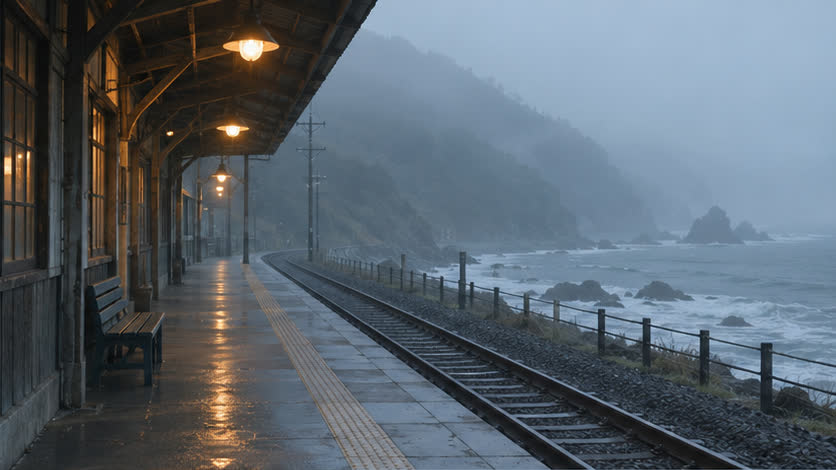
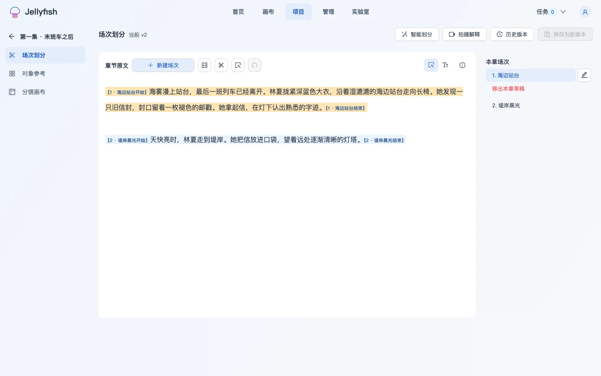
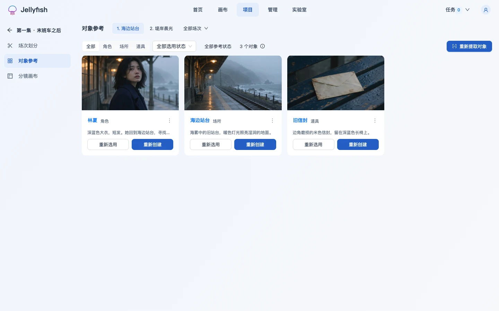

# Jellyfish — AI ショートドラマ制作スタジオ

<p align="center">
  
</p>

<p align="center">
  <a href="https://www.apache.org/licenses/LICENSE-2.0">
    
  </a>
  <a href="https://img.shields.io/badge/frontend-React%20%2B%20Vite-61DAFB">
    
  </a>
  <a href="https://img.shields.io/badge/backend-FastAPI-009688">
    
  </a>
  <a href="https://github.com/Forget-C/Jellyfish/actions/workflows/deploy-site.yml">
    
  </a>
  <a href="https://github.com/Forget-C/Jellyfish/actions/workflows/ghcr-images.yml">
    
  </a>
</p>

<p align="center">
  <a href="README.en.md">English</a> ·
  <a href="README.zh.md">简体中文</a> ·
  <a href="README.ja.md">日本語</a>
</p>

AI ショートドラマの制作ワークスペースです。章の本文をシーンに分け、参考素材をそろえ、絵コンテのキャンバスで候補画像を生成します。画面の表示言語は中国語（初期設定）と英語です。

[クイックスタート](#-docker-compose) · [ローカル開発](development/guides/local-development.md)

## 📷 スクリーンショット

<a href="../site/static/images/screenshots/home/storyboard.webp"></a>

**このカットができるまで**　海辺の駅のシーンでは、絵コンテ上でカットの説明と人物・ホーム・封筒の参考画像を画像モデルにつなぎました。生成された候補から最初のフレームを選び、ゆっくりと寄るカットを試し撮りしています。

[選んだ最初のフレーム](../site/static/images/docs/labs/letter-frame.jpg) · [▶ 3 秒間の試し撮り（ローカルデモ）](../site/static/images/sea-letter/letter-push-in.mp4)

<details>
<summary>シーンの参考素材と画面例</summary>

| 林夏 | 海辺の駅のホーム | 古い封筒 |
| --- | --- | --- |
| <a href="../site/static/images/docs/assets/samples/character.jpg"></a> | <a href="../site/static/images/docs/assets/samples/scene.jpg"></a> | <a href="../site/static/images/docs/assets/samples/prop.jpg"></a> |

| シーン分割 | シーンの参考素材 |
| --- | --- |
| <a href="../site/static/images/screenshots/home/scene-division.webp"></a> | <a href="../site/static/images/screenshots/home/object-references.webp"></a> |

</details>

## ✨ 主な特長

- 各シーンに対応する原文の範囲を確認できます。
- 同じ人物、場所、小道具の参考素材を複数のカットで再利用できます。
- 候補画像を選ぶ前に、生成に使った入力と結果を照合できます。

## ✨ 主な機能

### 1. AI による脚本の分析と絵コンテの作成

章の本文を保存してシーンの境界を指定し、選んだシーンの絵コンテを生成・編集します。

### 2. カットの準備と確認

章の本文 → シーン分割 → 参考素材の選択 → 絵コンテ → 生成前チェック → 候補画像の確認。

### 3. 素材の一貫性と再利用

人物、場所、小道具、衣装をプロジェクトの素材に関連付け、シーンごとに参考画像を選びます。

### 4. カット単位の画像・動画生成

キャンバスでカットの説明と参考素材をモデルカードにつなぎ、入力を確認して生成した画像や動画を確認します。

### 5. 非同期タスクの管理

テキスト・画像・動画のタスクを追跡し、失敗の原因を確認したり、対応するタスクをキャンセルしたりできます。

### 6. モデル・プロンプト・生成サービス

プロバイダーと既定モデルを設定し、プロンプトテンプレートを管理します。バックエンドとの連携には OpenAPI を使います。

## 🚀 機能一覧

### プロジェクトと章の管理

プロジェクトを作成し、章の本文を保存して過去のシーン分割案を参照できます。

### AI による脚本処理

テキストラボで台詞、人物の動き、カットの描写を試作できます。

### カットの準備手順

原文とシーンの参考素材を照合しながら、カットごとの描写を調整できます。

### 素材と登場要素の管理

プロジェクトの素材を管理し、各シーンで使用する参考画像を選択できます。

### カット生成ワークスペース

プロンプトとモデル設定を編集し、生成前チェックを実行して候補をプレビューできます。

### タスクセンター

進捗を追跡し、タスクを開いて結果を確認できます。

### モデルとプロンプトの管理

生成タスクごとの既定モデルを選び、再利用するプロンプトテンプレートを管理できます。

### ファイルとメディアの管理

アップロードした素材や生成結果をプレビューし、参考素材として再利用できます。

## 🎯 活用例

- ショートドラマのチームで絵コンテを準備し、候補画像をレビューする。
- 個人制作で同じシーンのカット割りを試す。
- 教育、ブランド、EC 向けの脚本を短編動画に仕上げる。

## 🔁 フロントエンドの OpenAPI クライアントと型の生成

現在のコードで API を `http://127.0.0.1:8000` に起動し、リポジトリのルートで次のコマンドを実行して `front/openapi.json` と `front/src/services/generated/` を更新します。

```bash
pnpm --dir front run openapi:update
```

## 🐳 Docker Compose

### ポート

- フロントエンド: `http://localhost:7788`
- API: `http://localhost:8000` (Swagger UI: `/docs`)
- MySQL: `localhost:${MYSQL_PORT:-3306}`
- RustFS: `http://localhost:${RUSTFS_PORT:-9000}`

### 起動

初回はリポジトリのルートで環境ファイルを作成し、サービスを起動します。

```bash
cp deploy/compose/.env.example deploy/compose/.env
docker compose --env-file deploy/compose/.env -f deploy/compose/docker-compose.yml up --build
```

フロントエンドを開いたら、[最初のプロジェクトを作成](../site/content/docs/guide/first-project.md)します。メディアを生成する前に[モデルを設定](../site/content/docs/getting-started/model-setup.md)してください。

## 🧑‍💻 ローカル開発

API、タスクワーカー、Vite の起動手順は[ローカル開発ガイド](development/guides/local-development.md)を参照してください。設計と規約は[開発ドキュメント](development/README.md)、公式サイトの保守は[サイトガイド](../site/README.md)にまとめています。

## 📄 ライセンス

このプロジェクトは [Apache-2.0](../LICENSE) ライセンスで公開されています。

## 💬 コミュニティ・フィードバック

- [GitHub Issues](https://github.com/Forget-C/Jellyfish/issues)
