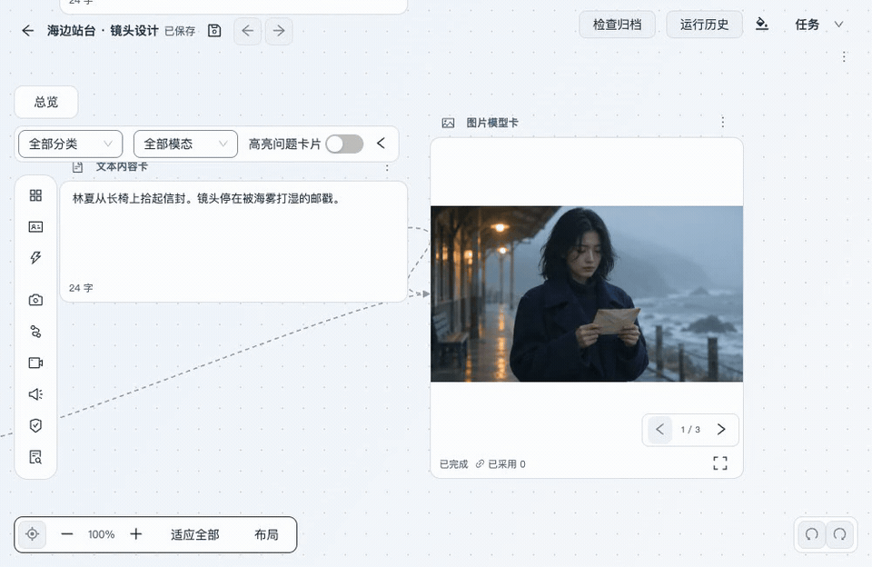
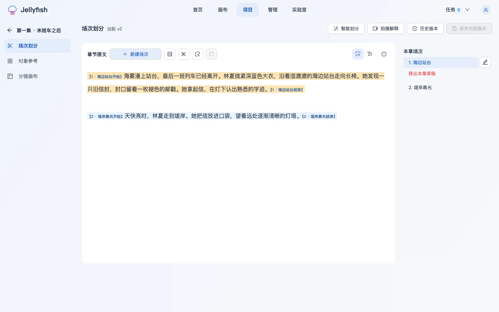
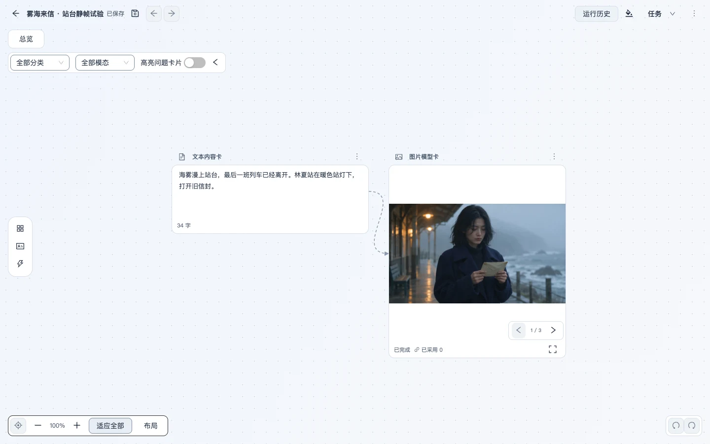
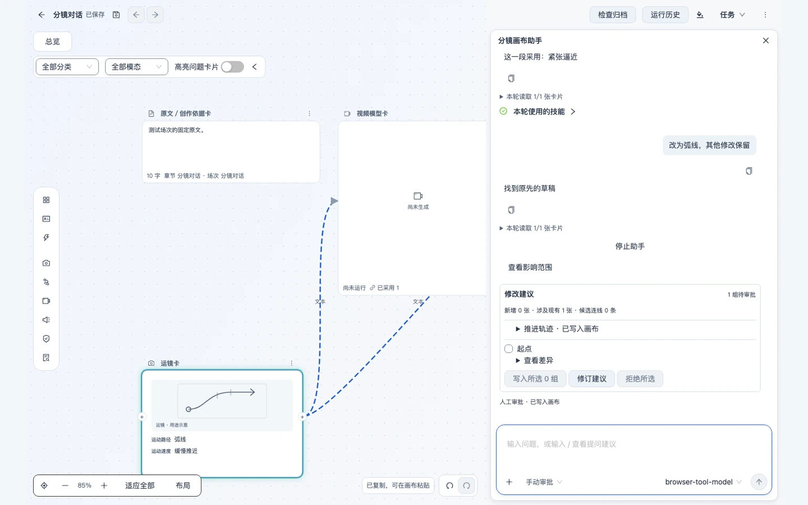
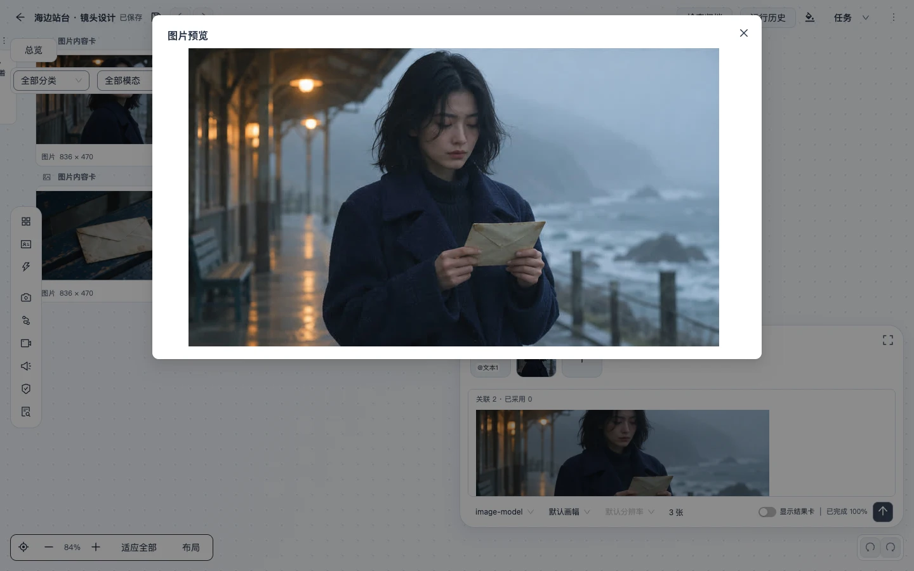
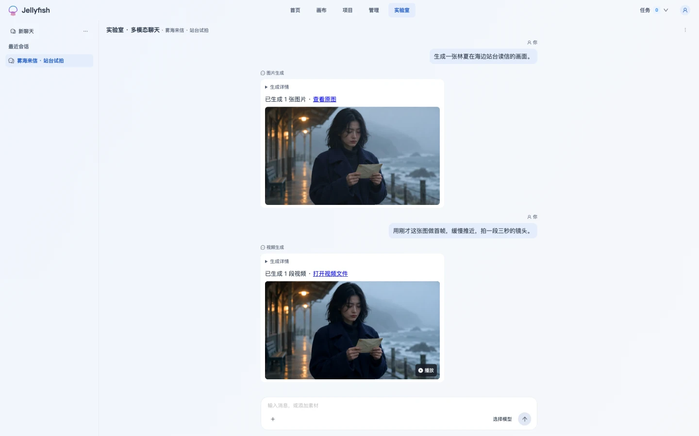
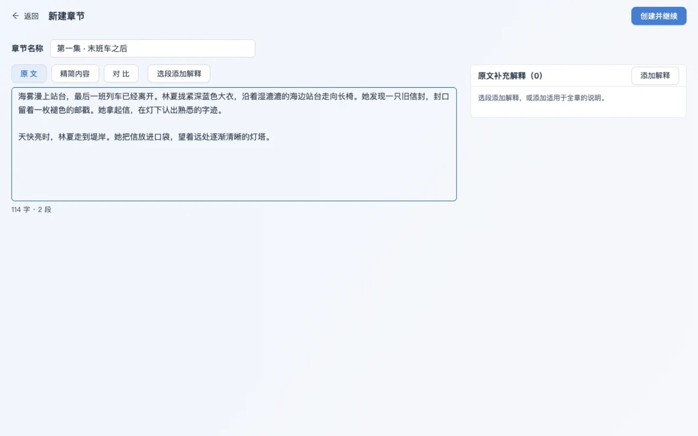
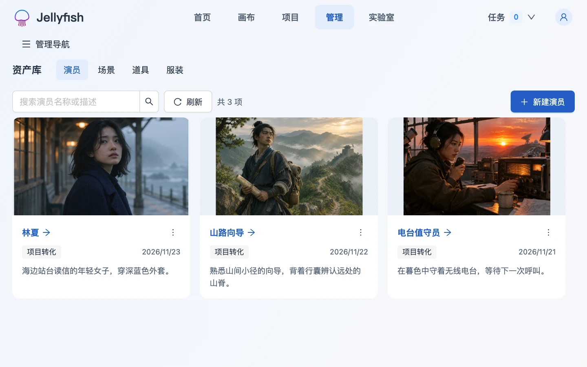
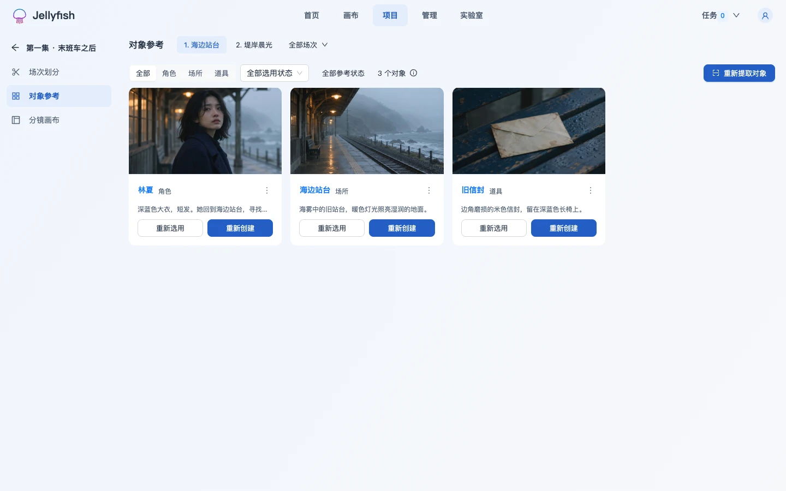

# Jellyfish — AI 短剧工作台

<p align="center">
  
</p>

<p align="center">
  <a href="https://www.apache.org/licenses/LICENSE-2.0">
    
  </a>
  <a href="https://img.shields.io/badge/frontend-React%20%2B%20Vite-61DAFB">
    
  </a>
  <a href="https://img.shields.io/badge/backend-FastAPI-009688">
    
  </a>
  <a href="https://github.com/Forget-C/Jellyfish/actions/workflows/deploy-site.yml">
    
  </a>
  <a href="https://github.com/Forget-C/Jellyfish/actions/workflows/ghcr-images.yml">
    
  </a>
</p>

<p align="center">
  <a href="README.en.md">English</a> ·
  <a href="README.zh.md">简体中文</a> ·
  <a href="README.ja.md">日本語</a>
</p>

面向 AI 短剧创作的制作工作台。从章节原文划分场次，准备视觉参考，再到分镜画布生成候选画面。界面支持中文和英文，默认中文。

[快速启动](#快速启动) · [本地开发](development/guides/local-development.md)

## Jellyfish 是什么？

<p align="center">
  <a href="../site/static/images/sea-letter/canvas-walkthrough.mp4"></a>
</p>

Jellyfish 帮短剧创作者把剧本变成分镜。先把章节划成场次，为每场戏选好人物、场景和道具参考图，再到分镜画布上生成、比较候选画面。演示里，林夏在站台读信的首帧就来自这组镜头描述和参考图。

## 特性

1. **剧本拆分**　将章节划为场次，每场戏都能回看对应的原文。
2. **共享资产库**　跨项目复用演员、场景、道具和服装。
3. **分镜画布**　将镜头描述和参考图连到图片模型，生成并比较候选画面。
4. **画布助手**　用自己的话描述想改的镜头，审阅助手的修改提案后再应用。
5. **图生视频**　在同一会话里生成静帧，再用它作为视频的首帧。
6. **MCP 接入**　从外部 MCP 客户端读取、编辑和运行画布，取回生成结果。

## 核心功能

### 从章节原文到分镜

将章节划分为场次，确认每场对应的原文，再生成可编辑的分镜。在画布上连接镜头描述、参考图和模型卡，调整输入后生成并比较候选画面。

<p align="center">
  <a href="../site/static/images/screenshots/home/scene-division.webp"></a>
  <a href="../site/static/images/screenshots/home/storyboard.webp"></a>
  <a href="../site/static/images/docs/canvas/graph.webp"></a>
</p>

### 修改镜头与生成视频

选中镜头卡，向画布助手描述想改的地方，确认提案后再应用。生成候选画面后，可在画布上放大查看。在会话中，主模型负责对话，图片模型生成静帧，视频模型可以用这张图作为首帧。

<p align="center">
  <a href="img/canvas-assistant-proposal.webp"></a>
  <a href="../site/static/images/screenshots/home/generation-preview.webp"></a>
  <a href="img/chat-image-to-video.webp"></a>
</p>

### 管理项目与视觉参考

按项目整理章节和场次，从章节进入分镜工作台。在全局资产库中管理可跨项目复用的演员、场景、道具和服装，再为每场戏选定人物、场景和道具参考图。

<p align="center">
  <a href="../site/static/images/docs/chapter/chapter.webp"></a>
  <a href="img/previews/assets.webp"></a>
  <a href="../site/static/images/screenshots/home/object-references.webp"></a>
</p>

### 通过 MCP 连接画布

在外部 MCP 客户端读取、编辑和运行 Jellyfish 画布，并取回生成结果。 [接入指南](../site/content/docs/tools/generation-canvas.md#从-mcp-客户端连接画布)

## 快速启动

首次在本机体验时，先安装 Git 并启动带 Compose 插件的 Docker，再运行以下命令。

```bash
git clone https://github.com/Forget-C/Jellyfish.git
cd Jellyfish
cp deploy/compose/.env.example deploy/compose/.env
docker compose --env-file deploy/compose/.env -f deploy/compose/docker-compose.yml up --build -d
```

打开 [Jellyfish 工作台](http://localhost:7788)，进入「项目」，[创建第一个项目](../site/content/docs/guide/first-project.md)。首次生成图片或视频前，先[配置模型](../site/content/docs/getting-started/model-setup.md)。

[部署指南](../site/content/docs/getting-started/docker.md) · [画布 MCP](../site/content/docs/tools/generation-canvas.md#从-mcp-客户端连接画布) · [OpenAPI 客户端](development/guides/openapi.md)

## Star History

[](https://www.star-history.com/?repos=Forget-C%2FJellyfish&type=date)

[反馈问题](https://github.com/Forget-C/Jellyfish/issues) · [参与贡献](../site/content/docs/community/contributing.md) · [Apache 2.0 许可证](../LICENSE)
