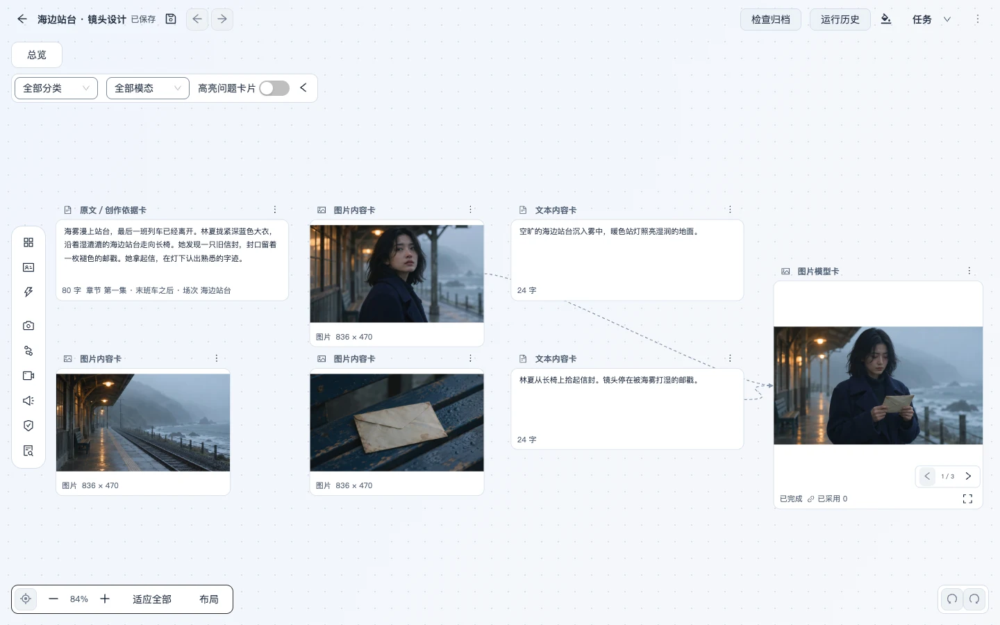

# Jellyfish — AI 短剧工作台

<p align="center">
  
</p>

<p align="center">
  <a href="https://www.apache.org/licenses/LICENSE-2.0">
    
  </a>
  <a href="https://img.shields.io/badge/frontend-React%20%2B%20Vite-61DAFB">
    
  </a>
  <a href="https://img.shields.io/badge/backend-FastAPI-009688">
    
  </a>
  <a href="https://github.com/Forget-C/Jellyfish/actions/workflows/deploy-site.yml">
    
  </a>
  <a href="https://github.com/Forget-C/Jellyfish/actions/workflows/ghcr-images.yml">
    
  </a>
</p>

<p align="center">
  <a href="README.en.md">English</a> ·
  <a href="README.zh.md">简体中文</a> ·
  <a href="README.ja.md">日本語</a>
</p>

面向 AI 短剧创作的制作工作台。从章节原文划分场次，准备视觉参考，再到分镜画布生成候选画面。界面支持中文和英文，默认中文。

[快速启动](#快速启动) · [本地开发](development/guides/local-development.md)

## Jellyfish 是什么？

<p align="center">
  <a href="../site/static/images/sea-letter/canvas-walkthrough.mp4"></a>
</p>

Jellyfish 帮短剧创作者把剧本变成分镜。先把章节划成场次，为每场戏选好人物、场景和道具参考图，再到分镜画布上生成、比较候选画面。演示里，林夏在站台读信的首帧就来自这组镜头描述和参考图。

## 核心功能

| 从章节原文生成分镜 | 在同一会话中生成图片和视频 |
| --- | --- |
| <a href="../site/static/images/screenshots/home/scene-division.webp"></a> <a href="../site/static/images/screenshots/home/storyboard.webp"></a> | <a href="img/chat-image-to-video.webp"></a> |
| 智能划分章节，确认每场对应的原文后，按场生成可编辑的分镜。 | 主模型负责对话，图片和视频分别由选定的生成模型执行。可以接着上一轮的图片生成视频。 |

| 画布编辑 | 画布智能助手 |
| --- | --- |
| <a href="../site/static/images/docs/canvas/graph.webp"></a> | <a href="img/canvas-assistant-proposal.webp"></a> |
| 连接镜头描述、参考图和模型卡，调整输入并运行画布，比较候选画面。 | 选中镜头卡，用自然语言描述想改的内容，查看并采用助手的修改提案。 |

| 项目管理 | 全局资产库 |
| --- | --- |
| <a href="../site/static/images/docs/chapter/chapter.webp"></a> | <a href="../site/static/images/screenshots/assets.png"></a> |
| 按项目组织章节和场次，从章节进入对应的分镜工作台。 | 集中管理演员、场景、道具和服装，让多个项目复用视觉素材。 |

### 通过 MCP 连接画布

在外部 MCP 客户端读取、编辑和运行 Jellyfish 画布，并取回生成结果。 [接入指南](../site/content/docs/tools/generation-canvas.md#从-mcp-客户端连接画布)

## 快速启动

首次在本机体验时，先安装 Git 并启动带 Compose 插件的 Docker，再运行以下命令。

```bash
git clone https://github.com/Forget-C/Jellyfish.git
cd Jellyfish
cp deploy/compose/.env.example deploy/compose/.env
docker compose --env-file deploy/compose/.env -f deploy/compose/docker-compose.yml up --build -d
```

打开 [Jellyfish 工作台](http://localhost:7788)，进入「项目」，[创建第一个项目](../site/content/docs/guide/first-project.md)。首次生成图片或视频前，先[配置模型](../site/content/docs/getting-started/model-setup.md)。

[部署指南](../site/content/docs/getting-started/docker.md) · [画布 MCP](../site/content/docs/tools/generation-canvas.md#从-mcp-客户端连接画布) · [OpenAPI 客户端](development/guides/openapi.md)

## Star History

[](https://www.star-history.com/?repos=Forget-C%2FJellyfish&type=date)

[反馈问题](https://github.com/Forget-C/Jellyfish/issues) · [参与贡献](../site/content/docs/community/contributing.md) · [Apache 2.0 许可证](../LICENSE)
