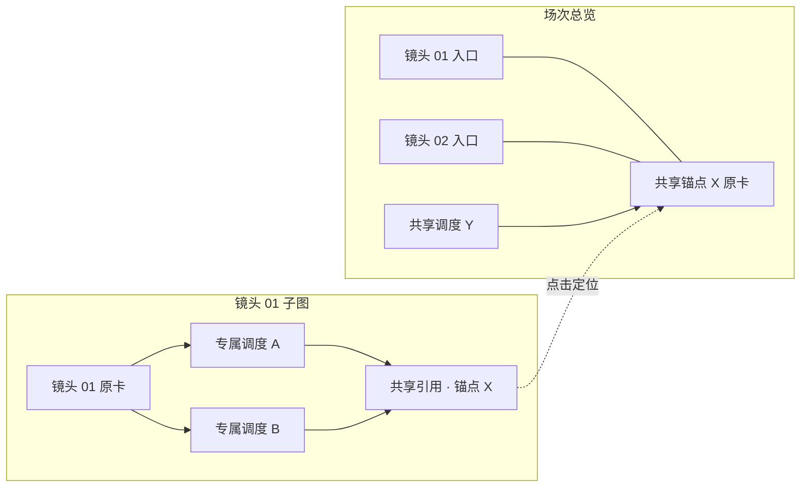

## 状态与目标

**方案已实施。** 用户已确认分组与编辑边界四项、迁移与导航三项、布局与连线三项决策。本文保留实施依据；当前行为见[导演画布架构](../architecture/directing-foundation.md)。

主导航改为“场次总览 → 镜头 01 · 设计”。全部岗位按镜头关联组织，岗位保留为标签或轻分区，不再进入第二层岗位子图。目标是让逐镜内容集中、跨镜共享可见、引用来源可追溯，并保持所有合法场次设计可访问。

业务数据继续属于同一场次版本：不复制工作单，不增加逐镜版本，不改变生产单元、任务、参考素材或剪辑采用语义。人物持续任务沿用镜内活动的设计字段；后台生成任务不纳入导演设计卡片。

## 与上一方案的关系

上一轮已完成的[场次画布工作台计划](./canvas-sequence-workbench-plan.md)保留实施历史。新方案实施时，以下行为按本文替代：

| 上一方案 | 本方案 |
| --- | --- |
| 七个设计域汇总卡作为外层主入口 | 每个镜头一个入口；全部岗位在对应镜头内按标签／分区组织。 |
| 正式卡固定在岗位子图或外层 | 按全场适用性及确定的镜头关联集合决定显示位置；数据职责仍保持原定义。 |
| 各视图共用整场／当前镜头范围开关 | 总览覆盖整场，镜头子图固定当前镜头；镜头选择器切换整个子图内容。 |
| 范围外目标作为完整原卡临时加入子图 | 跳转到目标真实位置；迁移中保留编辑器与提示，不在子图复制原卡。 |
| 直接边和传递路径推导边共同铺开 | 原卡之间展示真实直接字段边；镜头—共享关系单独汇总，间接路径留在明细。 |

继续沿用统一子图入口样式、真实模糊预览、直接导航无穿越动画、同一份草稿、版本与身份隔离、只读限制、引用校验、共享表单、手动布局优先及独立布局撤销。当前事实已同步至 architecture 和工作台操作指南。

## 对象分类与唯一原卡

术语见根目录 [GLOSSARY.md](../../../../GLOSSARY.md)。分类依据是当前场次版本中的确定关系，专属不表示永久独占，也不等于内容的完整执行适用性。

| 类别 | 判定 | 原卡位置与编辑 |
| --- | --- | --- |
| 镜头 | 设计中的计划条目，使用稳定镜头身份 | 总览显示进入子图的镜头入口；子图中央显示该镜头原卡并提供编辑。 |
| 专属卡片 | 非全场适用对象，确定关联恰好一个镜头 | 原卡只在该镜头子图，可编辑。 |
| 共享卡片 | 非全场适用对象，确定关联至少两个不同镜头 | 原卡只在总览共享区，可编辑；各镜头引用同一份内容。 |
| 全场适用内容 | 全场规则或背景，按自身语义确定 | 原卡在总览全场内容区；不因只有一个镜头而变成专属。 |
| 未关联设计 | 非全场适用对象，尚无确定镜头关联 | 原卡在总览可收起的未关联设计区，可编辑；不自动归到当前镜头。 |
| 虚拟跨镜头卡片 | 镜头子图对外层共享目标的引用表示 | 同一子图同一目标只出现一张；只能定位，不编辑，不成为独立工作单。 |

每个设计对象只有一张正式原卡。镜头入口和虚拟引用均不建立业务副本；共享分类、入口数量及布局改变不修改对象身份。

### 镜头关联规则

按每个对象关联的**不同镜头集合**计数，不数线条，也不数引用者数量：一个镜头的三个调度引用同一锚点仍只算一镜；两个镜头共用的调度所引用的锚点也关联两镜。

每镜关联按以下既有业务规则选取，并补齐必要依赖：

1. 当前镜头及其明确引用的节拍、调度、人物／物件、事件和验收要求。
2. 所覆盖节拍的表演工作单；当前镜头明确参与者及已纳入表演涉及人物的角色情境；明确归属当前镜头的摄影工作单。
3. 当前镜头、其节拍、调度及已纳入表演引用的事件构成事件依据集合。镜内活动按触发事件命中集合选取，连续性按变化事件命中集合选取；对白按已纳入表演的对白引用选取。
4. 补齐以上对象通过真实字段引用所需的依赖，包括调度或活动引用的空间锚点。不能因依赖对象位于另一个岗位而遗漏。
5. 必要引用补齐不反向扩大工作单集合：不因共用人物、场所、验收、名称或锚点就收入其他工作单；不沿无方向图无限扩散。

全场适用内容单独分类，不把常驻显示误算为逐镜引用。关联不确定的内容不收入镜头子图。人物名单未知与明确为空保持区别，不回退成全场人物；关联设计也不反写镜头参与名单。连续性没有明确持续区间时，不推断其对后续镜头持续生效。缺失引用保留原标识与不可用提示，不虚构可编辑对象。

### 必须补齐的当前实现边界

现有 `directorShotKeys` 可作为选取规则基础，但不能直接反转其 `relatedKeys` 作为最终分类。它当前只补齐无设计域的引用目标，可能遗漏镜内活动所引用的空间锚点。

已通过现有测试样例的内存变体核实：镜头 1 经调度引用锚点 A；镜头 2 经事件关联活动，该活动也引用 A。镜头 2 子图能显示 A 的引用卡，但 `relatedKeys` 没有 A；直接计数会误判为镜头 1 专属。实施必须覆盖该回归。

## 视图内容与默认布局

默认布局采用中心对象和固定功能区，不强制圆周等距，不采用持续移动卡片的力导向效果。方位表达阅读组织；不依据摆放位置新建业务连线。

### 场次总览

| 默认位置 | 内容与排列 |
| --- | --- |
| 中央 | 原文依据，作为首次进入的浏览锚点，保持摘要可读。 |
| 上方 | 全场适用原卡：叙事与约束、空间规则、本场场所、表演适用说明、环境与留白、声音安排、提示词要求。 |
| 中央四周内层 | 镜头入口按计划顺序逐圈排列；各入口独立，不设“镜头设计”分组。镜头增多时逐圈向外扩展。 |
| 外侧左方 | 共享原卡按类型／岗位轻分区，展示实际关联镜头数；不按引用镜头重复放置。 |
| 外侧下方 | 默认收起的未关联设计区，显示数量并支持展开；定位区内对象时自动展开。 |

原文是版本固定的创作依据，当前无完整逐镜原文区间映射，因此不画没有字段依据的逐镜原文定位线。镜头之间不因编号相邻就画业务依赖线。全场适用通过卡片标记表达，不向每个镜头重复画适用线。

无镜头的空方案保留创建首个镜头、编辑全场内容及未关联设计的入口。总览不随当前镜头选择过滤掉其他镜头或共享原卡。

### 镜头子图

| 默认位置 | 内容与排列 |
| --- | --- |
| 中央 | 当前镜头原卡；工具栏镜头选择器切换本镜上下文。 |
| 上方 | 专属节拍、调度、空间锚点，按类型轻分区。 |
| 左侧 | 专属人物／物件、触发事件、验收要求。 |
| 右侧 | 其他岗位专属工作单：角色情境与表演、镜内活动、摄影、连续性、对白等，按岗位／类型分区。 |
| 下方 | 紧凑的虚拟共享引用卡，同一目标一张，各引用者分别连入。 |

进入镜头即查看本镜内容，不再额外要求切一次“当前镜头”范围。选择器切换镜头会切换专属卡与必要引用，并恢复对应镜头的有效浏览现场。没有专属成员的岗位不显示空岗位容器；全场适用原卡不在子图复制。

### 入口、原卡与虚拟引用的表达

- 镜头入口沿用统一叠层样式和“聚合子图 · 镜头 01”标题；页面标题为“镜头 01 · 设计”。序号随计划顺序更新，身份不随序号变化。
- 入口展示真实用途、内容状态与目标子图的模糊布局预览。预览包括实际可见的专属卡及虚拟引用，不显示可读子卡正文，不写入浏览或业务数据。
- 镜头入口整卡或键盘确认进入，拖动与菜单独立；普通原卡沿用共享表单与侧边编辑区。
- 虚拟卡显示“共享引用 · 对象名称”、目标简要说明及定位操作，不提供编辑、删除原对象或解除业务引用的操作，也不伪装成另一层子图入口。
- 待处理和未保存状态来自真实内容；零问题不代表岗位完成、执行准备就绪或人工验收通过。

### 布局稳定性、窄屏与大图

分区按实际卡片宽高紧凑排列，空分区不占位，内容多时向外扩展。总览以原文为中心，镜头入口占内层；全场内容、跨镜共享与未关联设计分别在外侧上方、左方和下方避让。首次或主动整理按可用空间排布；窄屏首次布局采用单列，顺序为原文、全场内容、镜头入口、跨镜共享、未关联设计。镜头子图仍按功能区排布。卡片保持可读尺寸，不为一次塞进整图而自动缩小；“适应全部”由用户主动使用。

手动坐标优先，切镜、编辑、缩放及窗口变化不自动重排。拖动镜头入口只改浏览坐标，不改计划顺序；计划顺序改变时编号更新，手动位置保留，主动重新整理才按新顺序排列。位置、缩放及整理撤销按版本和总览／镜头视图隔离；小地图继续表示当前可见布局。

## 连线与共享关系

| 类型 | 确定规则 |
| --- | --- |
| 总览镜头入口—共享原卡 | 每对仅一条无箭头汇总线，表达“关联”；明细保留真实引用者、字段、方向及完整路径。 |
| 总览共享原卡 A→共享原卡 B | 有真实直接字段引用才画有向实线，箭头从引用者指向被引用对象；同端点同方向的多个字段可合并视觉线，明细保留每项。 |
| A→B→C 的传递路径 | 保留真实的 A→B、B→C，不额外画推导捷径 A→C；若 A 确有直接引用 C 的字段，则保留该直接边。 |
| 两个对象仅共同被某镜头使用 | 不因此建立它们之间的关系。 |
| 子图专属原卡与专属原卡／虚拟卡 | 保留真实字段关系和实际方向，不铺开全部传递路径。A→虚拟卡与 B→同一虚拟卡分别保留。 |

例如共享调度引用共享锚点和共享人物，两条真实关系均在总览显示；不因为已存在镜头汇总线就省掉它们，也不因此给锚点和人物添加一条线。

### 关联集合与子图可见范围分开

子图虚拟卡只表示与本镜正式成员有直接字段边的外层共享目标；方向按原字段保留。共享目标后续的共享关系链留在总览。

例如“镜头→共享节拍→共享事件”：子图显示共享节拍的虚拟卡；只有本镜某个正式成员也直接引用该事件时，才同时显示事件虚拟卡。该事件仍计入镜头关联集合及总览汇总关系，不因子图省略它的虚拟卡而改变共享分类。

图中点线仅说明导航动作，不是画布中的业务边。总览镜头 01—X 的一条汇总线保留 A、B 等真实引用明细。

### 关系查看

所有线默认弱化，悬停或键盘聚焦时突出相关线和两端，活动时显示标签，点击查看来源明细。无实际可见端点时不画悬空线；未关联区收起时隐藏其内部及跨区线，展开后恢复真实关系。

连线仅表达和检查关系，不直接编辑或解除引用。引用增删在所属原对象表单完成，保留现有校验。全场对象和已展开的未关联对象若有真实字段关系，也按原字段展示，不推断新的镜头关联。

## 关联变化与自动迁移

一次有效关联修改进入当前场次草稿后，按完整结果更新分类；不等待服务器保存，不额外弹迁移确认。批量修改按最终结果处理，内容撤销／重做时分类同步更新。迁移本身不产生额外业务修改，也不替换对象身份。

| 关联变化 | 显示结果 |
| --- | --- |
| 一镜变多镜 | 原卡转到总览共享区，各相关子图显示必要的虚拟引用。 |
| 多镜变一镜 | 原卡进入唯一相关子图，替换该处虚拟卡；其他子图移除已无依据的引用。 |
| 专属镜头 A 改为 B | 原卡从 A 转到 B，A 不保留无依据引用。 |
| 有关联变零关联 | 原卡转到总览未关联设计区，保留内容。 |
| 零关联变一镜或多镜 | 按最终集合进入对应子图或总览共享区。 |
| 仍为多镜，但镜头集合变化 | 原卡留在总览，只更新关联镜头、引用卡和连线。 |

全场适用内容不按数量迁移。解除关联不等于删除；真实删除继续受设计引用、生产单元引用及只读限制约束。

### 保留编辑现场与坐标

自动迁移不改变当前视角、所选镜头及已打开编辑器。编辑器继续绑定同一对象，提示“已移至总览共享区／镜头 02／未关联设计区”并提供定位入口；原子图不保留第二张可编辑卡。用户主动关闭或导航时沿用草稿保护。对象确实删除或身份无法唯一确认时停止编辑并说明，不猜测同名或同下标对象。

同镜头内原卡与引用卡互换，优先继承该对象的位置。迁入另一视图时优先恢复其仍有效的历史位置，无记录则找空位；尺寸变化只处理相关卡片碰撞，不重排整图。业务撤销不主动切换画布，也不等同于布局整理撤销。

### 新增与空状态的衔接

新增沿用已有对象类型和表单，只预填可以确定的归属，例如当前镜头摄影工作单。节拍、事件、调度等关联需有明确选择，不为让新卡留在子图而自动补造关系。

尚未建立的工作单表单不计为业务对象，不参与分类或连线。建立后的对象按实际关联分类；暂无关联则进入未关联设计区，通过同一编辑器与位置提示保留本次编辑现场。其余只读、引用校验、未保存输入保护沿用既有规则。

## 虚拟引用跳转、返回与失效

虚拟卡只定位，不自动打开编辑。点击时以目标身份解析最新位置，旧链接同样处理：

| 目标此刻状态 | 定位行为 |
| --- | --- |
| 仍为共享卡 | 进入总览定位原卡，保留来源镜头选择。 |
| 已变成某镜头专属 | 进入对应子图定位原卡，同步当前镜头选择。 |
| 已变为未关联设计 | 进入总览并展开未关联设计区，定位原卡。 |
| 已在当前视图 | 直接定位，不增加多余返回步骤。 |
| 已删除或无法唯一识别 | 留在当前视图，提示不可用，不定位其他同名对象。 |

全部导航直接切换，不播放穿越或淡入淡出动画。只做目标可见所需的定位调整，不写入对象布局或触发业务保存。

### 浏览历史

每次真实跳转记录来源视图、来源镜头、平移缩放及来源对象。共享原卡编辑、查看连线明细、平移缩放不增加返回层级；主动进入另一个镜头等真实导航正常记录。

“返回上一处”按浏览历史恢复来源，“场次总览”直接回总览；浏览器前进／后退遵循相同规则。返回使用最新草稿，不撤销共享编辑，也不恢复旧分类。

| 返回时的来源状态 | 恢复规则 |
| --- | --- |
| 来源虚拟卡仍存在 | 恢复原镜头子图、平移缩放及虚拟卡焦点。 |
| 同一对象已变成本镜专属 | 恢复到对应原卡。 |
| 对象已不再关联来源镜头，或已不可用 | 回到来源镜头中心并说明关联变化／对象不可用，不创建旧引用，不自动追去另一镜头。 |
| 来源镜头已删除 | 回同版本总览；目标当前在总览且可识别时定位该原卡，否则定位原文依据。 |

正常返回恢复原视角；来源表示失效或原视角无法显示有效目标时，才做必要定位。前进同样按最新数据解析。版本间不混用草稿、镜头选择、布局或历史目标。

## 实现边界与执行顺序

### 现有能力与必须修改处

- 复用场次设计契约、表单、引用校验及同一草稿；预期不需要新增后端对象或修改 API。
- 建立一次整场直接关系图，复用逐镜业务选取规则并补齐必要依赖，再计算对象关联镜头集合、分类与两层投影；避免为每张卡重复构建全部镜头图。
- `sceneDesignGraph` 当前同时生成直接边和推导边，不能将全部边原样显示；`shotGraph` 的部分展示方向也不能代替真实字段方向。镜头汇总边需单独保留来源及路径。
- 当前编辑器在画布卡片之外，可保持迁移中的输入；普通 `go()` 会关闭侧栏，因此自动迁移不能调用普通导航。旧临时显示完整原卡的逻辑需按本方案替换。
- 复用位置缓存、焦点与历史恢复，新增原卡／虚拟卡之间的身份对应。摄影、表演依自然键，活动、情境依内容快照；只对可唯一识别的对象续接，歧义对象不按数组位置恢复。
- 新总览及逐镜视图独立保存浏览现场；旧七域坐标不能未经验证直接混用。分组背景、关系检查、小地图及共享 UI 可复用，中心布局需要实际实现。

### 实施步骤与验证

| 步骤 | 工作内容 | 验证边界 |
| --- | --- | --- |
| 1 | 明确关联集合、四类原对象归位及虚拟引用投影 | 现有图投影测试，重点覆盖间接锚点遗漏、不同镜头计数和不反向扩散。 |
| 2 | 总览／镜头入口、全部岗位内容、新增与编辑衔接 | 公开画布渲染和交互测试；验证内容不丢失、原卡唯一及无镜头起稿。 |
| 3 | 自动迁移、虚拟跳转、身份与历史恢复 | 关联修改与撤销、编辑中迁移、源／目标失效、版本隔离。 |
| 4 | 默认布局、真实预览、汇总与直接关系线 | 布局及卡片浏览器测试，1440px／390px 视觉验收和密集样例。 |
| 5 | 文档与受影响流程回归 | 前端类型检查、相关版本流程及共享控件验收；落地后同步 architecture 和工作台指南。 |

实现阶段从项目根目录运行 `pnpm --dir front run typecheck`，并运行受影响的图投影、卡片、布局、版本流程和工作台 UI 检查。相同代码环境下已通过的结果复用，不因纯文档修改执行应用测试。

## 验收矩阵

| 场景 | 必须满足 |
| --- | --- |
| 无镜头／只有一个镜头 | 原文、全场及未关联内容可达；能建首镜，全场规则不变专属。 |
| 一镜多次引用与多镜共用 | 计数按不同镜头；原卡唯一，虚拟卡每镜每目标一张。 |
| 调度与活动间接使用同一锚点 | 两镜都计入，不能误判为一镜专属。 |
| 无事件活动、无明确逐镜依据的连续性 | 留在未关联设计，不因共用人物／场所猜测镜头。 |
| 专属 A、B 同时引用共享 X | 子图保留 A→虚拟 X、B→虚拟 X；总览仅镜头—X 一条线，来源明细完整。 |
| 共享 A→B→C 及确有直接 A→C | 只显示实际直接边，不画推导捷径；确有的直接字段边不能被误删。 |
| 共享链经过子图外层目标 | 关联集合完整；子图仅呈现与正式成员实际相连的共享入口。 |
| 零／一／多镜及专属 A→B 迁移 | 原卡正确归位，解除不删除，镜头集合变化同步引用与连线。 |
| 编辑中迁移与关联撤销／重做 | 输入、对象身份、当前视角连续；不留下重复原卡，不强制导航。 |
| 跳转后目标迁移、删除或身份歧义 | 定位最新位置或明确提示，不猜同名／下标，不误报仍存在的对象为删除。 |
| 返回来源虚拟卡消失／来源镜头删除 | 按原卡、镜头中心、总览规则回退；保留最新编辑结果。 |
| 只读版本与版本切换 | 可浏览不可越权修改；内容、位置和身份目标不串版本。 |
| 手动位置、窗口变化与窄屏 | 不意外重排；默认分区无碰撞，卡片与控件可读可操作。 |
| 密集共享图、折叠未关联区、键盘关系查看 | 无悬空线，焦点和来源明细可用，展开后真实关系恢复。 |
| 入口预览、镜头切换与浏览历史 | 预览对应真实可见图，不写入数据；导航无动画，不触发业务保存。 |

使用相同关系样例比较现行与新布局的可读缩放、包围范围、连线交叉及完成定位／切镜的操作数。收益是待验证的设计预期，不宣称严格环形最省空间或新布局已实测更优。

## 参考与验证状态

| 参考 | 可借鉴内容 | 边界 |
| --- | --- | --- |
| [Unreal Sequencer](https://dev.epicgames.com/documentation/en-us/unreal-engine/sequences-shots-and-takes-in-unreal-engine) | 总序列进入镜头、层级导航、浏览历史及上层上下文。 | 镜头有独立 Sequence asset，不能照搬本项目的数据归属；时间线不证明画布布局效率。 |
| [Obsidian Graph view](https://obsidian.md/help/plugins/graph) | 全局图与当前对象的局部关系视图并存。 | 连接跳数不能代替业务关联规则，点状图不能证明文本卡片布局效率。 |
| [yEd Radial Layout](https://yed.yworks.com/support/manual/layout/layout_radial.html) | 中心对象、关系层级及类型分组。 | 偏重树结构，不能据此将多镜共享对象视为单镜所有。 |

已补齐活动锚点关联、镜头集合归位、总览／逐镜投影、只读共享引用、导航与布局，并更新架构及工作台指南。图投影与布局单测、卡片编辑和桌面／390px 浏览器验收见本轮提交记录。尚未对新旧布局进行量化性能与完成任务操作数比较，不能据此断言新布局严格优于旧布局。
