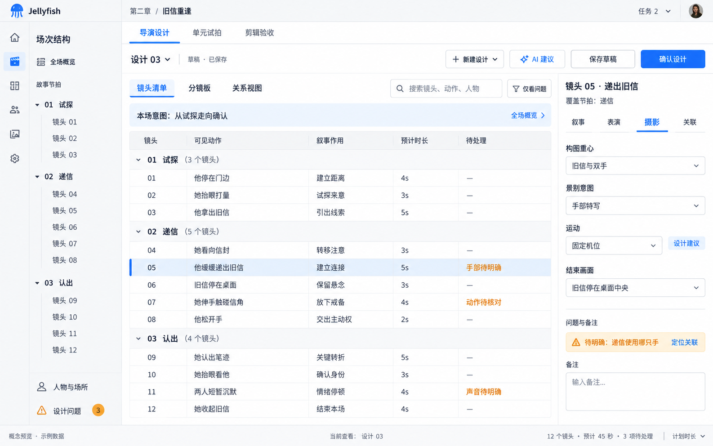
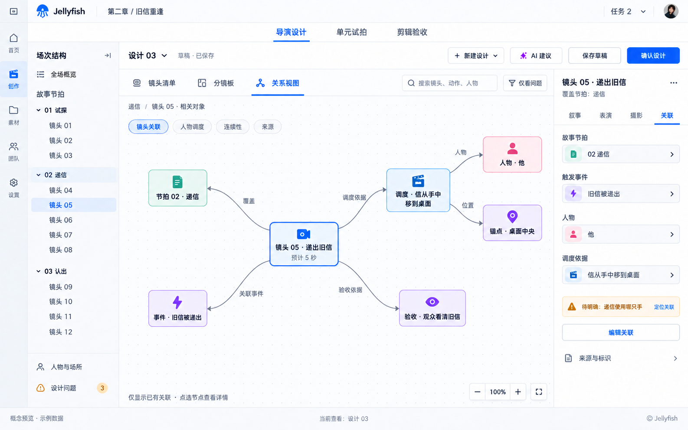

> 2026-09-15。用户已确定执行方向：**先完成全站布局框架统一，再在这套框架内实现新的场次工作台，并与已确认预览图保持一致。** A1–A3 已完成并通过 MA 验收；B1–B5 已完成并通过 MB 验收。本文是本轮任务顺序和视觉验收的维护入口。

## 1. 目标、依据与范围

### 1.1 成功标准

1. 全站采用统一的顶部品牌与上下文栏、左侧窄导航、页面工具栏和基础视觉规范；各页面按实际需要使用列表、分栏或编辑器布局。
2. 场次工作台按“导演设计 → 单元试拍 → 剪辑验收”组织；中央展示正在处理的镜头、单元或素材，右侧展示所选对象详情。
3. 设计页的镜头清单和关系视图在区域位置、比例、信息层级、颜色与控件密度上符合本计划中的预览基准；不能只完成配色或菜单收窄就认定达成。
4. 现有数据、来源、版本、任务、草稿保护和采用规则继续成立；布局调整不能使操作丢失或改变其业务含义。
5. A 阶段全站验收通过后，才进入 B 阶段场次业务界面实施。各阶段都须有实际截图和对应交互证据，计划与参考图片本身不代表实现通过。

### 1.2 与既有计划的关系

- [原场次实施任务](/docs/plans/directing-workbench-implementation-tasks/)的 M0–M4、[原体验优化计划](/docs/plans/directing-workbench-experience-plan/)的 UX1–UX5 保留历史完成结论。
- 本轮按 A/B 编号单独推进。旧体验计划中“保留现有项目视觉风格”“示意不作为像素布局验收”及允许大块引导置于阶段导航之上的约定，仅描述上一轮交付，不适用于本轮。
- 本文规定新的目标外观与实施顺序；当前已生效业务事实仍以[核心数据与版本](/docs/architecture/directing-foundation/)为准。实现落地后再同步受影响的 architecture，不提前把方案写成当前事实。
- 用户已取消的 A19 五秒用户测试保持取消；本轮采用截图、交互和回归验证，不重新要求招募体验者。

### 1.3 本轮范围

- **A 阶段**：全站公共框架、菜单、真实名称面包屑、任务入口、主题、各路由容器和页面工具栏适配，以及响应式与全站验证。预计约 3–5 人日，含适配与验证，属于代码检查后的粗估。
- **B 阶段**：场次工作区控制栏、镜头清单、完整六岗对象编辑、分镜板、关系视图、版本比较、单元与参考准备、编译审稿、候选审片、粗剪时间线、连续性和返工入口。
- 沿用 React、Ant Design、现有路由和 generated client。公共框架优先复用已有布局容器，只抽取跨页面确实共用的结构。
- 不新增完整多轨剪辑、自动视频理解、自动采用、团队协作或节点执行引擎。图片中的示例菜单不代表要新增对应业务模块。

## 2. 预览基准与一致性规则

### 2.1 固定参考图

两张图均为用户已认可方案的概念预览，原始尺寸为 **1586 × 992**；示例内容不作为生产数据。参考图与本文保存在同一目录，使用相对路径，供本地 Markdown 预览和文档站共同读取。

**参考 A：镜头清单。全站框架与默认设计工作区的主基准。**



**参考 B：修正后的镜头关系图。关系视图内容与关联方式的基准。**



两图的细微差异按以下规则统一：

1. 顶栏、品牌、导航、阶段栏、工具栏与详情区比例以**参考 A**为主，以第 2.3 节规范值执行；参考 B 不另建一套外壳。
2. Graph 采用**参考 B 的镜头中心分支结构**。先前被修正的流水线式关系图不属于交付基准。
3. 本计划把生成图规范化为可实现布局；真实菜单、状态、控件类型和空值按业务语义呈现。调整自由文本控件、文案长度、无数据状态，不构成重排工作区的理由。
4. 试拍、剪辑及普通页面目前没有逐屏已确认效果图。其布局按本文规定、视觉沿用参考 A；实施时先形成同一框架内的代表性页面截图再检查，不声称这些页面已有逐像素参照。
5. 不在产品中复制“概念预览”“示例数据”等说明、演示头像、虚构版权信息或任务数量。品牌使用项目的矢量资产和统一尺寸，不从图片裁切标志或图标作为界面素材。

### 2.2 必须保持的区域关系

```text
┌────────────────────────────────────────────────────────────────────┐
│ Logo Jellyfish           项目 / 章节 / 场次               任务  头像 │
├──────┬──────────────────┬────────────────────────────────────────────┤
│ 全局 │ 当前业务导航     │ 导演设计       单元试拍       剪辑验收     │
│ 窄栏 │                  ├────────────────────────────────────────────┤
│      │ 场次结构 / 节拍  │ 设计版本 ▾ 草稿状态       新建 AI 保存 确认│
│      │                  ├────────────────────────────┬───────────────┤
│      │                  │ 清单 / 分镜 / 关系  搜索筛选│ 所选对象详情  │
│      │                  │                            │               │
│      │                  │ 中央工作区                 │ 字段 / 关联   │
│      │                  │                            │ 来源 / 问题   │
├──────┴──────────────────┴────────────────────────────┴───────────────┤
│ 当前查看对象 / 当前选择 / 预计或实际时长                             │
└────────────────────────────────────────────────────────────────────┘
```

- 顶栏横跨全站；品牌位于顶栏左侧，不放回宽菜单内部，不另叠加品牌副标题占据第二行。
- 全局窄栏与业务侧栏从顶栏下方开始。业务阶段栏与版本工具栏位于业务侧栏右侧；阶段、版本与内容视图各有一层，不能交换顺序。
- 全局入口使用“项目、资产、提示词、模型、实验室、设置”等已有名称。文件、Agent 等既有路由保持可达；不直接照搬图中的“团队”等示例入口。
- 中央区域是主要浏览与操作空间。右侧详情随选择变化，正常浏览时不弹出遮挡主区的大对话框。
- 版本选择、新建、AI 建议、保存和确认位于工具栏；完整任务记录不再出现在页面正文底部。
- 场次原文、完整规则和引用从对象上下文打开；首次无内容时中央展示起稿引导，已有内容时不再常驻大块流程说明和“下一步”卡片。
- 全站使用同一外壳，业务侧栏、右侧详情和底部状态栏按页面需求启用，不为简单列表页增加空面板。

### 2.3 桌面视觉规格

以下为 1586 × 992 基准视口下的实施值，单位为 CSS px。用于消除两张生成图的细微差异，不再逐页面自行选择一套尺寸。

| 项目 | 规范 |
| --- | --- |
| 全站顶栏 | 高 48；白色背景；底部 1px 分隔线 |
| 品牌 | 单行 Logo + Jellyfish；Logo 28–32；品牌字 18/600；桌面品牌区域宽 272，与场次左右导航总宽对齐 |
| 全局窄导航 | 宽 64；图标 20；点击区至少 40 × 40；选中背景浅蓝，配合图标/文字状态 |
| 业务侧栏 | 默认宽 208；右侧 1px 分隔；树行高 36；不再嵌入外层卡片 |
| 阶段栏 | 高 48；左对齐中央区；当前阶段使用蓝字与 3px 下划线，三阶段名称固定 |
| 版本与操作栏 | 高 64；横向内边距 16；左侧版本/保存状态，右侧操作；默认不换行 |
| 内容视图工具栏 | 高 56；清单/分镜/关系切换及搜索过滤；与下面内容左边线对齐 |
| 右侧详情 | 默认宽 344；左分隔线；内边距 16；页签下方显示字段，无多层卡片套框 |
| 底部状态栏 | 高 32；仅显示与当前阶段有关的摘要；确认操作仍在上方工具栏 |
| 列表密度 | 表头、组标题与数据行默认高 40；常规行以短句为主，全文在详情中查看 |
| 字体 | 沿用系统无衬线字体；正文 14；区域标题 16/600；辅助说明 12；状态不依赖颜色表达 |
| 间距与控件 | 间距采用 4/8/12/16/24；标准控件高 32；主要确认按钮高 40；圆角默认 6 |
| 色彩 | 主色 #1677ff；工作底色 #f7f9fc；面板 #ffffff；正文 #1f2937；次级文字 #667085；分隔线 #e5eaf0；选中浅蓝 #eaf3ff |
| 强调与层次 | 蓝色用于选择和主要操作；橙色用于需处理事项；普通面板用边框分隔，避免额外渐变、强投影和大块标题 |

分栏可在不改变区域关系的前提下调整宽度，提供恢复默认布局；视图切换保留选中对象。图中的摄影描述等自由文本仍用文本编辑，不能仅为模仿下拉箭头而改为有限枚举或丢失 Note 状态。

### 2.4 响应式规则

- **宽度 ≥1280**：完整桌面分栏，中央区获得剩余宽度。长面包屑折叠中间层级，当前对象保持可见。
- **1024–1279**：全局窄栏保持；业务侧栏可收起；右侧详情以可关闭面板打开，不同时压缩所有列。当前选择、版本与阶段不丢失。
- **768–1023**：业务导航与详情通过明确入口打开；工具栏分为固定主操作和“更多”菜单。任务、版本和确认仍可达。
- **宽度 <768**：全局导航改抽屉，品牌紧凑展示，中央列表与详情切换；三个阶段都可访问，图标具备可读名称。时间线/画布允许自身平移，整页不横向溢出。
- 键盘可操作导航、列表、关系节点、详情和主要按钮；窄屏不能依赖悬停才能获得必要信息。

## 3. 总体顺序与交付门槛

```text
方案与参考图归档（本轮）
          ↓
A1 公共框架与主题 → A2 全站页面适配 → A3 全站验收
                                           ↓
                                  MA：统一框架完成
                                           ↓
B1 场次外壳与镜头清单 → B2 分镜板、关系图与版本比较
                                           ↓
                B3 单元试拍 → B4 剪辑验收 → B5 综合收口
                                           ↓
                                  MB：新场次工作台完成
```

**MA 是硬依赖。** B 阶段的数据检查和设计推演可提前进行，但场次业务界面实施在 A3 通过后开始；不能只改场次页外观、保留其他页面旧框架后宣称全站统一。

| 阶段 | 当前状态 | 核心交付 | 验证与完成门槛 |
| --- | --- | --- | --- |
| 方案与参考图 | 已整理，图片引用已验证 | 本文、两张项目内参考图、任务顺序与规格 | 文档链接、图片和阶段依赖可核对 |
| A1 公共框架与主题 | 已完成 | 顶栏品牌、窄导航、上下文、任务入口、主题与布局容器 | 对照参考 A 的外层结构；桌面/窄屏基础操作可达 |
| A2 全站页面适配 | 已完成 | 第 4.2 节路由矩阵全部适配 | 逐路由核对工具栏、滚动、回跳、弹层及页面特有布局 |
| A3 全站验收 | 已完成，MA 通过 | 全站截图、路由与交互回归、有效架构更新 | V01–V06、G01–G04 通过，达到 MA |
| B1 场次外壳与镜头清单 | 已完成 | 三阶段外壳、版本操作、镜头清单、对象详情、完整六岗编辑 | 参考 A 一致；V07、W01–W03 通过 |
| B2 分镜、关系与版本 | 已完成 | 分镜板、聚焦关系图、版本比较 | 参考 B 一致；V08、W04–W06 通过；不是可省略的美化项 |
| B3 单元试拍 | 已完成 | 单元导航、参考槽位、生成指令、审稿、批量与依赖 | V09、W07–W08 通过；固定输入和执行边界保持 |
| B4 剪辑验收 | 已完成 | 素材库、播放器、时间线、接缝、返工与采用 | V10、W09–W10 通过；真实区间和采用指针准确 |
| B5 综合收口 | 已完成，MB 通过 | 完整流程回归、视觉对照、最终文档和证据 | 全部保留验收项通过，达到 MB；遗留项明确列出 |

B 阶段包含明显多于 A 阶段的交互调整，不纳入 A 阶段 3–5 人日估算。每阶段开始时根据真实代码与数据检查细化，不把图片生成耗时当开发估算。

## 4. A 阶段：全站布局框架统一

### 4.1 A1：公共框架与主题

- **A1-01 外层布局**：调整 `MainLayout` 的顶栏、导航与内容边界；统一使用已有 `WorkspaceLayout` / 滚动容器，明确整页滚动与局部面板滚动的归属。
- **A1-02 全站导航**：窄栏、可读标签/提示、选中状态、设置入口位置、移动端抽屉；保留现有业务入口与链接，不重写功能路由。
- **A1-03 页面上下文**：由路由与页面已有数据提供真实标题和有效回跳；加载中使用中性占位，失败不显示旧对象名称，不暴露 UUID，不重复发起页面已有的实体请求。
- **A1-04 任务与账户**：把任务触发入口移至顶栏，复用现有任务状态、取消、筛选、历史和业务回跳；更新原浮层的位置与层级。用户和语言入口保持可达。
- **A1-05 视觉统一**：在主题入口与公共样式中落实第 2.3 节；修正与本轮主色、边框、页签和布局直接冲突的局部覆盖。建立可复用的页面标题/工具栏结构，避免每页重新定义。

**完成条件**：公共框架可供所有页面接入；任务在页面切换后继续更新；侧栏、面包屑、头像和任务入口布局与参考 A 对应。此时尚不能标记全站适配完成。

### 4.2 A2：逐路由适配矩阵

以 `front/src/App.tsx` 的全部路由为清单；没有出现在当前主菜单中的页面也要检查。

| 页面/路由族 | 使用布局 | 本阶段调整与验证 |
| --- | --- | --- |
| `/projects` 项目列表 | 全局窄栏 + 主区 | 搜索、过滤、视图与新建操作统一工具栏；项目卡/表格滚动可用 |
| `/projects/:projectId` 项目工作台 | 全局窄栏 + 业务页签 + 主区 | 真实项目上下文、统一页签与操作区；章节、资产等页签可达，移除与新框架冲突的负边距 |
| 项目角色编辑 | 主区 + 表单 | 返回对应项目、表单保存和离开保护可用；不再重复堆叠面包屑式标题 |
| 章节场次列表 | 主区 + 原文/列表 | 原文编辑、划分、排序与进入场次的操作不被裁切 |
| 场次工作台 | 新外壳 + 当前业务内容 | 本阶段只适配框架、容器、真实上下文和任务入口；完整新内容布局在 B 阶段交付 |
| `/assets` 资产管理 | 分类/筛选 + 主区 | 分类切换、搜索、上传、预览与编辑入口按统一间距布局 |
| 演员/场所/道具/服装编辑 | 表单/图片工作区 | 四类编辑页分别检查：长表单、图片预览、生成与保存操作可达 |
| `/prompts` 提示词模板 | 列表/详情 | 标题、过滤、编辑及弹层样式统一，长文本正常滚动 |
| `/files` 文件管理 | 筛选 + 列表/预览 | 保留直接链接与已有入口；表格滚动、媒体预览及操作正常 |
| `/models` 模型管理 | 页签 + 分栏 | 供应商、模型、运行设置全部检查；复用内部布局并修正重复外壳 |
| `/agents` 与 `/agents/:id/edit` | 列表/编辑器 | 保留路由；工具栏及编辑器高度适配，无双重全屏高度计算 |
| `/lab` 实验室 | 会话侧栏 + 消息/输入区 | 文本、图片、视频三种模式均检查；输入区固定、历史可滚动、产物可预览 |
| 旧实验室地址 | 重定向 | 保留模式与会话参数，最终仍进入统一框架 |
| `/settings`、首页重定向与未找到页 | 简单内容区 | 表单、用户/语言入口与有效返回正常，错误页也使用统一外壳 |

A2 调整各页与外壳相关的标题、页签、工具栏、间距、分隔与滚动。业务内容结构重设计留在对应 B 阶段或已有业务任务，不把本阶段扩成所有表单与业务组件重写。

### 4.3 A3：全站验收与 MA

- 基准视口 1586 × 992 对照参考 A 检查公共框架；另检查 1440 × 900、1024 × 768、768 × 1024、375 × 812。
- 所有路由族至少一份桌面访问与交互记录；项目、资产编辑、模型、实验室、场次和设置检查代表性窄屏状态。
- 检查长标题、空列表、加载失败、任务运行、任务面板、下拉菜单、抽屉与保存中的页面；不能只看无数据首页。
- 更新实际生效的布局与导航说明；在本计划记录验证命令、环境、截图和未完成项。A3 通过后才标记 MA。

## 5. B 阶段：新场次工作台

### 5.1 B1：场次外壳、镜头清单与完整对象编辑

- **B1-01 三阶段与控制栏**：采用“导演设计 / 单元试拍 / 剪辑验收”；版本/保存状态在左，创建/AI/保存/确认在右。保留原八类 `view`、业务回跳和未保存保护。
- **B1-02 导航与清单**：左侧全场概览、故事节拍、人物场所和设计问题；中央默认镜头清单，列为镜头、可见动作、叙事作用、预计时长、待处理。左树与表格选择同步。
- **B1-03 选择与编辑**：单击行更新右侧详情；默认镜头详情使用图中的“叙事 / 表演 / 摄影 / 关联”四页签。调度、声音和连续性从关联项或全场导航打开对应对象详情，长正文可扩展阅读；全场六岗规则和提示词指导有完整的岗位审阅入口。原有合法字段保持可读写、可保存与恢复。
- **B1-04 大数量与查找**：覆盖 1、12、60、200 个镜头；固定表头、键盘移动、搜索过滤、按节拍查看，200 个镜头时按可见区域渲染。多节拍镜头显示跨节拍关联，不创建重复业务对象；列表选择和批量操作的范围必须明确。
- **B1-05 起稿与问题**：无设计时中央提供 AI/手动起稿；已有设计时手动起稿归入“新建设计”。AI 建议通过独立准备/结果面板处理，写入与确认分开。问题来自真实字段状态、既有校验和记录；“未记录问题”不能显示成已通过。

字段摘要直接读取原设计；没有第二份可编辑摘要或自动生成的独立真值。只读身份和来源不改成可编辑字段。共享节拍或表演规则修改前明确列出受影响镜头；全场内容不复制进每个镜头。

### 5.2 B2：分镜板、关系图与版本比较

- **B2-01 分镜板**：提供与清单共享选择的分镜视图。有显式绑定且来源匹配的画面才显示缩略图；无画面时使用简洁占位及动作短句。卡片只保留编号、可见动作、预计时长和问题。支持卡片密度选择，大集合只加载可见缩略图，不展示整段六岗正文。
- **B2-02 关系图**：以当前镜头为中心，按参考 B 自动布局；节点使用具名对象，边标明覆盖、关联事件、调度依据、验收依据等真实关系。调度再连接人物与锚点；不得把关系画成执行流水线。
- **B2-03 聚焦与关联编辑**：默认显示当前对象及相关节点；支持平移、缩放、适应画布和关系过滤。全场先按节拍聚合；点击节点更新详情。通过详情选择器编辑合法关联，缺失引用明确显示。位置布局不写入业务内容，间接关联须说明路径。
- **B2-04 版本浏览与比较**：从版本菜单进入历史，区分设计、计划与剪辑；基于稳定身份比较增删和字段修改，包含来源及 Note 状态。历史预览不改变编辑基线或当前采用；已确认版本通过显式动作派生新草稿。

**数据准备检查**：设计镜头当前以文字与关联字段为主，不能假设存在独立的镜头图片、镜头标题、几何坐标或每次草稿保存的历史快照。显示名称优先从编号与现有字段产生；已有预演图片只在设计版本/镜头精确匹配且用户明确选择时复用。多个候选不自动取最新。需要新增持久化图片绑定时，在 B2 内补齐最小契约、文件引用和版本校验，不能以假缩略图或本地临时绑定替代。关系图不要求新增空间坐标或画布数据库。

### 5.3 B3：单元试拍

```text
左：单元列表      中：动作范围 / 参考 / 指令 / 候选      右：参数与检查
                 上：计划版本、固定设计、保存确认与当前主操作
```

- **B3-01 单元导航**：单元按生产计划版本组织，显示动作范围、准备情况、执行状态和候选数量；允许筛选与明确的批量选择。镜头和单元保持各自身份与多对多覆盖关系。
- **B3-02 参考与依赖**：参考使用可预览槽位，显示用途、主体、位置、顺序与来源；前段依赖同时显示历史计划/单元、实际落幅及绑定参考。视频、图片、声音按真实媒体类型展示。
- **B3-03 指令与检查**：指令正文有独立阅读区；点击片段查看既有来源映射。审稿先显示岗位结论，问题定位到具体依据，完整依据与人工取舍可达；硬校验不能由艺术取舍绕过。
- **B3-04 执行与结果**：保存计划、确认参考、编译、审稿、执行各自保留明确状态与动作。批量先预检再提交；验证图与拆分/重组在当前阶段可达。任务运行/失败在所选单元显示摘要，完整记录通过顶栏入口进入。

生成前展示的是所选指令实际冻结的模型、时长、范围、参考和参数；不能使用正在编辑的新计划内容冒充已编译输入。没有参考图不一律判失败，以目标模型校验结果为准。新视频只登记候选。

### 5.4 B4：剪辑验收

```text
左：候选素材库             中：播放器 / 对比             右：审片详情
                          下：场次粗剪时间线
                 上：编辑剪辑、当前采用版本、保存与确认采用
```

- **B4-01 素材与审片**：缩略图列表按单元、结论过滤；选中素材更新播放器和详情。观察、实际覆盖、可用区间、完整来源与独立对比均可达。
- **B4-02 时间线**：在播放器标记入/出点，保留精确时间输入；加入、重排、替换只修改草稿。时间线显示实际片段缩略图与区间，预演显示虚线、文字及预计时长；支持顺序预览，不裁删完整 Take。
- **B4-03 接缝与返工**：问题标在真实相邻片段之间，点击比较落幅/入幅；返工携带片段和计划/单元身份。更换采用后只更新有关依赖及接缝复核状态。
- **B4-04 当前采用与验收**：顶部始终区分正在编辑的剪辑和当前采用；明确切换查看，默认不常驻第二套完整采用清单。画面验收、声音完成分别显示；三类来源台账保留完整入口。

同一 Take 多次采用按片段身份分别呈现。时间线水平滚动限制在自身区域。任务成功、审片通过、加入草稿和保存草稿都不改变服务端当前采用。

### 5.5 B5：综合收口

- 复验新建项目 → 章节原文 → 场次 → 设计确认 → 单元与参考 → 编译审稿 → 生成候选 → 审片粗剪 → 局部返工；设计确认后直接预演仍可用。
- 同时打开来源、版本历史或任务面板时，主工作区选择与编辑不丢失；保存中继续输入、失败恢复、迟到结果与浏览器后退按现有保护规则验证。
- 用真实页面对照两张参考图，验证四种镜头数量和代表性异常状态；试拍与剪辑使用同一主题和区域规律，不能回到纵向卡片堆叠布局。
- 更新已生效架构、受影响操作说明、测试入口和阶段证据；清理本次替代后无调用的旧展示代码，不保留两套工作台开关。全部验收通过才标记 MB。

## 6. 视觉与行为验收清单

### 6.1 视觉一致性：必须逐项记录

| 编号 | 验收项 | 通过条件 |
| --- | --- | --- |
| V01 | 顶栏与品牌 | 顶栏横跨页面；品牌单行位于左上，面包屑在其右侧；任务与头像在最右 |
| V02 | 导航层级 | 全局窄栏与业务导航分列；设置位置统一，已有入口可达；无旧 220px 展开主菜单混用 |
| V03 | 尺寸与对齐 | 基准视口按第 2.3 节核对栏宽/栏高；默认状态主要区域边界误差不超过 4px，文本抗锯齿不作为差异 |
| V04 | 基础视觉 | 主题、页签、按钮、分隔线、圆角、字号、间距统一；不存在与新主题冲突的紫色页签或旧按钮覆盖 |
| V05 | 页面适配 | 第 4.2 节路由矩阵逐项有结果；页面标题/工具栏/滚动与新外壳连贯，无双层外框和重复品牌 |
| V06 | 响应式与遮挡 | 规定视口下主要操作可达；整页无横向溢出；抽屉、菜单、任务面板不被外层裁切 |
| V07 | 镜头清单 | 参考 A 的左树、中表、右详情及工具栏层级成立；12 镜头样例无需展开长文即可比较关键列 |
| V08 | 关系视图 | 参考 B 的中心分支结构、具名节点与边、右详情成立；不能使用节点串行流水线冒充业务关系 |
| V09 | 单元试拍 | 左单元、中参考/指令、右参数/检查；任务历史独立；无整页堆叠所有单元与审稿正文 |
| V10 | 剪辑验收 | 素材库、播放器、右详情和底部时间线同屏组织；预演与真实媒体、草稿与采用有明确标识 |

对照截图使用固定视口、缩放 100%、默认分栏与确定性数据。参考 A 的 12 镜头样例作为默认布局样例；空数据及 1/60/200 镜头另行验证。采用并排或叠加对照记录差异，不仅填写“风格相近”。

**不能降低为“功能可用即可”的视觉要求**：品牌与面包屑位置、窄导航、业务侧栏、三阶段与工具栏顺序、列表/详情分区、任务独立入口、蓝白浅色基调。若实现需要改变这些目标，应明确列出差异和原因，不能默认为合理迭代或直接将该项标记通过。

### 6.2 交互与业务边界

| 编号 | 验收项 |
| --- | --- |
| G01 | 全站导航、有效面包屑、浏览器前后退、直接链接及旧实验室重定向正确，长名称和读取失败不串上下文 |
| G02 | 顶栏任务数量使用真实状态；取消、历史、筛选和业务回跳正常；打开记录不写入业务内容 |
| G03 | 所有路由可滚动到必要操作；媒体预览、长表单、模型分栏与实验室输入区正常，键盘焦点可见 |
| G04 | 主题/布局调整没有破坏原有保存、离开保护、任务轮询或重复挂载出新的任务轮询实例 |
| W01 | 版本选择/起稿/保存/确认位于控制栏；无设计时有空状态；已确认版本修改派生草稿 |
| W02 | 六岗、声音、来源及全部合法字段可读写/查看并恢复；Note 状态准确，共享规则修改影响范围明确 |
| W03 | 1/12/60/200 镜头可定位；搜索、过滤、滚动和键盘选择正常；视图切换保留真实对象身份 |
| W04 | 分镜图片有明确绑定与版本/来源；无图可工作，多个候选不自动选取，不额外发起模型任务 |
| W05 | 图上的边与真实关联一致；缺失/间接关联可识别；图、清单、详情使用同一数据与选择 |
| W06 | 版本比较按真实快照与身份；浏览历史不切换采用、执行任务或静默替换编辑基线 |
| W07 | 同名单元跨计划隔离；所选提示词/审稿精确匹配；固定参数、媒体类型、参考顺序与依赖可核对 |
| W08 | 批量、验证图、重组、编译审稿和明确执行可完成；失败与结果迟到不覆盖编辑，不自动采用 |
| W09 | 实际区间、同一 Take 多次采用、预演、重排、替换、播放和提帧正确；草稿/保存/当前采用分别判断 |
| W10 | 接缝、画面/声音验收、返工及来源往返保留身份；替换仅影响有关依赖，刷新和保存失败不丢修改 |

## 7. 验证方式、代码落点与文档同步

### 7.1 主要代码落点

| 范围 | 现有入口 |
| --- | --- |
| 公共框架与路由 | `front/src/layouts/MainLayout.tsx`、`front/src/App.tsx` |
| 主题与页面容器 | `front/src/main.tsx`、`front/src/index.css`、`front/src/App.css`、`front/src/components/layout/PageLayout.tsx` |
| 任务入口与状态 | `front/src/pages/aiStudio/components/TaskCenter.tsx`、`TaskRuntimeProvider.tsx`、现有任务 store |
| 全站适配 | 第 4.2 节各路由页面与其共用布局组件 |
| 场次设计 | `SequenceWorkspacePage.tsx`、`DesignNote.tsx`、`DesignEditor.tsx`、`WorkspaceHistory.tsx`、`workspace.css` |
| 单元与参考 | `PlanEditor.tsx`、`DependencyEditor.tsx`、`ReferencePreview.tsx`、审稿/批量/重组/验证图相关组件 |
| 审片与剪辑 | `CutEditor.tsx`、`PlannedCard.tsx`、`ContinuityPanel.tsx`、`FeedbackPanel.tsx`、`LedgerPanel.tsx` |

场次文件均位于 `front/src/pages/aiStudio/directing/`。表中是现有落点，不要求把新交互继续塞进同一个大组件。是否引入图布局或列表虚拟化依赖按 B1/B2 的实际需求选择，不先构建通用画布平台。

### 7.2 检查与证据

- 方案阶段已固定预览图，并验证 Markdown 与站点图片引用；A/B 阶段均已实施，实际验收见第 8 节。
- 实施修改 `front` 代码后，从项目根目录执行 `pnpm --dir front run typecheck`；A3 的共享框架变化运行已有纯行为回归及适用浏览器回归，补充全站路由/导航/容器的缺失覆盖。
- B1–B4 按受影响范围复用或更新 `front/tests/README.md` 所列回归。测试应围绕用户可见行为更新旧选择器和布局断言，不因结构变化删除仍有效的业务保护。
- B5 运行最终变更影响范围内的综合检查。相同代码和环境下已通过的检查复用；出现相关修改、失败或新疑点才重跑。
- 浏览器验证可使用已有合成媒体、真实历史结果与接口替身，不为布局检查重复调用付费模型；这种证据不代表真实模型艺术质量或真实用户理解通过。
- 若新增对外图片绑定等契约，按项目规则同步后端、OpenAPI、generated client，运行相关后端测试和 `uv run pylint app`；纯布局不触发接口重新生成。
- 每阶段记录提交/工作区版本、数据场景、视口、验证方式、结果和截图路径。截图放在 `site/static/images/directing-workbench/redesign/` 下对应阶段目录；不能用本节两张参考图充当实现截图。
- 仅在落地后更新受影响架构与指南；历史 release note 不在本轮范围。

## 8. 阶段记录

| 日期 | 阶段 | 交付与证据 | 未完成项 |
| --- | --- | --- | --- |
| 2026-09-15 | 方案与参考图 | 本文；参考 A/B 已归档到项目，原图保留；新计划已接入计划目录与旧计划后续入口 | 方案阶段当时 A1–A3、B1–B5 均待实施 |
| 2026-09-15 | A1 公共框架与主题 | 48px 顶栏、272px 品牌、64px 全局导航、真实面包屑、独立任务抽屉、蓝白主题、直接可选的账户语言入口 | 本阶段无；B 阶段内容未实施 |
| 2026-09-15 | A2 全站页面适配 | 第 4.2 节全部路由族；模型分类与 Agent 侧栏从 y=48 开始，实验室历史/输入区独立；资产与角色保存可达；旧实验室显式模式恢复修复 | 本阶段无 |
| 2026-09-15 | A3 全站验收 | 57 个页面/视口组合、44 项交互、2 种导航焦点尺寸、34 项纯行为测试、六组场次浏览器回归；97 张实际页面截图及参考 A 并排报告 | MA 通过；B1–B5 继续待实施 |
| 2026-09-15 | B1–B5 工作台与综合验收 | 三阶段工作区、分镜与关系、单元试拍、粗剪；39 项纯测试、12 项布局检查、56 组规定视口状态、连续业务流程及专项回归；第 8.2 节逐项审计和对照报告 | MB 通过，无本轮必需功能遗留项 |

阶段完成时在此追加实际结果并更新第 3 节状态。若某阶段有必需内容未完成，保持该阶段进行中并列出具体缺项，不以“基本完成”越过 MA/MB。


### 8.1 A1–A3 验收结果（MA）

**范围**：完成全站布局框架和各页面容器适配。场次页面保留当前业务内容，新的镜头清单、关系图、试拍与剪辑工作区属于 B 阶段，未提前标记完成。

**证据目录**：`site/static/images/directing-workbench/redesign/a3/`。入口为 `comparison.html`，可在本地浏览器直接打开；文档站点发布路径为 `/images/directing-workbench/redesign/a3/comparison.html`。报告包含参考 A 并排对照、全部视口截图、交互截图及原始结果链接。两张批准图仍以本页资源保存，避免本地读取与站点发布路径不一致。

- `results.json`：57 个页面与视口的实际边界、44 项交互、异常列表与接口请求。
- `focus.json`：1586px 和 375px 导航的实际聚焦状态、2px 描边及关闭检查。
- `source-manifest.json`：基线提交、前端文件指纹和验证环境，可用于核对提交中的实现与验收版本。
- `typecheck.log`、`shell-acceptance.log`、`focus.log` 及六组业务回归日志：对应命令输出。

| 验收项 | 结果与实际证据 |
| --- | --- |
| V01 顶栏与品牌 | 通过。参考 A 与实际模型分类页并排；顶栏 48px、品牌区域 272px，任务与账户位于右侧。 |
| V02 导航层级 | 通过。全局窄栏 64px；模型分类、Agent、实验室的业务侧栏均为 208px，起点 x=64/y=48；供应商与运行设置不保留空侧栏。全部已有导航入口保持可达。 |
| V03 尺寸与对齐 | 通过。共享框架上述边界实测与规范相同，误差 0px；Agent 编辑详情区实测宽 344px，供应商详情采用同一规格。场次内部的阶段/版本/内容视图栏在 B 阶段验收。 |
| V04 基础视觉 | 通过。公共主题和界面截图核对蓝白底色、蓝色选择与页签、6px 圆角、32px 标准控件和统一间距；移除旧紫色页签、按钮覆盖及项目卡片随机渐变。 |
| V05 全站适配 | 通过。第 4.2 节全部路由族均有桌面截图；项目九个页签、资产四类、模型三个页签及三种实验模式均有交互记录。 |
| V06 响应式与遮挡 | 通过。1586×992、1440×900、1024×768、768×1024、375×812 共 57 个组合，无文档或路由整页横向溢出；抽屉完全展开后重新截图核对。 |
| G01 路由与上下文 | 通过。首页/未找到页返回、有效章节面包屑、前进后退、长名称与父级读取失败；三类旧实验室入口保留模式与额外查询参数。当前实体标题复用页面数据，上级结果核对身份并忽略离开后的响应。 |
| G02 任务独立入口 | 通过。2 条记录中只有 1 条运行时，顶栏计数为 1；取消请求、筛选、历史与业务回跳正常。请求记录中只有显式资产保存、Agent 保存和一次任务取消，没有因打开历史而写入业务内容。 |
| G03 滚动与操作 | 通过。角色及四类资产保存和长表单末尾的生成入口、图片放大、三种实验历史与固定输入区、模型详情抽屉、桌面/手机键盘焦点。场次播放器与实际区间继续由既有合成媒体回归覆盖。 |
| G04 既有行为保持 | 通过。31 项既有纯行为测试、3 项导航测试、六组业务浏览器回归；全站路由切换保持任务轮询，保存/离开保护、采用与迟到结果保护未因布局调整丢失。 |

验证环境为 Node.js v24.19.0、Chromium 151.0.7922.34；浏览器脚本使用本机临时 Vite、隔离接口数据和合成媒体，未调用真实模型或写入真实后端。对应实现未再改变的业务回归和导航焦点证据直接复用。

```bash
pnpm --dir front run typecheck
node --test front/tests/shellNavigation.test.mjs
node front/tests/shellAcceptance.browser.mjs
node front/tests/shellFocus.browser.mjs
```

31 项既有纯行为测试和六组业务浏览器回归命令见 `front/tests/README.md`。Playwright 不在项目模块路径时，按该文件设置 `NODE_PATH` 并使用对应运行时。上述检查均通过；A 阶段无未完成项，后续按 B1 → B2 → B3 → B4 → B5 推进。

### 8.2 B1–B5 验收结果（MB）

**实现范围**：三阶段工作区、镜头清单与六岗编辑、显式来源分镜板、镜头中心关系图、版本比较、单元试拍、真实区间时间线及局部返工。基线提交为 `9d0dec1`；最终验收工作区进一步修复时间线底部控件留白、稳定媒体截图、归档证据及更新文档，源文件指纹见下方清单。

**证据入口**：[参考图与实际页面并排／叠加对照](/images/directing-workbench/redesign/b5/comparison.html)。参考 A/B 原图仍是本页资源；报告中的副本与原图逐字节一致。报告可在本地直接打开，所有图片、结果均随仓库保存，不依赖临时目录。

- [布局测量与 12 项交互](/images/directing-workbench/redesign/b5/layout-results.json)：1586×992 实际边界、分栏调整与恢复、1/60/200 镜头、共享选择、1279/1024/768/375px 导航与详情，以及试拍/剪辑布局。
- [56 组响应式与异常状态](/images/directing-workbench/redesign/b5/responsive/results.json)：1440×900、1024×768、768×1024、375×812，各 14 种状态；主操作及时间线底部播放控件直接检查首屏边界、状态栏遮挡与实际点击命中，不依靠滚动后可见判定。
- [分镜、关系与版本比较](/images/directing-workbench/redesign/b5/design-views/results.json)：200 镜头、显式图片来源、多候选选择、版本/镜头不匹配、真实关联和节拍聚合、版本增删与 Note/来源差异。浏览不写入、不切换编辑基线。
- [连续主流程及实际请求](/images/directing-workbench/redesign/b5/journey/results.json)：从新建项目、章节原文到场次设计确认、单元计划、编译审稿、生成候选、审片、精确区间、确认采用和局部返工。参考类型和历史依赖由生产专项回归补充，主流程不把无参考统一视为失败。
- [十项延迟保存与恢复](/images/directing-workbench/redesign/b5/write/results.json)：设计、计划、风格、反馈、剪辑、素材、接缝以及浏览器后退；保存等待中禁止重复写入和新输入，失败保留，完成后恢复编辑。
- [全站回归](/images/directing-workbench/redesign/b5/shell/results.json)与[键盘焦点](/images/directing-workbench/redesign/b5/focus/focus.json)：57 个页面/视口组合及既有全站交互，无整页横向溢出或页面异常。
- [验证记录](/images/directing-workbench/redesign/b5/verification.json)、[源文件和证据指纹](/images/directing-workbench/redesign/b5/source-manifest.json)：命令、复用结果和验证边界。部分专项脚本仅输出终端通过结论，验证记录明确区分该结论与原始 JSON，未补造日志。

#### 逐项交付审计

下表覆盖第 5 节所有交付项及 V/G/W 验收项。浏览器用实际前端配合隔离 API 和合成媒体；服务端未修改，已有版本、采用及依赖校验契约继续沿用。

| 交付项 | 当前实现与直接验证 |
| --- | --- |
| B1-01 / W01 | `SequenceWorkspacePage` 独立阶段与版本控制栏；`workspaceUsage` 验证八类旧入口、版本切换及离开保护，`workspaceJourney` 验证手动起稿、保存确认；已确认版本派生草稿。 |
| B1-02 / V07 | `DesignEditor` 左侧节拍、中间五列镜头、右侧对象；`design-12.png` 与参考 A 并排，12 个镜头无需展开长文即可比较动作、作用、时长与问题。 |
| B1-03 / W02 | `DesignFields` 直接编辑原对象，四个镜头详情页签及全场岗位入口；共享编辑前显示影响镜头。`workspaceProduction` 修改六岗与声音后保存、失败恢复、刷新，并对完整设计做深比较，未编辑字段及来源保持。 |
| B1-04 / W03 | `sequenceWorkbench` 验证 1/12/60/200 镜头、键盘定位与可见行数量；`workspaceDesignViews` 验证搜索、问题筛选、多节拍计数、侧栏清除阻挡过滤及切换设计后选择重置。 |
| B1-05 | `workspaceGuidance` 验证空状态、独立 AI 准备与结果、原文变化及失败；`workspaceProduction` 验证旧建议写入失败保留人工内容、成功仍为待确认草稿；问题由字段状态得出。 |
| B2-01 / W04 | `DesignStoryboard` 复用已保存预演图片绑定，用户显式选择来源剪辑和同镜头片段。`workspaceDesignViews` 检查不匹配版本/镜头不加载、多候选不默认选、切版重置及 200 镜头虚拟化；无新图片契约或模型请求。 |
| B2-02 / V08 | `DesignRelations` 使用镜头中心分支，节拍/事件/调度/验收具名，调度继续连人物和锚点；`design-relations.png` 对照参考 B，专项检查真实边。 |
| B2-03 / W05 | 图与清单共享选择，关联选择器写原字段；专项验证平移、缩放、适应、过滤、缺失引用、间接虚线、全场按节拍聚合及钻取；位置不持久化。 |
| B2-04 / W06 | `WorkspaceHistory` 与 `revisionDiff` 按稳定身份比较设计、计划、剪辑；纯测试覆盖顺序、增删和字段，浏览器验证 Note/来源、完整只读岗位快照，且无写请求或基线改变。 |
| B3-01 / V09 | `ProductionWorkbench` 左单元、中操作页签、右参数；所选单元显示实际任务摘要，完整任务独立。生产专项和 `tasksForUnit` 纯测试覆盖过滤、候选、运行/失败与跨计划同名单元隔离。 |
| B3-02 / W07 | `PlanEditor`、`DependencyEditor`、`ReferencePreview` 显示用途、主体、位置、顺序、类型和历史绑定。生产专项核对图片/视频/音频、顺序与参数；剪辑专项核对前段实际落幅及精确计划回跳。 |
| B3-03 | `PromptReader` 独立正文和冻结输入，片段来源映射可展开；生产专项核对历史设计、声音参考和指令切换，审稿依据/人工取舍及硬校验分别表达。 |
| B3-04 / W08 | 主流程验证确认、编译、审稿、显式生成；生产专项验证预检后批量、验证图和重组；使用/引导回归验证队列轮询、取消、迟到结果及完整记录回跳。候选不自动采用。 |
| B4-01 / V10 | `CutEditor` 素材库、播放器、右审片、底部时间线同屏；剪辑专项验证完整六秒素材、审片/范围/来源、独立对比和提帧。 |
| B4-02 / W09 | 真实区间按时长布局，预演虚线且使用预计时长；剪辑专项验证重复采用同一 Take、精确入出点、替换、重排、保存刷新和顺序播放；保存不会改变当前采用。延迟保存专项验证确认设计直接添加预演。 |
| B4-03 / W10 | 真正相邻片段显示接缝；剪辑专项检查两侧源区间播放、关闭/切换保留观察、采用替换后有关依赖与接缝待复核、无关项保持；返工携带原片段与历史计划身份。 |
| B4-04 | 顶栏区分编辑版本与当前采用，采用清单按需查看；剪辑专项检查画面通过/声音待后期、三类台账只读和来源往返，局部计划准备不改变采用。 |
| B5 主流程 | `workspaceJourney` 五段连续 UI 流程通过；`workspaceProduction` 和 `workspaceWrite` 补足参考/依赖、直接预演与失败恢复，完整范围不由单张截图代替。 |
| B5 上下文保护 / G04 | `workspaceUsage`、`workspaceGuidance`、`workspaceWrite` 覆盖来源/历史/任务浏览、旧入口、后退、迟到结果、保存失败；主流程验证顶栏任务结果回到具体素材且抽屉关闭。 |
| B5 视觉与清理 | 参考 A/B 并排与叠加、四种镜头数量、56 组异常/窄屏已归档。旧 `DesignSummary` 卡片展示与 `PlanEditor` 旧工作台分支已移除，保留共用 `DesignNote`。 |
| V01–V06 / G01–G03 | A3 结论保留，最终全站回归再次通过。B 内部尺寸见下表；56 组专项补充场次弹层和窄屏主操作，焦点检查为 2px 可见描边。 |
| B5 文档 | 当前事实已同步 `architecture/frontend-layout`、`architecture/directing-foundation`，操作入口同步 `guide/shot-status-flow`，命令同步 `front/tests/README.md`；参考图及报告本地/站点读取验证。 |

#### 视觉对照记录

基准 1586×992、100% 缩放、默认分栏。以下主要边界与第 2.3 节规范差为 **0px**，未使用更改参考图的方式消除差异。

| 区域 | 实测位置与尺寸 |
| --- | --- |
| 顶栏 | x=0，y=0，高48 |
| 全局窄栏 | x=0，y=48，宽64 |
| 业务导航 | x=64，y=48，宽208 |
| 阶段栏 | x=272，y=48，高48 |
| 版本控制栏 | x=272，y=96，高64 |
| 内容视图栏 | x=272，y=160，高56 |
| 右侧详情 | x=1242，y=160，宽344 |
| 底部状态栏 | x=64，y=960，高32 |

**符合基准的关系**：品牌与真实面包屑在顶栏，任务/账户在右；两级导航分列，阶段→版本→内容顺序不变；镜头清单与详情分区、蓝白底色、浅蓝选择与蓝色下划线保留。关系图以镜头为中心而非串行执行链。试拍与剪辑沿用同一外壳，完整任务不与业务内容平铺。

**明确记录的内容差异**（符合第 2.1 节规则）：

- 菜单使用现有项目/资产/提示词等入口，头像与任务数量来自实际状态；未照搬示例团队、任务2或演示头像。
- 参考的字段下拉改用可自由编辑文本并保留 Note 状态与字段来源；摄影四个主要字段仍在同一详情区域，不把示例内容变成枚举。
- 当前确定性样例共48秒、无已记录问题，因此显示“未记录问题”，没有复刻参考的45秒和三条虚构告警。另有真实缺失字段、来源变化、媒体/采用读取失败的专项截图。
- 关系节点按实际引用数量排布，保留分支方向、具名边与右侧共享详情；全场200镜头先聚合节拍，节点的相对间隔不当作固定像素契约。示例图标由项目已有图标/图形呈现，不裁切生成图。
- 768–1023px 的版本工具栏分两行；375px 次要创建与 AI 操作进入“更多”，主操作仍可见，业务导航与详情用抽屉。桌面区域位置未因此改变。

#### 验证环境与范围

Node.js v24.19.0、Chromium 151.0.7922.34；本机临时 Vite，隔离 API、确定性设计与合成媒体。纯行为39项、布局12项、响应式56组、全站57组合，以及使用/引导/生产/剪辑/延迟保存/设计视图/连续主流程回归通过。复用的专项终端结果和最后修改的关系在 `verification.json` 中列明。

本轮无服务端或接口契约变更，不生成 OpenAPI，不运行无关后端检查。证据证明前端交互、展示和请求边界，不声称验证真实模型艺术质量；用户已取消的五秒测试保持取消。前端类型检查、文档构建和图片解码结果见验证记录。

**MB 结论**：B1–B5 及 V07–V10、W01–W10 全部通过；V01–V06、G01–G04 的全站结论经本轮回归保持。无本轮必需功能遗留项。验证所用接口替身、合成媒体及取消的用户测试边界如上，不将其混同于线上模型质量验证。
