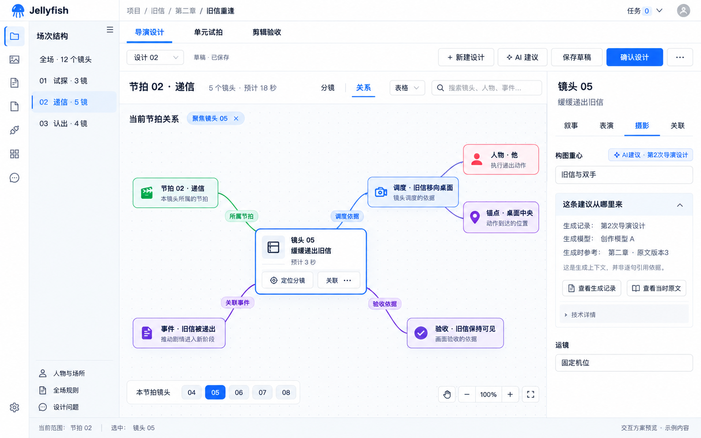

> 2026-09-15。C1–C5已完成，MC交互与视觉验收通过，逐项证据见第9节。最终复核已移除试拍和剪辑中央重复的对象选择器，相关业务回归重新通过。当前行为已同步架构与指南；A/B 阶段的参考图和历史验收结论保留。后端静态检查的 5 项既有问题单独记录，不宣称全仓库零告警。

## 1. 目标与依据

### 1.1 当前问题

以 `99376f9` 的实现为评估基线：

1. `DesignEditor` 左侧同时列节拍和镜头，中央再次列镜头；点击节拍或左侧镜头会强制切回清单，范围选择与展示方式耦合。
2. `DesignRelations` 主要围绕此前选中的镜头展开，没有完整承接当前节拍范围；用户难以区分切换范围、切换视图和选中对象。
3. `DesignFields` 直接输出来源的 `kind / reference / version`，用户看到的是内部标识。`model` 来源的 `reference` 在当前生成流程中使用生成来源标识，不一定是模型 ID，也不能默认等同于任务主键。
4. 顶部阶段入口、中央视图切换、右侧详情页签均较醒目，视觉层级接近，缺少清晰职责区分。

### 1.2 推荐方向

**中央工作区承担主要展示和操作；左侧选择范围，右侧解释与编辑所选对象。**

- 分镜编排是日常主视图，适合阅读动作顺序、画面安排与节奏。
- Graph 是关系设计工具，负责解释和修改对象之间的关联。
- 表格是辅助视图，用于密集比较、查找缺项及批量核对。
- 导演设计、单元试拍、剪辑验收保留为三个工作空间，分别提供适合其任务的对象与工具。
- 字段来源先展示可读来历，再按需查看记录和技术详情。

不将所有工作统一塞入 Graph。增加节点交互可以改善关系设计，但不能替代大量镜头的顺序阅读、时长比较和精确字段编辑。

### 1.3 与既有计划的关系

- [全站布局统一与场次工作台重设计计划](/docs/plans/frontend-shell-and-sequence-workbench-plan/)的 MA、MB 和归档截图保留为已交付事实。
- 本方案采用 C1–C5 独立推进。设计页原“默认镜头清单、左侧展开镜头树、三种同等级视图页签”的交互已由本文规则替代，当前事实同步至架构。
- 顶部品牌与面包屑、全局窄栏、业务侧栏、阶段与版本工具栏、右侧详情、底部状态的区域关系继续沿用。桌面规范值仍以旧计划第 2.3 节为准，不另建一套全站外壳。
- 既有版本、草稿保护、固定输入、真实媒体区间、任务状态及人工采用边界继续成立。
- 不新增节点执行引擎、完整多轨剪辑、自动采用、虚构来源或逐次编辑历史。用户已取消的五秒测试不重新引入。

## 2. 四层职责

| 层级 | 回答的问题 | 主要区域 | 例子 |
| --- | --- | --- | --- |
| 工作空间 | 现在完成哪类工作？ | 顶部阶段入口 | 导演设计、单元试拍、剪辑验收 |
| 当前范围 | 正在处理哪些内容？ | 左侧导航 | 全场、节拍02、指定生产计划内的单元 |
| 展示方式 | 怎样查看当前范围？ | 中央轻量工具栏 | 分镜、关系、表格 |
| 所选对象 | 正在检查或修改谁？ | 中央选择联动右侧详情 | 镜头05、某个人物、某个剪辑片段 |

左侧不再兼任视图切换器。中央选择对象不自动改变左侧范围；只有明确的“进入该节拍”等操作改变范围。

### 2.1 左侧导航

设计空间默认结构：

```text
场次结构
  全场 · 12 个镜头
  01 试探 · 3 镜
  02 递信 · 5 镜
  03 认出 · 4 镜

人物与场所
全场规则
设计问题
```

- 不再默认展开镜头子树。镜头定位由中央分镜、搜索、表格和关系画布完成。
- 全场、节拍是范围入口；人物与场所、全场规则、设计问题是辅助工具入口，用间距和分隔线与范围分组区分。
- 打开辅助工具时保留当前范围和编辑内容，关闭后回到原位置。
- 节拍名称取已有内容；空名称显示“未命名节拍”，不编造叙事内容。
- 跨节拍镜头保持一个对象身份，可在相关节拍中出现；全场镜头数与时长按镜头去重，各节拍统计明确表示关联镜头，不能相加冒充全场统计。
- 未归入节拍的镜头在全场可见，有实际数据时提供“未分组”范围入口，不能因取消镜头树而失去入口。

### 2.2 范围、视图和选择的切换规则

| 用户动作 | 预期行为 |
| --- | --- |
| 首次进入设计空间或节拍 | 默认分镜；全场按节拍组织，节拍内展示其关联镜头 |
| 从分镜切到关系或表格 | 保留当前范围与所选镜头；滚动、缩放按视图分别记忆 |
| 在关系视图点击另一节拍 | 保持关系展示，不强制切回清单 |
| 新范围包含此前选择 | 保留所选对象；显示其在当前范围内的关联 |
| 新范围不包含此前选择 | 取消过期选择，右侧显示新范围概览，不静默选中任意镜头 |
| 点击中央镜头或节点 | 更新右侧详情，不重置范围，也不自动重排关系画布 |
| 搜索或问题筛选 | 明确作用于当前范围；显示筛选条件并支持一键清除 |
| 筛选隐藏当前选择 | 明示“所选对象不在当前筛选结果中”，提供清除筛选；不保留无解释的详情 |
| 切换设计版本 | 只保留在新版本仍有效的范围与对象身份；失效则回全场或范围概览，清除旧图片来源绑定选择 |
| 返回或业务回跳 | 恢复合法的工作空间、范围、视图和对象；未保存内容继续走既有保护规则 |

跨节拍对象展开不自动扩大范围。显式点击“进入来源节拍”才切换范围，并提供返回位置。

## 3. 中央展示方式的主次

| 方式 | 主任务 | 入口与地位 |
| --- | --- | --- |
| 分镜 | 动作顺序、画面安排、预计节奏、镜头选择与编排 | 默认主视图 |
| 关系 | 理解与修改节拍、事件、人物、调度、验收等关联 | 与分镜相邻的主要设计工具 |
| 表格 | 比较时长、缺项、状态，进行密集或批量核对 | 工具栏辅助入口，可切换为当前展示方式 |

中央工具栏显示明确范围，例如“节拍02 · 递信 / 5个镜头 / 预计18秒”，展示方式使用轻量切换，视觉权重低于工作空间入口。表格即使从辅助入口进入，也必须显示当前激活状态，并能直接返回分镜或关系。

### 3.1 分镜编排

- 卡片主要显示编号、可见动作、预计时长和待处理问题；完整规则在右侧详情或全场规则工具中查看。
- 无画面时使用明确占位与动作短句，仍可选择、编辑和编排，不以生成图片作为使用前提。
- 图片继续要求持久化绑定、精确版本/镜头匹配和显式来源选择；多个候选不自动取最新。
- 支持镜头顺序调整，并提供键盘等价操作。节拍过滤视图下调整顺序时，必须明确作用于当前设计的镜头序列；其他未选镜头相对顺序保持，跨节拍镜头不会复制为新对象。
- 1/12/60/200 镜头均可定位；大集合只渲染可见内容。

### 3.2 Graph 的范围与交互

全场关系视图先按节拍聚合；进入节拍后展示该节拍镜头及有关对象。选择“聚焦此对象”进一步缩小到对象直接关联，并显示可退出的聚焦标记。

| 操作 | 行为与约束 |
| --- | --- |
| 单击节点 | 更新右侧详情；画布不突然重排 |
| 聚焦此对象 | 展开直接关联；退出后恢复此前视角 |
| 定位分镜 | 在同范围分镜中定位同一镜头；被筛选遮挡时明确清除条件或提示 |
| 添加关联 | 选择合法对象与关系类型，修改现有业务引用 |
| 点击连线 | 显示关联含义，提供修改或解除关联 |
| 点击问题标记 | 定位对应字段及有关对象，展示真实问题依据 |
| 修改共享对象 | 编辑前显示影响镜头；保存仍更新唯一对象 |
| 展开跨节拍关系 | 标明“来自节拍03”等边界，按需展开，保留返回入口 |
| 拖动节点 | 只调整视角布局；不修改镜头顺序、关联或执行状态 |

额外边界：

- 解除关联与删除对象是不同动作，不共用含糊的“删除”入口。
- 只允许编辑契约中合法、可写的直接关联；间接关系标明路径，定位到原始关联进行修改，不能直接删除一条推导边。
- 缺失引用保留可识别入口，允许修复；不能自动连接同名对象。
- 关系类型以当前契约为准，不把所有节点做成任意连线端口。
- 节点操作提供可见按钮或菜单及键盘入口，不仅依赖右键、双击或悬停。
- 图片中的连线表达业务关联，不表达生成执行顺序。

## 4. 可读来源

### 4.1 两级展示

字段旁显示简短摘要，点击后在右侧展示来源卡片，返回字段时保留输入、选择和滚动位置。避免逐层打开大抽屉。

| 来源 | 字段旁摘要示例 | 展开后主要内容 |
| --- | --- | --- |
| 人工 | 人工填写 | 已记录的填写者、说明；未知信息不补造 |
| 模型 | AI建议 · 第2次导演设计 | 生成记录、当时模型、生成输入上下文、查看记录 |
| 章节 | 章节原文 · 第3版 | 章节名称、准确版本、已记录的段落范围、查看当时原文 |
| 文件 | 参考视频 · 00:12–00:15 | 文件名称、媒体预览、准确区间、文件来源 |
| 版本 | 继承自设计02 | 版本名称、身份与修订、已记录的对应对象、打开只读历史 |

“第2次”等人类可读标签须按真实记录稳定生成，不能使用过滤后的列表序号冒充固定身份。多个来源全部可达，摘要可显示“另2项”。

来源卡片示例：

```text
这条建议从哪里来
生成记录：第2次导演设计
生成模型：当时使用的模型名称
生成时参考：第二章 · 原文版本3

这是生成上下文，并非逐句引用依据。
查看生成记录    查看当时原文
技术详情 ▸
```

### 4.2 内容依据与生成记录分开

- **内容依据**：有明确记录的原文段落、图片、媒体区间或历史对象引用。
- **生成记录**：内容由哪次生成产生，以及当时使用的模型和输入。
- 模型曾参考某段原文，不等于每个字段都有该段原文的直接依据。没有字段级映射时仅展示“生成时参考”。
- 来源类型、Note 内容状态与版本确认状态分别表达；“AI建议”不等于已确认，也不生成置信度百分比。
- 人工改写后的来源按实际记录显示，不从旧版本差异推断不存在的作者、时间或完整编辑链。

### 4.3 解析和数据边界

当前任务快照包含 `model_name`、`provider_key`、`run_args` 等信息，但场次任务读取接口未完整提供来源展示信息。实施前须核对已有接口可用信息，再补最小查询契约：

1. 按来源类型解析。`model` 来源通过准确的生成来源标识关联任务快照，不默认拿 `reference` 直接查询模型或任务主键。
2. 限定项目、场次及相关历史版本归属；不按“最新任务”“同名模型”或相似文本猜测来源。
3. 优先展示生成时保存的名称；当前模型改名或删除不能改写历史来历。只有当前名称时明确区分，不冒充历史名称。
4. 无法解析时显示“历史生成记录暂不可用”等可读说明；原始类型、标识、版本仍可在技术详情查看及复制。
5. 原文片段、文件区间、修改者、时间仅在有真实记录时显示。无完整历史时不构造历史。
6. 解析采用按需或批量读取，避免每个字段各自发起重复请求；跨对象切换时忽略迟到结果。
7. 只返回展示需要的名称、历史上下文及受控跳转目标，不直接暴露供应商原始响应或完整任务输入快照。
8. 保留现有来源标识与版本作为业务依据，可读标签不成为第二套可编辑真值。

已增加只读批量来源接口并同步 OpenAPI、generated client；当前实现边界见[可读来源解析](/docs/architecture/directing-foundation/#可读来源解析)。来源异常与完整跨阶段回归已通过 C5 验收，详见第 9 节。

## 5. 三个工作空间采用同一组织逻辑

| 工作空间 | 左侧范围/对象组织 | 中央主要工作 | 右侧详情 |
| --- | --- | --- | --- |
| 导演设计 | 全场、节拍 | 分镜编排与关系设计；表格辅助 | 镜头、人物、调度等对象 |
| 单元试拍 | 当前生产计划内的单元 | 参考准备、指令、审稿、候选比较 | 参数、检查与冻结输入 |
| 剪辑验收 | 候选素材和筛选 | 播放器与时间线 | 素材审片、片段区间、接缝 |

- 顶部三个入口保持稳定名称与位置；它们切换工作空间，内部视图使用较轻的控件。
- 左侧不再重复阶段入口；各空间按自身对象组织，不强行让试拍、剪辑沿用节拍树。
- 保存与确认属于当前空间的版本工具栏。任务、版本历史、来源不变成额外业务阶段。
- 从某镜头进入试拍，按精确设计/计划关联定位；多个候选单元时提供选择，无关联时说明并给出合法准备入口。
- 一个单元可以覆盖多个镜头或节拍；一个 Take 可以多次作为不同剪辑片段采用，不能用同名对象替代完整身份。
- 每个空间恢复自己的有效选择、范围和滚动位置；切换继续保护未保存内容。打开来源、任务、历史不替换编辑基线。
- 试拍显示所选指令真正冻结的输入，生成成功只登记候选。加入/保存粗剪仍不等于设为当前采用。

### 5.1 内部切换与主工作区

三个空间统一区域职责，但中央工具随任务变化，不复制同一组 Tab。

| 空间 | 中央始终明确的主要内容 | 内部切换的作用 | 不应出现的重复 |
| --- | --- | --- | --- |
| 导演设计 | 当前全场或节拍的镜头 | 分镜与关系切换同一范围的表达；表格提供密集核对 | 左侧再列一套镜头清单，或点击节拍后新开一组同义 Tab |
| 单元试拍 | 当前单元的准备与拍摄内容 | 参考、指令、审稿按准备任务组织；候选区承接拍摄结果 | 用内部 Tab 再选择生产单元，或把任务日志当作内容阶段 |
| 剪辑验收 | 当前素材播放器和粗剪时间线 | 右侧切换素材审查、片段区间与接缝详情，保留播放和时间线位置 | 用一个与播放器同级的大 Tab 隐藏整个时间线，或在左侧重复验收阶段 |

单元试拍的主操作随实际准备状态显示，例如“编译指令”“开始拍摄”；剪辑验收围绕“检查素材 → 选择区间 → 加入粗剪 → 审查接缝”展开。检查未通过时在相应对象附近解释阻塞原因，不用长篇全局说明替代操作入口。

### 5.2 任务记录、版本历史与创建操作

- **任务记录**回答“某次执行是否完成”：展示进度、失败原因、取消及业务回跳。入口放在全局任务区或工具栏任务按钮，执行中的任务可显示紧凑状态；完整日志不占中央内容页签。
- **版本历史**回答“正在查看或确认哪份内容”：入口跟随版本工具栏，支持只读查看和比较。一次任务可能失败或产生候选，不能据此虚构一个已确认内容版本。
- **字段来源**回答“这条内容从哪里来”：从字段进入来源卡片，必要时跳到对应任务或只读版本，返回后保留编辑位置。
- **方案选择与手动起稿**属于版本及创建操作，放在顶部上下文工具栏；无内容时可在空态提供创建入口。已有内容时不作为中央正文卡片长期占位。

### 5.3 典型交互验收路径

1. 进入导演设计，默认看到分镜；选择节拍02后仅展示其关联镜头。
2. 切换关系视图，选中镜头05，右侧显示镜头详情；查看来源再返回，仍保持当前节拍、对象和画布位置。
3. 点击关联线，直接关联可修改；间接关系说明路径并定位真实拥有该引用的对象。共享对象编辑前显示受影响镜头。
4. 点击“查看对应试拍单元”，按当前设计版本给出准确关联；存在多个单元时明确选择，无关联时进入准备入口。
5. 进入剪辑验收后围绕实际 Take 和片段操作；打开任务或历史不改变采用状态，返回设计仍能恢复有效上下文。

## 6. 预览与视觉约束



图为本次对话生成的概念预览，已归档为本页资源，供本地 Markdown 与文档站读取。它展示关系视图激活时的状态，不改变“首次进入默认分镜”的规则。

需要落实的关系：

- 左侧仅展示范围，不重复镜头清单。
- 中央明确显示当前节拍；分镜/关系为主要切换，表格为辅助入口。
- 关系节点能定位分镜和编辑关联；右侧显示可读来源及受控回跳。
- 品牌、顶部上下文、全局窄栏、业务侧栏与详情区位置沿用已有框架。

图中的人物、计数、模型名称、来源记录和文案均为示例，不作为真实数据或完成证据。节点图标、边的方向、字段排列和布局尺寸以业务契约及文字规格为准；不得将画面中的勾号等图形误用为已验收状态。原 A/B 参考图及其验收档案不覆盖、不替换。

响应式继续检查 1586×992、1440×900、1024×768、768×1024、375×812。窄屏范围与详情使用明确入口，所选范围保持可见；画布自身可平移，整页不横向溢出，主要按钮不进入底部状态栏覆盖范围。

## 7. 实施阶段与完成门槛

| 阶段 | 状态 | 任务 | 验证与依赖 |
| --- | --- | --- | --- |
| C1 范围与导航 | 已完成 | 四层状态分离、移除默认镜头树、节拍范围统一、默认分镜、视图记忆、辅助表格入口 | 导航/过滤/选择测试；无图及1/12/60/200镜头；为C3提供范围基础 |
| C2 可读来源 | 已完成 | 分类型解析、简短摘要、来源卡片、历史名称、缺失状态和必要接口 | 精确归属/历史快照/迟到结果/失败测试；可与C1并行 |
| C3 中央设计操作 | 已完成 | 分镜编排、范围内Graph、聚焦/返回、节点与连线操作、共享影响提示 | 依赖C1；来源入口接入C2；覆盖跨节拍、直接/间接关联和键盘操作 |
| C4 工作空间一致性 | 已完成 | 三空间层级、版本工具栏、状态恢复及一对多业务回跳 | 复用C1/C2规则，验证跨计划同名单元、多次采用同Take和草稿保护 |
| C5 综合验收 | 已完成 | 完整流程、视觉与响应式、来源异常、回归、架构及指南同步 | C1–C4完成后执行，下列验收项逐项归档才通过MC |

### 7.1 验收清单

| 编号 | 完成证据要求 |
| --- | --- |
| C-A01 范围 | 左侧节拍选择只改变范围，不强制切换展示方式；全场、未分组与跨节拍内容可达，统计不重复 |
| C-A02 展示主次 | 首次进入默认分镜；关系入口清晰；表格为辅助入口但批量核对、精确编辑能力保持；三者服从同一范围 |
| C-A03 选择与返回 | 切视图保留同一对象，切范围和版本正确处理失效选择；搜索遮挡有说明；聚焦、来源、历史、任务往返不丢输入 |
| C-A04 大集合 | 1/12/60/200镜头可查找、定位、滚动与键盘选择；全场Graph先聚合，分镜虚拟化及显式图片绑定保持 |
| C-A05 关系操作 | 单击不重排；合法关联可添加/修改/解除，间接边定位原关系；删除对象单独表达，共享修改显示影响范围 |
| C-A06 编排 | 调整镜头顺序只改变声明的序列；过滤外镜头相对顺序保持；跨节拍镜头身份和合法关联不丢失；拖图节点不改顺序 |
| C-A07 来源可读 | 五种来源有可读摘要与展开详情；模型来源精确解析，历史名称不被当前配置覆盖；技术标识退出默认阅读层 |
| C-A08 来源可信 | 缺失/已删除/无法访问/迟到响应有明确状态；跨项目来源不可读；生成上下文不冒充字段依据，无虚构时间、作者和历史 |
| C-A09 工作空间 | 三空间主要对象与工具清晰；多单元映射明确选择；空间切换与业务回跳保留精确身份和未保存保护 |
| C-A10 业务边界 | 确认版本不可原地改写；固定输入、任务状态、候选审查、草稿和采用分别表达；真实媒体区间与预演不混淆 |
| C-A11 视觉与响应式 | 规定视口下框架连贯，范围/视图/详情层级清晰；主操作与底部播放按钮无遮挡，图片和来源详情正常读取 |
| C-A12 交付 | 类型检查及适用回归通过；若改接口，后端/OpenAPI/generated client同步；架构/指南只在实现后更新，最终证据归档 |

### 7.2 验证入口

- 前端实现后从项目根目录执行 `pnpm --dir front run typecheck`。
- 按影响更新 `front/tests/README.md` 中的设计视图、布局、使用、引导、生产、剪辑、延迟保存、响应式及连续主流程回归；新增有行为价值的范围、关系编辑和来源解析覆盖。
- 后端应用代码改变时运行相关测试及 `backend` 目录的 `uv run pylint app`；对外契约改变时，在确认运行的是当前后端后，从项目根目录执行 `pnpm --dir front run openapi:update`。
- 全站框架不变时复用其已有证据；若共享布局或导航改变，补跑对应全站回归。已通过且行为未改变的检查不机械重复。
- 使用隔离接口与合成媒体验证交互，不把模型艺术质量作为布局或来源显示的通过依据。
- 实施截图、结果和源文件指纹归档到 `site/static/images/directing-workbench/refinement/`，与B5历史证据分开。MC未通过前列出具体未完成项。

## 8. 产品参考与记录

- [Figma：设计文件的区域与职责](https://help.figma.com/hc/en-us/articles/15297425105303-Explore-design-files)：借鉴左侧组织、中央操作、右侧所选对象属性的职责分工。
- [Milanote：嵌套画板](https://help.milanote.com/en/articles/9860073-nesting-boards)：借鉴分层进入内容范围，避免主画板承载所有细节。
- [DaVinci Resolve：按任务划分工作空间](https://www.blackmagicdesign.com/products/davinciresolve)：借鉴工作空间切换与内部专用工具的层级。

这些资料用于交互设计参考，不代表直接复制其功能、布局或业务模型。

| 日期 | 记录 | 验证 | 下一步 |
| --- | --- | --- | --- |
| 2026-09-15 | 方案与概念预览归档，新增独立计划并链接既有A/B计划 | 本地图片存在性与文档站构建/引用检查 | C1–C5均待实施；本轮不改应用代码 |
| 2026-09-15 | C1/C3 初步实现：默认分镜、范围与视图分离、过滤内编排、关系编辑与节点布局移动；修复连线点击被画布拖动截获 | 类型检查、8项设计行为测试通过；12镜头隔离浏览器覆盖范围/选择/过滤/编排保存/解除关联；整体 MC 未通过 | 补齐状态恢复、大集合与完整响应式验证，继续 C2/C4；窄屏详情入口遮挡说明已修复，浏览器复测与375px截图核对通过 |
| 2026-09-15 | C2 来源解析服务初稿：准确生成身份、历史模型名、原文摘录、版本匹配与文件归属校验 | 3项隔离数据库测试通过；全应用 Pylint 剩余5项既有问题（task_worker两项、studio_assets、lab_generation_tasks、task_queries各一项），本次新增模块无检查问题；尚未接入公开接口与前端，不能视为来源功能已完成 | 补充异常覆盖、API/generated client、来源卡片与业务跳转 |
| 2026-09-15 | C2接口与前端接通，设计/指令/参考/审稿/剪辑观察复用可读来源；来源卡片保留字段、只读历史及迟到隔离；C4开始保存设计浏览范围/视图/对象；缺失关系入口可修复 | 12项前端行为测试、7项来源/API测试、两组隔离浏览器与类型检查通过；OpenAPI只新增来源查询及3个相关schema；文档站构建通过；Pylint仍为上述5项既有问题 | C1–C4尚未整体验收：补齐大集合、范围返回画布位置、一对多业务回跳、真实媒体来源预览及各阶段完整回归，最后执行C5/MC |
| 2026-09-15 | 中间验收：范围、节点与来源操作，三空间状态恢复和精确业务回跳落地；修复平板版本栏溢出和完整关联重载丢失缩放 | 48项前端行为测试、8项后端测试、11组浏览器回归及64个响应式状态通过；类型检查、接口语义差异及文档站验证完成 | 最终视觉复核发现试拍/剪辑中央仍有重复选择入口，收口后复测；保留5项无关静态检查问题，未调用真实模型，不将合成媒体验证当作成片质量证明 |
| 2026-09-15 | 最终视觉复核收口：移除试拍中央单元选择器与剪辑中央候选选择器；左侧统一对象选择，中央只展示上下文 | 受影响的9组浏览器回归全部重新通过，含窄屏键盘选择与草稿保护；修正主流程测试缺少返工必填字段及渲染等待的覆盖漏洞 | MC通过，最终截图和输出替换为复测结果 |

## 9. 交付验收

**MC通过。** 以下记录与最终中央重复入口收口后的结果对应，试拍、剪辑、引导、使用、写入、布局、响应式和主流程已重新通过。尚未自动提交 commit。原 A/B 档案保留，本轮证据独立存放于 `site/static/images/directing-workbench/refinement/`。

[验证清单与边界](/images/directing-workbench/refinement/verification.json)包含11组浏览器结果目录。代码及测试指纹见[源文件指纹](/images/directing-workbench/refinement/source-fingerprints.json)。关系类型记忆由范围交互与大集合回归验证；重复入口移除后补跑了全部受影响的业务、布局与响应式用例。来源和后端证据复用未改变代码下的通过结果。

| 验收项 | 结论与可核对证据 |
| --- | --- |
| C-A01 范围 | 通过。[范围交互](/images/directing-workbench/refinement/workspaceRefinement/results.json)及[48项行为测试](/images/directing-workbench/refinement/unit-output.txt)覆盖全场、节拍、未分组、跨节拍去重与失效选择。 |
| C-A02 展示主次 | 通过。范围交互证明默认分镜、关系保持范围、辅助表格共享选择；[布局几何](/images/directing-workbench/refinement/sequenceWorkbench/results.json)核对固定框架尺寸。 |
| C-A03 选择与返回 | 通过。范围交互覆盖聚焦返回、关系类型与缩放重载、设计到试拍返回；[大集合回归](/images/directing-workbench/refinement/workspaceDesignViews/results.json)覆盖版本切换、表格/分镜滚动恢复；[来源回归](/images/directing-workbench/refinement/sourceProvenance/results.json)验证返回不丢输入与迟到隔离。 |
| C-A04 大集合 | 通过。大集合回归覆盖1/12/60/200镜头、键盘首尾定位、虚拟渲染、全场节拍聚合以及错版和多来源预演；没有以自动取最新图片补空。 |
| C-A05 关系操作 | 通过。范围交互验证节点选择不重排、添加合法引用并保存、解除关联不删对象、缺失引用修复、间接边键盘定位原始对象；行为测试覆盖合法引用更换与必填约束。共享影响取实际关联镜头。 |
| C-A06 编排 | 通过。范围交互保存并核对过滤外位置不变、跨节拍对象不复制；键盘移动图节点不发业务写入。 |
| C-A07 来源可读 | 通过。来源回归覆盖五类来源、人类可读历史模型、生成上下文、只读历史、技术详情默认折叠、真实媒体区间播放。 |
| C-A08 来源可信 | 通过。[8项后端测试](/images/directing-workbench/refinement/backend-output.txt)覆盖精确生成身份、项目/场次归属、冲突历史、删除文件和无效区间；来源回归覆盖失败重试、媒体错误、请求去重及迟到响应。 |
| C-A09 工作空间 | 通过。左侧是单元和候选素材的统一选择入口，中央仅显示当前对象摘要，窄屏从“场次导航”选择。范围交互验证一对多计划/单元选择和试拍筛选/滚动恢复；[剪辑回归](/images/directing-workbench/refinement/workspaceCut/output.txt)验证同Take多片段、精确片段/筛选/缩放/时间线恢复；[写入保护](/images/directing-workbench/refinement/workspaceWrite/output.txt)覆盖延迟写入、失败与离开保护。 |
| C-A10 业务边界 | 通过。[完整主流程](/images/directing-workbench/refinement/workspaceJourney/results.json)从项目创建走到精确区间粗剪与局部返工；[试拍](/images/directing-workbench/refinement/workspaceProduction/output.txt)、[使用](/images/directing-workbench/refinement/workspaceUsage/output.txt)及[引导](/images/directing-workbench/refinement/workspaceGuidance/output.txt)核对固定输入、任务隔离、人工采用与业务回跳。 |
| C-A11 视觉与响应式 | 通过。1586×992框架几何及三空间截图、[四尺寸×16状态](/images/directing-workbench/refinement/workspaceAcceptance/results.json)覆盖1440×900、1024×768、768×1024、375×812；检查实际内容宽度、主要按钮边界与命中，包含关系图和来源卡片。 |
| C-A12 交付 | 通过。[类型检查](/images/directing-workbench/refinement/typecheck-output.txt)、[接口差异](/images/directing-workbench/refinement/openapi-diff.json)、[文档构建](/images/directing-workbench/refinement/hugo-output.txt)已核对；架构与操作指南同步。[Pylint结果](/images/directing-workbench/refinement/pylint-output.txt)为5项既有问题，本次新增模块无告警。 |

### 9.1 实际页面

以下为真实页面的隔离数据截图，区别于第6节概念预览。品牌、顶栏、窄导航、业务侧栏、阶段栏与详情区保持已确认框架，关系图操作服从真实数据引用。


### 9.2 验证边界

- 浏览器使用隔离接口与合成媒体，覆盖交互和请求契约，不证明真实模型艺术质量；响应式为 Chromium CSS 视口检查，不宣称全部浏览器或真实手机硬件通过。
- 全应用 Pylint 执行完成但退出码为30：`task_worker`两项，`studio_assets`、`lab_generation_tasks`、`task_queries`各一项，均为既有问题。本轮未扩大范围修改这些模块。
- 当前来源快照缺失时保持不可用状态，不反推作者、模型名称、历史版本或字段级引用。当前计划没有要求补造这些历史数据。
