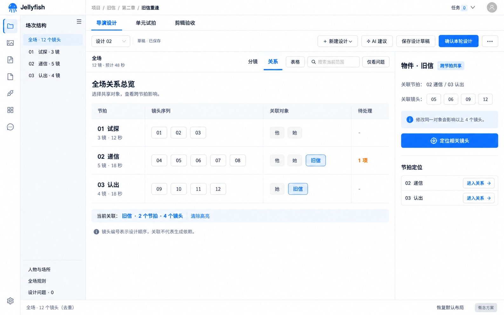

> 2026-09-16。两轮方案已合并实施，D1–D4完成，最终里程碑MD验收通过。以 `742d349` 为评估基线，C阶段历史记录保留；当前行为已同步架构与指南，逐项证据见第9节。

## 0. 合并范围与执行状态

此前的“全场关系总览优化计划”和后续“优化计划”链接指向同一文件，分别描述关系总览与镜头展示两部分。本次统一范围、依赖、阶段交付与验收，不再作为两套独立计划执行。

| 合并来源 | 保留的完整范围 | 主要实施阶段 |
| --- | --- | --- |
| 全场关系总览方案 | 保留全场入口；紧凑节拍行、真实共享引用、去重统计、工具分层、影响高亮、进入节拍及返回 | D3 |
| 分镜与清单方案 | 镜头/关系主视图；分镜/清单展示切换；紧凑分镜、画面来源、清单字段、真实顺序及排序操作 | D1、D2 |
| 两者共同要求 | 统一选择、范围和筛选；草稿保护、状态恢复、跨视图定位；规模、键盘与响应式验收 | D1建立规则，D2/D3分别落实，D4综合验收 |

- 合并时两部分均未实施；现已完成实现及独立验收。概念图与方案构建不作为功能完成证据，第9节记录真实页面与回归结果。
- C阶段已交付内容作为基线保留。品牌位置、左侧导航、面包屑及整体布局沿用既有框架，本轮不重新设计全站外壳。
- 本轮集中优化导演设计；单元试拍与剪辑验收仅验证相关业务回跳，不扩展重设计范围。
- 具体展示和交互以第2–4节为统一规格；实施阶段只分配工作和验收责任，不另设重复规则。

## 1. 评估与决策

### 1.1 当前问题

当前 `DesignRelations` 在全场且未聚焦对象时，通过独立分支展示节拍入口卡片：

- 中央主要重复左侧节拍导航，未充分表达跨节拍关系。
- “镜头关联 / 人物调度 / 完整关联”影响详细图的节点过滤，不影响全场卡片；全场切换后内容相同。
- 网格卡片占满可用区域，内容少时也产生大量空白；每个节拍重复两个操作按钮。
- 全场卡片仍显示图形缩放控件，控件与当前展示不匹配。

### 1.2 推荐结论

**保留“全场 · N个镜头”的点击交互，将全场关系视图改为紧凑关系总览；节拍内继续使用详细 Graph。**

| 选项 | 评价 |
| --- | --- |
| 取消全场，只保留节拍入口 | 简化导航，但整场浏览、全场搜索、跨节拍比较失去直接入口，也影响分镜和清单的范围选择，不采用 |
| 仅缩小原卡片 | 可以减少空白，但中央仍主要重复导航，不足以解决职责问题 |
| 保留全场，重做关系总览 | 全场负责比较和发现问题，节拍负责具体编辑，采用此方向 |

全场关系总览按**节拍**组织，用于观察共享对象和跨节拍影响；镜头清单按**镜头**组织，用于比较字段、时长和缺项。分镜与清单属于同一镜头工作区的两种展示方式，不再将表格作为独立按钮切换的第三个主视图。

### 1.3 分镜与表格的问题及决策

- 当前分镜无画面仍保留120px图片占位，卡片行高约268–300px；动作只显示一行，叙事作用未展示，空间分配与信息价值不匹配。
- 每张卡片常驻前移、后移及“未记录问题”，顶部常驻预演来源选择，重复操作与辅助设置过于突出。
- 当前全场按镜头的第一个有效节拍分组。若01、03属于同一节拍而02属于另一节拍，展示可能变为01、03、02，与真实镜头顺序不同；键盘定位也必须与可见顺序统一。
- “表格”外观是操作按钮，实际替换整个中央视图；进入后两个主Tab均不选中。它目前是选择镜头并联动右侧详情的清单，不具备电子表格式单元格编辑或批量操作。
- “本场意图”和“全场概览”不应仅出现在清单中，应归属全场上下文。

**采用“镜头 / 关系”两个主视图；镜头内提供“分镜 / 清单”轻量展示切换。** Graph负责关联解释与编辑，不能替代按顺序阅读分镜及对齐字段比较。

## 2. 展示结构

### 2.1 保持已有框架

沿用品牌、顶栏与面包屑、全局窄导航、业务侧栏、阶段及版本工具栏、中央工作区、右侧详情和底部状态栏的既有区域关系。初次进入导演设计默认“镜头 → 分镜”，后续记忆用户选择；切换范围不强制改变主视图或展示方式。

左侧继续提供全场、各节拍，以及有实际数据时的未分组入口。人物与场所、全场规则、设计问题仍是辅助入口。

### 2.2 全场关系总览

用紧凑节拍行替代大卡片网格，每行由以下内容组成：

| 区域 | 内容与作用 |
| --- | --- |
| 节拍 | 编号、名称、关联镜头数与预计时长 |
| 镜头序列 | 紧凑编号按钮，按当前设计中的真实镜头顺序排列；选择后联动详情 |
| 关联对象 | 人物、物件、事件等可读标签；选择后查看跨节拍影响 |
| 待处理 | 实际问题数量，点击定位问题对象或问题列表 |

- 桌面常规行高建议约64–88px，必要时换行；不为了填满屏幕拉高每一行。
- 使用浅分隔线和轻量选中状态，不嵌套大卡片，不重复常驻“查看详情”和“进入关系”按钮。
- 全场数量与预计时长放在标题或状态栏，不再占单独的统计卡片。
- 默认不绘制全部关系线。选中对象时高亮相关节拍、镜头和对象标签，其他内容降低视觉权重但仍可操作。
- 共享对象关联多处时使用同一业务身份；高亮是当前已有引用的可视表达，不创建新的关联。
- 默认优先展示跨节拍共享对象，其他已关联对象通过展开入口查看；不能仅显示热门或同名对象而遗漏实际引用。

### 2.3 分层工具

| 当前展示 | 工具 |
| --- | --- |
| 全场关系总览 | 搜索、问题过滤、清除高亮、普通滚动；隐藏三种详细关系预设和缩放控件 |
| 节拍关系 Graph | 保留镜头关联、人物调度、完整关联，以及缩放、平移、聚焦和合法关联编辑 |
| 镜头主视图 | 分镜/清单轻量切换、搜索和问题过滤；分镜提供密度及画面显示设置，不出现关系图工具 |

详细图的关系类型和视角仍需记忆；返回全场隐藏不适用的控件，不清空此前节拍图的状态。未分组关系范围继续可操作，不因隐藏全场图形工具而被误当作总览。

### 2.4 镜头主视图与清单职责

中央主切换为“镜头 / 关系”；在镜头工具栏提供“分镜 / 清单”轻量切换，不增加两排厚重Tab，移除独立“表格”按钮。两种展示共用同一镜头集合、范围、搜索、问题过滤、选中身份与右侧编辑。

| 展示 | 主要任务 | 内容 |
| --- | --- | --- |
| 分镜 | 依次阅读动作、观察画面衔接 | 按真实镜头顺序排列的卡片，突出动作、画面与时长 |
| 清单 | 快速扫描、比较字段与发现缺项 | 镜号、可见动作、叙事作用、节拍、预计时长、问题 |
| 关系 | 理解共享对象及引用影响 | 全场紧凑节拍行，节拍内详细Graph |

清单保持点击行联动右侧详情的编辑方式，本次不扩展单元格编辑、多选或批量编辑。“本场意图”归入全场上下文或右侧全场详情；在两种镜头展示中均有明确入口，不让清单承担额外业务职责。

### 2.5 分镜密度、画面与顺序

- 无图时默认使用紧凑文字分镜，不保留大块空图片占位：镜号、预计时长、最多两行可见动作、一行叙事作用摘要、节拍标签及实际问题入口。完整内容可在右侧读取。
- 无问题时不逐卡重复“未记录问题”；存在问题时展示数量和可定位入口。缺失动作或时长仍明确提示，不能以空白隐藏缺项。
- 用户可启用“显示画面”，使用统一比例的画面区；显式启用后无图镜头显示简洁缺图状态以保持网格稳定。收起画面时回到文字分镜，不自动随素材到达改变布局。
- “画面来源”收进展示设置，需要时展开。保留设计版本、已保存预演绑定和多来源明确选择规则，不自动使用最新图片，不将预演画面当作实际拍摄覆盖。
- 全场默认紧凑密度，镜头连续按真实设计顺序排列；节拍用标签表达，不按首个关联节拍重排。节拍范围仅筛选镜头，保留全场镜号与相对顺序，可手动调大卡片。
- 跨节拍镜头在全场分镜和清单中只展示一次，标明多个节拍；关系总览可在多个节拍行引用同一镜头，两种语义明确区分。
- 移除每张卡片常驻的前移/后移按钮，选中后提供紧凑排序入口及键盘操作。拖动仅可作为补充，不是本次必需项或唯一操作方式。
- 筛选状态下沿用“调整当前筛选镜头在设计序列中的位置，其他镜头顺序保持”的语义，在排序操作处明确说明结果；排序后展示、编号、选中身份和键盘遍历保持一致。
- 大集合继续虚拟滚动；不为每个节拍新增独立滚动容器。展示方式和密度由用户选择并记忆，不按数量自动跳转清单。

## 3. 交互规则

| 用户动作 | 行为 |
| --- | --- |
| 点击左侧全场 | 将范围切到全场，保持镜头/关系主视图及镜头内的分镜/清单展示方式 |
| 在总览点击节拍名称 | 选择节拍，右侧显示详情；左侧范围仍为全场，不隐式进入节拍 |
| 点击镜头编号 | 选择该真实镜头，右侧显示可编辑详情，不改变镜头顺序或范围 |
| 点击共享对象，例如旧信 | 高亮相关节拍和镜头，右侧列出实际影响范围，并提供精确定位入口 |
| 点击“进入节拍关系” | 明确进入对应节拍的 Graph，保留关系展示方式，提供返回全场入口 |
| 切换分镜/清单 | 保持范围、搜索、问题过滤和所选镜头；分别记忆滚动位置，有有效选中镜头时优先使其可见，不丢失未保存编辑 |
| 从关系定位镜头 | 进入镜头主视图，沿用已记忆的分镜/清单方式并定位指定身份；必要的范围或筛选调整须明确表达 |
| 返回全场 | 恢复仍有效的搜索、问题过滤、滚动和对象选择 |
| 清除高亮 | 清除关系聚焦；保留全场范围、搜索条件和未保存编辑 |
| 搜索或筛选隐藏所选对象 | 明确提示并提供清除筛选，不让右侧详情成为无解释的残留 |

聚合关系用于解释、比较和定位，不支持直接删除一条推导出来的全场关联。具体引用仍在节拍关系图或原对象详情中修改。共享对象编辑前展示受影响镜头；查看来源、历史和任务不改变编辑基线。

“定位相关镜头”只对当前已有镜头定位：有多个镜头时展示可选清单或高亮集合，不静默跳到第一个对象。切换版本时核对全部身份，失效选择回到有效范围概览。

## 4. 数据与规模边界

- 复用当前设计中的节拍、镜头和真实引用；不增加第二套可编辑的聚合数据。
- 人物、物件等经调度或表演对象间接关联时，详情能够解释路径；不能按名称相同猜测引用，不能将共享关系画成生成依赖。
- 一个镜头可以出现在多个关联节拍行中，但全场镜头数量、预计时长及共享影响镜头数均按身份去重。节拍内统计是关联统计，不能相加作为全场总数。
- 未分组镜头保留总览行及左侧入口。没有节拍但已有镜头时仍可在全场操作，不强迫先创建节拍；空场次提供既有创建入口。
- 镜头过多时以编号摘要和“展开剩余N镜”控制单行高度。展开后可直接选择全部对象；搜索可定位被摘要折叠的镜头，不能只搜索已渲染项。
- 大集合按需渲染，覆盖1/12/60/200镜头和单一节拍内集中大量镜头的情况。少量节拍允许自然留白，不以拉高行或堆叠信息填满空间。
- 窄屏保留节拍及镜头摘要，关联详情进入已有详情抽屉；所有操作有可见入口及键盘等价方式，不仅依赖悬停或双击。
- 本次优先复用现有接口。若实现中确需改变对外契约，再同步后端、OpenAPI与generated client，不能先以臆造的数据补齐展示。

## 5. 概念预览

图片使用内置 imagegen 工具，以当前工作台截图为底图生成。核心提示为“保留已有外壳，用紧凑节拍行、镜头序列和共享对象高亮替代大卡片”。这是布局与交互概念，不是已实现截图；人物、物件、计数及问题均为示例。

此图仅约束全场关系总览的中央布局及既有外壳。图中旧“分镜 / 关系 / 表格”工具栏已由本次确认的“镜头 / 关系”及镜头内“分镜 / 清单”层级替代，不应照图复刻旧入口。该图不作为新版分镜、清单的完成证据。

实施时以本文规则及真实契约为准。图中的关联标签应可达完整对象集合，不能只支持示例中的人物与物件；较长名称、展开状态、键盘焦点和窄屏需另行验证。原A/B参考图及C阶段验收档案不覆盖、不替换。

## 6. 统一实施阶段

执行顺序：**D1统一入口和状态 → D2完成镜头展示 → D3完成关系总览 → D4联调验收**。D2和D3均使用D1的范围、选择与视图规则，不各自建立独立导航。按此顺序交付，可先稳定镜头定位，再接入关系总览的跨视图回跳。

| 阶段 | 状态 | 交付结果 | 依赖与验收出口 |
| --- | --- | --- | --- |
| D1 统一视图层级与公共状态 | 已完成 | 镜头/关系主视图，镜头内分镜/清单切换，全场上下文统一入口 | 以现有C阶段为基线；D-A01、D-A09及公共状态检查通过后进入D2 |
| D2 分镜与清单优化 | 已完成 | 紧凑分镜、画面设置、清单字段、真实顺序和选中排序操作 | 依赖D1；D-A10、D-A11及镜头范围内D-A05/06/07通过后进入D3 |
| D3 全场关系总览与定位 | 已完成 | 紧凑节拍行、可信关联、共享高亮、工具分层及跨视图定位 | 依赖D1状态规则与D2镜头定位；D-A02/03/04及关系范围内D-A05/06/07通过后进入D4 |
| D4 综合验收与文档交付 | 已完成 | 两部分联调完成，文档与独立验收证据归档 | 依赖D1–D3全部完成；D-A01至D-A11全部通过后确认D阶段完成 |

### D1：先统一入口和状态

- [x] 将主视图改为“镜头 / 关系”，镜头内部提供轻量“分镜 / 清单”切换，移除独立表格按钮。
- [x] 将本场意图及全场概览入口归入共享的全场上下文，分镜和清单均可访问。
- [x] 明确范围、主视图、镜头展示方式、选中对象、筛选和滚动状态的职责；分镜与清单分别记忆位置，选中对象保持同一身份。
- [x] 将已有storyboard/list/relations视图记忆映射到新层级，首次进入默认镜头→分镜；异常或失效状态有有效回退。
- [x] 保留草稿及版本边界，切换展示和范围不丢失未保存编辑。

验证：旧视图记忆恢复、首次进入、全场/节拍/未分组切换、两种镜头展示切换、筛选隐藏选中对象、版本切换及草稿保护。此阶段可沿用旧中央内容，不宣称密度与关系总览已完成。

### D2：完成分镜与清单

- [x] 实现无图紧凑卡片，突出动作、叙事作用、时长、节拍及真实问题。
- [x] 实现显式画面显示设置与收纳后的来源选择，保持历史版本和多来源绑定规则。
- [x] 补齐清单字段，两种展示都按真实镜头顺序排列，跨节拍镜头在全场只出现一次。
- [x] 排序工具跟随选中对象，提供键盘等价操作；筛选排序结果、镜号及遍历顺序一致。
- [x] 完成两种展示的定位、滚动恢复、虚拟渲染和窄屏布局。

验证：用01/03同节拍、02另一节拍的交错样例检查顺序；覆盖跨节拍、无图/有图/多来源、缺项、筛选排序、异步素材到达，以及1/12/60/200镜头。完成后，镜头工作区具备独立可验收结果。

### D3：完成全场关系总览

- [x] 从真实引用组织节拍行、未分组行、共享对象与直接/间接关联路径；全场数量和时长按镜头身份去重。
- [x] 用紧凑行替换大卡片，加入镜头编号、对象标签和真实问题入口，去除独立统计卡片。
- [x] 全场隐藏无效关系预设和缩放控件；节拍图保留原有过滤、缩放、聚焦及合法编辑能力。
- [x] 实现共享对象高亮、影响详情、明确进入节拍与返回；关系定位镜头接入D2，不另造镜头详情或列表。
- [x] 实现长行摘要、完整展开、全量搜索及键盘操作；保持草稿、筛选、选择和图形状态。

验证：直接/间接引用、同名不同对象、缺失引用、跨节拍去重、无节拍、未分组、单节拍集中200镜头，以及全场关系→节拍关系→全场、关系→镜头→关系往返。聚合关系不能被当成可直接删除的业务引用。

### D4：联调与最终交付

- [x] 对统一规格及D-A01至D-A11逐项记录结果，不以局部截图代替完整交互验收。
- [x] 在五种目标尺寸检查两种镜头展示、全场总览及节拍图，核对外壳一致性和操作可达性。
- [x] 验证来源/详情往返、相关试拍及剪辑业务回跳、版本失效选择和未保存草稿保护。
- [x] 运行类型检查及受影响回归；记录实际通过、失败或限制，不重复使用旧C阶段结果作为新功能证据。
- [x] 实现完成后同步当前架构与操作指南，归档新截图、测试结果和源文件指纹，更新本计划状态。

**阶段完成口径：** 对应任务及验证通过才标记该阶段完成；D1–D3局部完成不代表整个计划完成。最终里程碑MD表示D1–D4全部验收通过，不能因为计划写完、图片生成或文档构建成功而提前标记。

## 7. 验收标准

| 编号 | 完成要求 |
| --- | --- |
| D-A01 范围保留 | 全场、节拍与未分组可达；切换范围不强制换视图，无节拍时仍能操作镜头 |
| D-A02 展示密度 | 不再出现撑满工作区的节拍入口卡片和独立统计卡片；常规节拍行紧凑，长内容有完整访问路径 |
| D-A03 控件真实 | 全场不显示无效关系预设或缩放；节拍图仍可过滤、缩放、聚焦，返回保留有效状态 |
| D-A04 关系可信 | 共享高亮、影响数量、直接/间接路径来自真实引用；重名不合并，跨节拍数量去重，聚合边不能直接删除 |
| D-A05 选择与编辑 | 点击对象只选择，明确进入才改变范围；精确定位、筛选提示、版本失效处理和草稿保护均成立 |
| D-A06 规模与可访问性 | 1/12/60/200镜头及单节拍集中大集合可搜索、展开和键盘定位，无对象因摘要或虚拟渲染失去入口 |
| D-A07 视觉与响应式 | 1586×992、1440×900、1024×768、768×1024、375×812下沿用外壳；页面不横向溢出，主要操作无遮挡，预览图正常读取 |
| D-A08 交付 | 类型检查和受影响回归通过，当前架构与指南在实现后同步，截图/结果/源文件指纹独立归档，明确已知限制 |
| D-A09 视图职责 | 只有镜头/关系两个主视图；分镜/清单是镜头展示切换，无独立表格按钮；全场意图不再清单专属，切换保留选中和草稿 |
| D-A10 分镜信息密度 | 默认无图分镜不留大图片占位，动作和叙事作用可读；排序跟随选择、问题按需显示；画面来源可访问且版本对应，异步素材不引起模式跳转 |
| D-A11 顺序一致 | 分镜与清单严格保持设计顺序，跨节拍不复制；节拍交错、范围过滤和排序后，视觉顺序与键盘遍历一致；两种展示切换能定位同一镜头 |

实施后从项目根目录执行 `pnpm --dir front run typecheck`，按影响更新并运行设计范围、设计视图、工作台布局及响应式回归；涉及草稿或业务回跳时补跑对应业务用例。纯文档阶段只检查文档构建、链接和图片，不要求运行应用测试。

D阶段证据已存放于 `site/static/images/directing-workbench/scene-overview/`。MD已通过，原C阶段档案仅作历史对照。

## 8. 关联计划与参考

- [场次工作台导航、视图与来源优化方案](/docs/plans/sequence-workbench-interaction-refinement/)：C阶段已交付事实与业务边界，本计划扩展其镜头视图层级并细化全场关系聚合展示；不回写C阶段历史验收结论。
- [全站布局统一与场次工作台重设计计划](/docs/plans/frontend-shell-and-sequence-workbench-plan/)：继续沿用既有框架与尺寸约束。
- [Miro：Frames](https://help.miro.com/hc/en-us/articles/360018261813-Frames)：借鉴分组导航及紧凑列表，不照搬卡片式画板。
- [Figma：缩放与视图](https://help.figma.com/hc/en-us/articles/360041065034-Adjust-your-zoom-and-view-options)：借鉴全局查看与选中对象聚焦的区分。

| 日期 | 记录 | 状态 |
| --- | --- | --- |
| 2026-09-16 | 全场关系总览方案及概念预览归档，加入计划索引并链接C阶段计划 | D1–D4待实施；本轮不修改应用代码 |
| 2026-09-16 | 用户确认镜头/关系主视图、分镜/清单展示切换与分镜密度优化；并入D阶段，调整实施顺序，明确旧概念图工具栏不再适用 | D1–D4待实施；仅更新计划 |
| 2026-09-16 | 将两轮未实施方案整理为唯一执行计划，明确合并范围、D1–D4依赖、任务清单与验收出口 | D1–D4全部待实施；未修改应用代码 |
| 2026-09-16 | D1–D4落地，真实页面和受影响业务回归通过；同步架构、指南与独立验收档案 | MD通过；未提交commit |

## 9. MD验收记录

### 9.1 交付结果与范围

- D1：镜头/关系主视图、分镜/清单轻量切换、共享全场上下文、旧浏览记录映射和选中状态保留已实现。
- D2：紧凑文字分镜、显式画面显示和来源、清单节拍字段、真实顺序、选中排序和手机双列紧凑分镜已实现；多来源仍需明确选择。
- D3：全场紧凑节拍行、未分组、共享高亮、真实路径、问题、展开与完整搜索、进入节拍及返回已实现。间接引用缺失也可追溯原对象；聚合展示不产生新的业务引用。
- D4：五尺寸×四种展示、1/12/60/200镜头、单节拍集中200镜头、空场次、草稿与业务回跳检查通过。架构和指南已同步。
- 本轮没有修改后端或对外契约，不生成OpenAPI，不重复运行后端测试或Pylint。未引入拖动排序、单元格编辑或批量编辑；这些不在本次承诺范围内。

### 9.2 逐项验收证据

[完整验收清单及文件哈希](/images/directing-workbench/scene-overview/verification.json)记录D-A01至D-A11与结果文件的对应关系；[浏览器批次结果](/images/directing-workbench/scene-overview/browser-results.json)记录退出状态和最终列宽修正的定向复核。

| 标准 | 结果 | 核查依据 |
| --- | --- | --- |
| D-A01 范围保留 | 通过 | 专属回归验证无节拍、未分组、空场次创建；交互回归验证范围切换 |
| D-A02 展示密度 | 通过 | 五尺寸真实总览截图；无大卡片和独立统计卡片，长集合可展开 |
| D-A03 控件真实 | 通过 | 全场无图形预设/缩放；进入节拍后过滤、缩放、聚焦有效 |
| D-A04 关系可信 | 通过 | 纯行为测试验证重名隔离、直接/间接路径、去重与缺失引用；浏览器验证合法引用编辑 |
| D-A05 选择与编辑 | 通过 | 专属回归验证选择与进入分离、未保存正文及滚动恢复；写入、来源、完整流程回归通过 |
| D-A06 规模与可访问性 | 通过 | 1/12/60/200镜头虚拟定位；集中200镜头展开、键盘选择、搜索与清单定位 |
| D-A07 视觉与响应式 | 通过 | 五尺寸×分镜/清单/总览/节拍图共20状态；既有64状态响应式回归；主控件命中与清单标题完整性检查 |
| D-A08 交付 | 通过 | 类型检查、51项纯行为、9组浏览器回归，文档构建与差异检查通过；独立证据及源码指纹已归档 |
| D-A09 视图职责 | 通过 | 无独立表格按钮；旧list/relations/storyboard浏览记录恢复；切换保留镜头选择与正文 |
| D-A10 分镜信息密度 | 通过 | 无图默认不占图片区；开启后选择明确绑定，错版不加载，多来源不自动选择；实际截图复核 |
| D-A11 顺序一致 | 通过 | 交错节拍分镜/清单顺序断言；跨节拍身份与筛选排序行为；同镜头跨展示定位 |

### 9.3 验证批次与边界

- `pnpm --dir front run typecheck`：通过。
- `node --test front/tests/*.test.mjs`：51项通过。
- 九组浏览器回归：`workspaceSceneOverview`、`workspaceDesignViews`、`workspaceRefinement`、`sequenceWorkbench`、`workspaceProduction`、`workspaceWrite`、`workspaceAcceptance`、`workspaceJourney`、`sourceProvenance`全部通过。运行环境与命令见`front/tests/README.md`。
- 专属回归共25条结果，其中20条为五种尺寸下的展示检查。既有响应式回归覆盖四尺寸×16状态。
- 首批九组回归运行期间源码指纹保持一致。随后仅调整清单两列宽度并增加标题可读性断言，重跑专属五尺寸回归通过；业务代码未变，其余结果复用。基线和最终源码指纹分别保留，不把旧截图当作最终清单截图。
- `hugo --source site --destination /tmp/jellyfish-scene-overview-plan-site --cacheDir /tmp/jellyfish-directing-assessment-cache`与`git diff --check`：通过。Hugo仍有项目既有`.Site.Data`弃用提示。
- 验证使用Chromium、接口替身与合成媒体，不连接生产服务，不证明真实生成模型质量或所有浏览器/手机硬件表现。本次无已知未完成项。

### 9.4 实际页面

以下为最终实现的隔离验收截图，示例正文和人物不代表真实项目数据：

