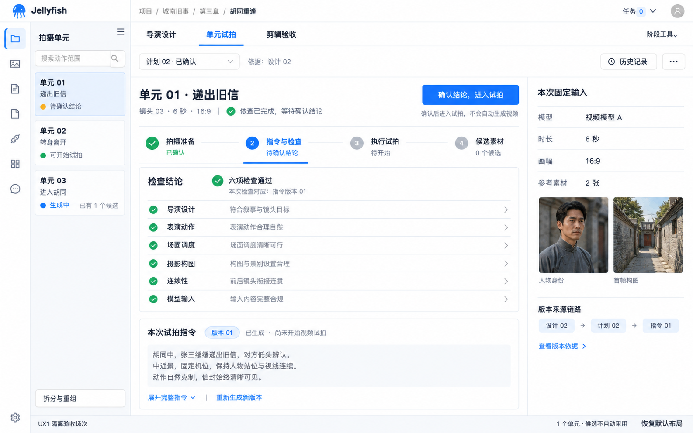

> 2026-09-16。以 `f640045` 为评估基线。F1–F4已完成本计划范围内的实现与隔离验收；概念图和实际四尺寸截图均已归档。最终验收依据见第9节，后续按需接入真实供应商运行，不将隔离验收等同于成片质量验收。

后续展示调整见[场次工作台紧凑布局与试拍检查优化计划](/docs/plans/sequence-workbench-compact-review/)，包括标题压缩、问题优先、指令详情面板与公共布局。该计划已完成实现与隔离验收；本文保留F1–F4的流程约束及历史验收记录，当前展示规格与验收结果以该后续计划为准。

## 1. 目标与范围

单元试拍应围绕当前单元持续推进。用户始终能看见：这次要拍什么、已经完成什么、现在需要做什么。每次操作都在原上下文留下明确结果，并接住下一步。

本计划承接[场次资产准备与设计到试拍衔接优化计划](/docs/plans/sequence-workbench-asset-to-shoot/)：保留其资产闭环、设计到试拍入口、镜头显式选择和版本保护，继续完善进入试拍后的实际操作体验。原计划的E阶段完成记录不改写为本计划的验收证据。

- 范围：单元导航状态、工作区职责、指令与检查闭环、操作成功后的定位、执行反馈、历史与刷新恢复。
- 保持既有品牌位置、图标栏、侧栏、面包屑、阶段导航和蓝白视觉风格；不重新设计全站框架。
- 复用计划、指令、审稿、任务与Take契约，不新增第二套可编辑业务状态或通用工作流引擎。
- 不重做导演设计和剪辑验收；候选生成成功仍不代表审查通过、实际覆盖成立或已采用。

## 2. 实施前的评估依据与问题

用户描述：进入试拍首先看到“准备生成指令”，生成后不知道下一步；检查并保存后又看到起稿入口，无法判断是否完成。

实施前基线的代码核查确认：

1. `SequenceWorkspacePage.tsx`在已确认计划的指令内容顶部常驻“准备生成指令”，已有指令后也不降级；重复生成与首次生成缺少层级区分。
2. 检查在指令页发起，结果在任务结果弹窗中查看和保存，执行操作位于另一个子页签，业务上下文被拆开。
3. 保存审稿时会设置对应计划、单元、指令和审稿身份，但最终仅切换到`shoot`大阶段，没有明确定位到检查结论或执行位置。
4. `ProductionWorkbench.tsx`的子页签浏览位置与`workspaceGuidance.ts`的下一步判断分别维护，完成操作不保证内容与主操作同时推进。
5. 单元列表主要展示已有指令和候选数，不能充分区分等待确认结论、需修改和可开始试拍。
6. `workspaceJourney.browser.mjs`在保存审稿后手动点击“检查与试拍”才能继续，证明流程可执行，不证明用户能自然发现下一步。

这些证据可以解释“视觉上回到起点”，不等于已经复现数据丢失。实施时须分别验证“结果未保存”“结果已保存但未选中”“结果已选中但浏览位置未推进”，不能只替换按钮文案。

## 3. 预览与视觉约束

[打开原尺寸预览](./concept-preview.png)

预览使用imagegen基于现有工作台截图生成，与本文保存在同一目录，使用相对路径供本地Markdown预览和文档站共同读取，不依赖本机生成缓存路径。它展示“六项检查通过，但检查结论尚未由用户确认保存”的状态。

### 必须与预览一致的部分

- 左侧按单元展示动作摘要和具体工作状态，选中单元有清晰高亮。
- 中央标题稳定为“单元01 · 递出旧信”，不以“准备生成指令”等操作代替对象标题。
- 单元标题区域只有一个蓝色主操作；本图为“确认结论，进入试拍”。
- 四个工作区按“拍摄准备 → 指令与检查 → 执行试拍 → 候选素材”排列，当前浏览位置与业务状态分别表达。
- 检查结论使用紧凑行和汇总，正文与生成指令在同一区域；不恢复六张等权重的大卡片。
- “重新生成新版本”是次级操作，右侧集中展示实际固定输入和可读版本依据。

### 以本文规格为准的部分

- 图中的项目、动作、模型和图片均为示意，不写成固定业务数据。
- 生成图存在的字形或措辞误差不照搬；状态文案统一为“检查已完成，等待确认结论”。
- 六岗职责沿用现有契约：导演、表演、调度、摄影、连续性、提示词。图中“模型输入”不得被理解为新增岗位，或用模型审稿替代服务端能力预检。
- 预览只展示一个桌面状态；问题、失败、运行中、多个版本和窄屏状态须按下文补齐，不能仅实现静态外观。

## 4. 页面职责

### 4.1 左侧：单元与工作进度

每行展示单元编号、动作摘要、当前工作状态，候选数作为独立补充。例如：

| 单元 | 动作 | 工作状态 | 已有成果 |
| --- | --- | --- | --- |
| 单元01 | 递出旧信 | 待确认结论 | — |
| 单元02 | 转身离开 | 可开始试拍 | — |
| 单元03 | 进入胡同 | 视频生成中 | 已有1个候选 |

“检查中”与“视频生成中”明确区分；再次试拍不隐藏已有候选。阶段状态不扩展为一个覆盖所有业务事实的总状态字段。

### 4.2 中央顶部：稳定标题与唯一主操作

- 标题表示单元和动作，副信息显示镜头范围、时长、画幅及必要的版本依据。
- 状态与主操作由当前精确上下文决定，不随浏览子页签而回退。
- 主操作只保留一个；原有大面积下一步提示条与内容内重复按钮应整合，不能叠加两组竞争操作。
- 保存草稿、重做、历史和高级工具保持次级层级。

### 4.3 四个工作区

| 工作区 | 主要内容 | 退出本步的结果 |
| --- | --- | --- |
| 拍摄准备 | 动作范围、模型、实际时长、参考及准备确认 | 精确计划版本已确认 |
| 指令与检查 | 指令正文、检查进度、结果摘要、问题处理、确认结论 | 匹配本次指令的检查结论已保存；是否可执行另行判断 |
| 执行试拍 | 实际提交摘要、明确开拍、运行与失败反馈 | 登记本次真实任务及候选结果 |
| 候选素材 | 已有候选视频、新结果、进入剪辑验收的入口 | 用户进入对应Take的审片位置，不自动采用 |

允许自由回看，不做强制逐页填写的向导。右侧在准备阶段仍提供参数编辑；进入指令和执行后展示所选指令实际冻结的模型名称、时长、参考及版本依据。浏览历史版本时标明历史身份，不将当前计划参数冒充历史输入。

## 5. 操作与状态衔接

| 真实状态 | 中央主要内容 | 主操作及结果 |
| --- | --- | --- |
| 准备未完成 | 具体缺项及对应字段 | 完成拍摄准备，定位当前缺项 |
| 准备已确认、尚无指令 | 动作与输入摘要 | 生成试拍指令；成功后显示指令正文，主操作变为检查这份指令 |
| 指令已生成、尚未检查 | 指令版本与正文 | 检查这份指令；成功受理后原地显示检查中 |
| 检查进行中 | 精确任务进度，指令仍可阅读 | 查看检查进度；不可重复提交同一检查 |
| 检查完成、结论未确认 | 结论汇总和问题清单 | 满足条件时确认结论，进入试拍；有问题时查看并处理问题 |
| 检查结论已保存、仍有问题 | 尚需处理项及原因 | 定位问题；保存不伪装为通过 |
| 结论已确认且满足执行条件 | 可开拍状态、实际输入摘要 | 核对并开始试拍；提交前仍由服务端校验 |
| 视频生成中 | 当前任务进度、取消入口、已有候选 | 查看生成进度，不重新展示起稿为主动作 |
| 视频生成失败或取消 | 当前任务的真实结果和恢复路径 | 允许时明确重试；需修正时先定位问题 |
| 视频生成成功 | 新候选及对应任务信息 | 查看样片，定位实际Take；人工审片与采用另行完成 |

上表不是只看最新时间的线性状态机。加载中或核实失败先显示状态未知，禁止据此建议重复提交；多条任务和已有候选可并存。新任务运行时仍可查看旧候选，旧候选未审片也不能遮蔽本轮检查结果。优先展示用户当前明确选择的工作；没有明确选择且存在多组合法版本时提示选择。

### 5.1 指令生成后

- 成功结果替代空态，显示“试拍指令已生成 · 版本1”和实际正文；由本次响应确定精确版本。
- “重新生成新版本”进入次级操作，说明新指令需要重新检查，旧指令与审稿保留。
- 生成失败保留原有内容和输入；多个新增版本无法唯一确认时，明确选择，不能按列表最后一项猜测。

### 5.2 检查过程与结果

- 主路径在“指令与检查”原地完成，任务中心保留通用状态和回跳，不承担结果发现的唯一入口。
- 先展示结论摘要，如“5项通过，1项需处理”。通过项为紧凑行，问题项展开并提供实际字段定位。
- 完整依据可展开阅读，显示对应指令版本。任务完成、检查通过、结论已保存、可执行分别表达。
- 人工艺术取舍复用既有理由与版本派生规则，不绕过结构、文件、模型能力及依赖校验。

### 5.3 保存结论后

- 满足条件：按钮“确认结论，进入试拍”；保存成功后选中精确审稿和指令，进入“执行试拍”，显示可开拍摘要。
- 仍有问题：保存后留在问题位置，显示“结论已保存，仍有N项需处理”。
- 保存失败：原地显示失败并可重试，保留结论、阅读位置和版本身份，不退回起稿。
- 保存成功但响应或后续读取不明确：核实原任务的已保存结果，不自动重复检查或派生审稿。
- 确认结论只保存并导航，不自动发起视频生成。

### 5.4 开拍与候选

- 执行区显示实际动作、模型名称、时长、参考缩略图、指令与审稿版本；用户明确点击才提交视频任务，不叠加无必要的重复确认弹窗。
- 受理中的重复点击、未知结果和重试遵守既有请求身份规则；明确再拍一次与核实同一次提交区分。
- 成功后在当前上下文显示新候选入口；候选列表保留历史素材，进入剪辑验收时定位对应Take。

## 6. 浏览、恢复与版本规则

1. 页签表示“正在看什么”，业务状态表示“做到哪里”。回看准备或指令不要求重做，也不清空后续结果。
2. 用户主动操作成功后，在该操作所属单元内推进；如果等待期间已切到别的单元或历史版本，迟到结果只更新原单元，不抢当前页面。
3. 后台检查或视频任务完成时更新对应单元状态并提供查看入口，不自动切走用户当前工作。
4. 按计划版本、单元、指令、审稿和任务身份恢复上下文。当前单元明确产生的新结果可继续使用；历史多版本未选择时不得自动取最新。
5. 同一计划和单元的再次选择不应清掉已选指令与审稿；跨单元切换按各自合法上下文恢复。历史入口和用户明确选择优先于默认推进。
6. 刷新、返回和结果回跳区分无数据、未选择、读取失败及历史依据不可用。未知状态不展示“请重新生成”。
7. 修改模型、范围或参考后明确解释旧指令与检查对应原计划，新计划需要重新准备；旧成果保持可查。
8. 草稿保护和已有计划派生规则继续生效；未保存编辑不能被后台结果、导航或加载响应覆盖。

## 7. 实施阶段

按F1 → F2 → F3 → F4实施；每阶段先核查当前代码和已有测试，再实现并完成相应验证。

| 阶段 | 任务与交付 | 验证方式 | 状态 |
| --- | --- | --- | --- |
| F1 操作结果衔接 | 复现三类“回到起点”；生成后展示结果并指向检查；保存审稿按结果定位；重复生成降级 | 不靠测试手动寻找子页签即可从生成走到检查，再到执行；失败保留及重试、无需重新编译 | 已完成 |
| F2 工作区与状态统一 | 调整四区职责，集中指令与检查，独立执行区；稳定标题、唯一主操作、左侧状态与固定输入 | 按预览核对布局；检查中/视频生成中、通过/待确认/可执行、已有候选并存均准确 | 已完成 |
| F3 上下文与异常恢复 | 精确版本恢复、迟到结果隔离、刷新与历史回看、修改准备后的说明 | 多单元、多指令、多审稿、旧任务、失败重试、重复点击、未保存草稿和失效依据回归 | 已完成 |
| F4 综合验收与文档 | 连续操作旅程、四尺寸与键盘、实际截图归档；同步架构和指南 | 隔离端到端回归、实际布局和控件命中、适用类型/后端/文档检查及局限记录 | 已完成 |

### 实现边界

- 优先围绕现有`SequenceWorkspacePage`、`ProductionWorkbench`、`workspaceGuidance`、`workspaceProduction`和任务上下文完善，不为展示状态新增重复数据库字段。
- 一个事实来源驱动左侧状态、内容摘要和主操作，避免各处独立猜测；数据身份不从按钮标题推导。
- 接口调用继续使用generated client。若现有响应无法可靠核实本次操作身份，再按实际需要变更后端契约并同步OpenAPI，不先扩大范围。
- 不合并用户必须明确授权的业务动作：生成指令、发起检查、确认结论、提交视频和采用素材保持可辨识的边界。

## 8. 最终验收清单

- [x] 指令生成成功后直接看见结果和检查入口，不再把首次生成作为主要操作。
- [x] 检查在原单元可查看进度与结论；无需去任务中心寻找结果才能继续。
- [x] 通过结论确认保存后进入执行区，仍有问题则停在具体问题，失败时原地恢复。
- [x] 点击确认结论不会提交视频；只有明确开始试拍才产生视频任务。
- [x] 左侧、中央状态和唯一主操作一致，回看旧步骤不回退业务状态。
- [x] 单元重复点击、跨单元切换、刷新、历史与任务回跳保持精确身份，不自动选择最新版本。
- [x] 检查与视频任务状态区分；后台完成和迟到响应不抢占其他单元或覆盖编辑。
- [x] 多版本、核实失败、取消、重复点击和部分成功重试均有清晰结果，不重复起稿或提交。
- [x] 输入改变后说明需重做的范围，旧计划、审稿和候选保持可查。
- [x] 候选生成、人工审片、实际覆盖和采用分别表达，入口定位真实素材。
- [x] 框架、信息层级与预览一致；1440/1024/768/375宽度及键盘操作可用，主操作无遮挡，正文不被挤成窄列。
- [x] 前端typecheck和受影响回归通过；若改后端，完成相关测试、Pylint和契约同步；文档构建、图片链接和差异检查通过，既有失败单独记录。

## 9. 验证记录与参考

### 最终验收结论

F1–F4完成。以下逐项对应第8节验收清单；后续按日期排列的记录保留实施过程，其中“待完成”仅描述当时状态，不是当前待办。

| 验收项 | 当前实现与直接证据 |
| --- | --- |
| 1 指令生成后衔接 | `workspaceJourney.browser.mjs`由主操作生成后直接进入正文与检查；编译响应返回精确指令身份。 |
| 2 内联检查 | `workspaceShootProgress.browser.mjs`验证检查运行、取消、状态读取失败及结论；不需任务中心发现结果。 |
| 3 保存与问题恢复 | `workspaceShootContext.browser.mjs`覆盖通过后进入执行、有问题留在检查、保存失败和响应丢失恢复。 |
| 4 显式视频授权 | 完整旅程与恢复用例断言确认结论不创建视频；原提交核实复用身份，“再拍一次”才分配新身份。 |
| 5 状态与主操作 | 进度回归断言左侧检查/视频状态、旧候选数和唯一主操作；回看候选后可准确返回执行区。 |
| 6 精确身份恢复 | Context、Guidance、Refinement浏览器回归覆盖重复选择、跨单元、刷新、历史、失效版本及任务回跳，不按最新版本猜测。 |
| 7 迟到响应与编辑保护 | Context验证编译、检查、保存迟到响应尊重返回意图；Write十组回归验证写入中保护和失败保留。 |
| 8 异常与并发 | 46项前端状态测试、完整响应丢失旅程和真实MySQL三项并发用例，覆盖原请求恢复、不同版本与重复提交边界。 |
| 9 输入变化与历史 | Production、Usage、ShootSteps验证冻结模型/参考及来源，确认计划派生、部分成功重试、旧版本引用保持。 |
| 10 候选与采用分离 | 完整旅程、Usage回归验证候选、审片、实际区间和确认粗剪，进入Take不自动采用。 |
| 11 视觉与键盘 | 已归档1440/1024/768/375实际截图；Progress检查横向溢出、主操作命中、键盘展开；逐张视觉核对。 |
| 12 工程与文档 | typecheck、46项前端状态测试、124项后端场次测试通过；默认跳过的3项MySQL用例已在独立库执行通过；OpenAPI、架构和指南同步，文档构建和差异检查通过。 |

#### 最终受影响回归

- 试拍入口 `workspaceShootStart`、准备确认 `workspaceShootSteps`、资产衔接 `workspaceAssetFlow`、十组写入保护 `workspaceWrite`、阶段与视图恢复 `workspaceRefinement`通过。
- 生产与冻结输入 `workspaceProduction`、错误定位和业务回跳 `workspaceGuidance`、版本引用/审片采用 `workspaceUsage`通过。旧测试按四工作区、内联结果及编号展示更新，保留原业务断言。
- 明确输入拒绝（400/409/422）清理未受理的编译/检查请求，保留具体问题定位；首次编译失败可原地重试。响应不明保留原身份核实，两者分别回归通过。
- 最终恢复旅程：`jellyfish-journey-bHmQ4n`；生产：`jellyfish-ux3-mXDFrk`；引导：`jellyfish-ux2-GDK0rH`；引用与采用：`jellyfish-ux1-WiURZI`。临时目录仅用于定位运行记录，正式四尺寸截图和[验收摘要](./acceptance/verification.json)随本文归档。

#### 验证边界与既有问题

- 浏览器使用隔离数据与示意媒体，不调用真实付费供应商；本次验收证明交互、请求恢复和业务边界，不证明生成画面质量。
- 已在独立MySQL 8.0.39测试库执行完整迁移及多连接并发验证，容器已清理，未向应用库写入测试业务数据。本机开发库已加载本计划要求的`9bf5b2f0c813`迁移。
- `uv run pylint app`仍返回5条既有告警：`task_worker.py` W0706/R0911、`studio_assets.py` E0213、`lab_generation_tasks.py` W0611、`task_queries.py` C0123；本次改动无新增告警。Hugo仍有主题`.Site.Data`弃用提示。
- 待核实请求的刷新恢复范围是同一浏览器标签页；浏览器存储不可用时停止提交并明确提示，不伪装为未提交。历史检查版本不按正文回填来源任务。
- 本次未自动提交commit或部署。

### 2026-09-16：操作衔接首轮验证（未完成整体验收）

- 已实现四个工作区、内联检查结论；生成指令后定位“指令与检查”，保存通过结论后定位“执行试拍”。再次点击当前单元不清空所选指令与审稿。
- 指令生成响应按操作开始时的上下文核对；用户已切换单元或版本时不替换其当前选择。此分支尚待延迟响应浏览器回归验证。
- 检查与视频任务的运行摘要分开显示；本轮指令检查结果优先于旧候选，其他单元的报告不能成为本次检查结果。
- `workspaceJourney.browser.mjs`隔离完整旅程通过；用例无需手动切入指令页或执行页，并断言确认结论不会生成视频、重复点击单元保留版本。首轮证据目录：`/var/folders/7l/9qr93fss507b4cg9dvmf19000000gn/T/jellyfish-journey-n6wlCk`（临时路径，F4另行归档正式截图）。
- `node --test front/tests/workspaceGuidance.test.mjs front/tests/workspaceTaskContext.test.mjs`：13项通过，覆盖精确任务范围、检查与视频状态区分及旧候选不遮蔽本轮检查结果。
- 状态优先级改动后的完整旅程再次通过，证据目录：`/var/folders/7l/9qr93fss507b4cg9dvmf19000000gn/T/jellyfish-journey-MpbC2R`。`pnpm --dir front run typecheck`、`git diff --check`及文档站构建通过；Hugo仍有主题使用`.Site.Data`的弃用提示。
- 本轮尚未完成：跨单元恢复、多个检查结果显式选择、迟到审稿保存响应隔离、保存部分成功时的幂等核实、完整状态统一、视觉与四尺寸验收、其他受影响回归及架构/指南同步。后续进度见下节；不能据首轮旅程通过判定F1–F4完成。

### 2026-09-16：精确选择与恢复

- 每个计划/单元分别保存所选指令、已保存审稿和待确认检查批次；切回时按当前工作区校验归属，缺失引用不替换为较新版本。
- 多个待确认检查需要显式选择；回看已保存结论时，新检查不会替代其展示。选择批次不产生检查、保存或视频任务。
- 检查受理后定位“指令与检查”，选中本次受理的检查任务；保存与编译响应增加当前上下文及卸载保护。迟到响应分支仍需专门浏览器验收。
- “确认结论，进入试拍”使用完整六岗矩阵判断；空报告、缺项、重复岗位和其他指令报告均不使用此文案。
- `workspaceShootContext.browser.mjs`通过：跨单元及刷新恢复、多检查显式选择、已保存结论回看、失效指令不替换以及浏览动作无业务写入。
- `workspaceGuidance.test.mjs`、`workspaceContext.test.mjs`、`workspaceTaskContext.test.mjs`合计20项通过。选择恢复改动后的完整旅程通过，临时证据目录：`/var/folders/7l/9qr93fss507b4cg9dvmf19000000gn/T/jellyfish-journey-BQx4Al`。
- 检查受理定位改动后的完整旅程通过，临时证据目录：`/var/folders/7l/9qr93fss507b4cg9dvmf19000000gn/T/jellyfish-journey-4CrarE`；本轮最终typecheck、差异检查和文档构建通过。
- 待完成：审稿保存的服务端幂等与响应不明核实、迟到响应专门回归、完整状态与内联运行反馈、视觉与四尺寸验收、其余受影响回归以及架构/指南同步。F1–F3保持进行中，F4尚未验收。

### 2026-09-16：审稿保存幂等与网络恢复

- 原始审稿增加唯一的`source_task_id`，同一检查任务保存和确认原子执行，重试返回原版本；人工取舍版本保持独立。前端按任务身份核实保存结果，不再用正文相同判断是否保存。
- 保存失败保留报告和主操作；提交结果不明时只读查询工作区，找到原任务关联版本才继续。缺少证据时允许用户重试同一幂等保存，不自动再检查或开拍。
- 已同步OpenAPI和generated client，确认8000端口加载当前工作区契约后生成。已在本机开发库执行增量迁移`9bf5b2f0c813`，不回填历史版本的任务身份。数据和迁移边界已同步到架构文档，四区操作与失败恢复已同步到操作指南。
- 后端场次测试：122项通过，2项MySQL测试在默认环境跳过；随后使用已有MySQL 8.0.39镜像创建独立临时容器，完整迁移和两项真实多连接测试通过，包含同一检查并发保存返回唯一版本。测试容器已清理，未向应用库写入测试数据。
- 存储校验调整后复跑生产与迁移用例：12项通过。`uv run pylint app`本轮改动无新增问题，仍有5条既有告警：`task_worker.py`的W0706/R0911、`studio_assets.py`的E0213、`lab_generation_tasks.py`的W0611、`task_queries.py`的C0123。
- 前端状态与恢复逻辑21项测试通过。`workspaceShootContext.browser.mjs`覆盖保存失败原地重试、成功但响应丢失后的只读核实、保存仍需修改的结论停在问题区；完整旅程通过，临时证据目录：`/var/folders/7l/9qr93fss507b4cg9dvmf19000000gn/T/jellyfish-journey-YB0NL3`。
- 延迟保存回归通过：浏览器返回在写入中被既有保护暂缓；修复了保存成功自动推进会改变待返回历史位置的问题，现在优先保留用户等待中的导航意图。写入结束后继续返回，保留正确的历史地址，重复保存历史任务不产生新版本。
- 最终typecheck与差异检查通过；正常完整旅程再次通过（`jellyfish-journey-0G21im`），共用写入保护10组浏览器检查通过（`jellyfish-write-jhlAUM`），证据均在本机临时目录，正式截图仍待F4归档。文档构建通过，保留主题`.Site.Data`既有弃用提示。
- 待完成：检查/视频任务内联运行反馈与取消/未知状态、统一左侧和中央状态、模型与固定输入可读性、唯一主操作的视觉收敛、四尺寸与键盘验收、其他受影响回归及最终文档核对。尚未达到F1–F4整体验收条件。

### 2026-09-16：内联进度与受理状态核实

- 检查和视频执行区已分别展示任务进度、取消和失败信息；历史取消记录不遮蔽当前检查结果。左侧状态复用主操作判断，候选数量独立显示。
- 固定输入按所选指令绑定的计划读取，展示模型名称、参考缩略图、动作范围和可读版本链；技术标识收纳到详情。指令默认摘要，可用键盘展开全文。
- 已受理任务立即按返回的任务身份读取，不等待工作区任务索引更新。状态缺失或读取失败时不建议重复提交；已明确选择另一份指令时，原指令的任务不占据当前主操作。
- 修复同一定位参数重复导航不切回执行区的问题；从候选区再次点击“查看本次任务”可回到执行进度。
- `workspaceGuidance.test.mjs`、`workspaceTaskContext.test.mjs`、`workspaceContext.test.mjs`共22项通过；typecheck及差异检查通过。`workspaceShootContext.browser.mjs`复跑通过，覆盖精确版本恢复、多检查显式选择、保存失败重试与响应丢失后的原版本核实。
- `workspaceShootProgress.browser.mjs`通过，覆盖任务索引滞后、检查取消后重试、状态读取失败恢复、视频失败、旧候选保留，以及1440/1024/768/375宽度、主操作命中和键盘展开。临时截图与结果目录：`/var/folders/7l/9qr93fss507b4cg9dvmf19000000gn/T/jellyfish-shoot-progress-Nn0H0O`。此轮为隔离数据验收，不代表真实供应商生成验收。
- 仍待完成：视频提交响应不明时跨刷新保留同一次请求身份、明确“再拍一次”的入口、编译异常恢复及迟到响应覆盖、其余受影响回归、最终截图归档与逐项验收。F1–F4均保持进行中。

### 2026-09-16：试拍提交恢复与再次拍摄

- 视频提交前持久化精确指令/审稿对应的请求身份；响应缺失或失败时保留“核实本次提交”，同一标签页刷新后复用原请求。受理任务身份保存后才清理待核实记录。存储损坏或不可用时停止新提交，避免丢失身份后重复执行。
- 执行区增加次级“再拍一次”动作，仅在检查、版本与任务状态允许时执行。明确再次拍摄使用新的请求身份，已有候选保留且不自动采用。
- 23项前端状态与恢复测试、typecheck、差异检查通过。浏览器回归模拟服务端已受理但网络响应丢失，刷新后核实返回原任务；断言前两次请求身份相同，明确再拍才使用新身份，旧候选均保留。证据目录：`/var/folders/7l/9qr93fss507b4cg9dvmf19000000gn/T/jellyfish-shoot-progress-iHZSQs`。
- 完整操作旅程复跑通过，包含编译、检查、确认、视频候选、审片粗剪与局部返工，证据目录：`/var/folders/7l/9qr93fss507b4cg9dvmf19000000gn/T/jellyfish-journey-JYu5IH`。已同步架构和操作指南。
- 待完成：编译与检查提交异常恢复及迟到响应覆盖、其余受影响回归、最终截图归档和逐项验收；这些结果不代表F1–F4已全部完成。

### 2026-09-16：迟到响应与四尺寸截图归档

- `workspaceShootContext.browser.mjs`新增编译与检查提交延迟场景：操作等待期间用户返回导演设计，写入保护结束后继续原导航；迟到响应不改写历史选择，不再次编译、检查或开拍。与已有保存、版本恢复用例一起通过。
- 检查区域去掉嵌套工作区造成的重复内边距，确认说明收敛为短句；保留检查结果与实际执行的区别。手机宽度下六岗结论以紧凑行显示，主操作仍完整可见。
- `workspaceShootProgress.browser.mjs`在最终样式上复跑通过：四尺寸均无横向溢出、主操作无遮挡且可命中，键盘可展开指令；同时覆盖检查取消、状态读取失败、试拍响应丢失后刷新恢复和明确再次拍摄。typecheck与差异检查通过。
- 已逐张核对并归档真实页面截图：[1440桌面](./acceptance/check-ready-1440.png)、[1024平板横屏](./acceptance/check-ready-1024.png)、[768平板](./acceptance/check-ready-768.png)、[375手机](./acceptance/check-ready-375.png)，以及[浏览器检查结果](./acceptance/results.json)。截图使用隔离数据和示意参考图；概念图仍独立保留。
- 尚待完成：编译与检查提交响应不明时的可靠恢复、其余受影响回归和最终逐项验收。截图证明当前布局，不代表全部异常路径或供应商执行已验收。

### 2026-09-16：编译响应恢复

- 编译复用现有操作记录保存可选请求身份，无新增表或迁移。服务在场次锁内返回原指令，拒绝跨计划、单元和操作复用身份。响应新增`compiled_prompt_revision_id`，前端不再通过新增版本数量猜测本次结果。
- 编译请求在发送前保存到当前标签页；失败或响应缺失保留“核实本次指令生成”，刷新后仍复用原请求。旧版本与其他操作产生的版本保持可查。
- 已核对8000端口后端的工作目录及新契约，再同步OpenAPI和generated client。后端生产回归9项通过，全场次回归123项通过、2项MySQL用例因无隔离连接配置跳过。本轮编译并发分支尚未在真实MySQL多连接环境验收。
- 前端24项状态/恢复测试和typecheck通过。完整浏览器旅程在`JELLYFISH_TEST_COMPILE_LOST_RESPONSE=1`下通过：模拟编译已成功但响应丢失、并发出现另一份指令，刷新重试沿用原请求并明确选择原指令，随后完成审稿、拍摄、审片与返工。证据目录：`/var/folders/7l/9qr93fss507b4cg9dvmf19000000gn/T/jellyfish-journey-WRjRUU`。
- Pylint无本轮新增问题，仍保留前述5条既有告警；已同步架构与操作指南。待完成：检查提交响应不明恢复、本轮编译MySQL并发验收、其余受影响回归和最终逐项验收。

### 2026-09-16：检查提交恢复与真实并发验证

- 检查提交增加场次内请求身份，固定指令和检查参数；重试返回原任务，取消或完成后核实也不会隐式重新检查。恢复元数据保存在任务快照顶层，不进入模型输入。前端跨刷新保留待核实请求，使用“核实本次检查”继续。
- 连续模拟编译和检查响应丢失的完整操作旅程通过：`JELLYFISH_TEST_COMPILE_LOST_RESPONSE=1 JELLYFISH_TEST_REVIEW_LOST_RESPONSE=1`，恢复原指令与原检查任务，不自动保存结论或开拍，之后可完成候选、审片与局部返工。证据目录：`/var/folders/7l/9qr93fss507b4cg9dvmf19000000gn/T/jellyfish-journey-yK7YHa`。
- 使用本机已有MySQL 8.0.39镜像建立独立临时库，执行完整迁移。重复读隔离级别下的双连接测试发现并修复“操作记录已可见、对应指令仍读旧快照”的问题；恢复版本使用当前读，编译接口响应确保包含原指令正文。
- 独立MySQL三项用例分两次通过：完整场次并发回归2项，以及新增编译接口响应并发回归1项。包含同请求并发编译只产生一份指令、并发检查只创建一个任务，以及同检查结果并发保存只产生一个版本。
- 后端全场次回归124项通过，3项MySQL测试在默认环境跳过后已于上述独立库验证。前端25项状态测试、typecheck与差异检查通过；OpenAPI与generated client已同步。Pylint仍只有前述5条既有告警。
- 待完成：其余受影响浏览器回归、最终界面与状态逐项核对及文档收敛。不得将本轮恢复和并发用例通过等同于全部F1–F4完成。

设计参考：[GitLab任务状态与人工动作](https://docs.gitlab.com/ci/jobs/)、[Frame.io检查与审批决定](https://help.frame.io/en/articles/14543173-transitioning-from-workfront-proof-to-the-frame-io-viewer)。借鉴其状态与动作分离的原则，不照搬外观或引入其业务规则。
