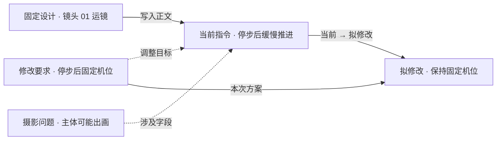

> 2026-10-08。用户已确认本次概念示意图的内容区表现形式，任务计划已整理，2026-10-09 已开始实施，T1–T6 实施与验收完成，证据及既有检查限制见第 8 节。示意图用于确定内容组织和交互方向，不作为实际页面截图或测试证据。

## 1. 目标与范围

在“单元试拍 → 指令与检查”中，让用户直接读到当前指令，针对具体内容提出修改，并在同一内容位置核对拟修改结果。

成功标准：

- 不打开详情面板也能阅读本次动作、摄影与运镜、声音及关键约束；完整正文仍可访问。
- 从内容卡片或检查问题进入修改时，明确展示调整对象和当前内容，生成请求携带可核实的对象范围。
- 方案返回后，在对应卡片展示当前内容与拟修改内容，所有实际变化均有可见入口；不能遗漏范围外影响。
- 阅读、选择对象、填写要求和预览不写入确认版本；仅显式采用后保存新版本并重新检查，不自动拍摄。
- 切换单元、计划、指令或检查来源后，旧选择、旧方案和迟到结果不会用于新对象。
- 桌面、窄屏与键盘操作均能完成阅读 → 修改 → 预览 → 采用复检。

本轮范围限于指令内容区及其检查联动。保留现有场次工作台分层框架、单元导航、三步试拍结构和检查侧栏。示意图中的色彩、图标和间距按项目现有样式落实；不照搬新增头像、通知、缩略图等外围元素。

不包含整篇模型原文任意编辑、通用图编辑器、自由拖拽连线、多方案并行、部分勾选采用、自动循环优化、自动拍摄或整场重新设计。

本计划承接[指令生命周期计划](/docs/plans/sequence-instruction-lifecycle/)和[布局统一计划](/docs/plans/sequence-workbench-layout-unification-plan/)。实施完成后，替代既有“完整正文仅在详情查看、主区只保留动作摘要”的展示规格；版本保护、页面职责、检查与拍摄授权语义继续有效。历史计划验收记录保留原义，当前架构在实现完成后同步更新。

## 2. 实施前核对的实现事实

| 位置 | 现有能力与限制 |
| --- | --- |
| `ReviewRevisionPanel.tsx` | 主区展示 coverage 动作范围及部分表演摘要；有统一修改输入、字段直接编辑、方案更新、采用复检和恢复 |
| `PromptReader.tsx` / `readableText.ts` | 易读名称、模型原文、复制、原文坐标、重复和重叠摘录定位、固定快照来源；尚无结构化卡片 |
| `ShootInstructions.tsx` | 完整正文、固定输入、版本历史在详情面板中；历史预览与工作版本分开 |
| `ProductionWorkbench.tsx` | 顶部步骤主操作、固定主区和检查侧栏、窄屏辅助抽屉 |
| `ProductionService.render_unit` | v4 正文包含参考和声音概要、场次背景、本次执行动作、摄影和项目风格；背景不能追加为本次动作 |
| `CompilationDecision` | 提供字段路径、正文摘录及参考去向；没有独立正文块 ID 或唯一片段坐标，部分标题和概要未映射 |
| `ReviewRevisionRequest` | 支持整体要求、人工 edits、检查 directions；没有独立自然语言修改范围 |
| `ReviewRevisionCandidate` | 提供真实字段 changes、完整 preview_text 和候选身份；没有新正文的 decisions |
| `review_revision.py` | 按固定设计与单元提供可编辑白名单，排除其他镜头共享字段；确认版本不可原地改写 |

已有浏览器生命周期测试显式断言默认正文不可见。此次需将该断言更新为结构化正文可读，同时保留技术详情按需展开、历史隔离和零隐式写入的断言。

## 3. 内容区规格

### 3.1 默认结构化阅读

主区顶部显示“本次指令”、工作版本和“结构化阅读 / 关联图 / 模型原文”切换。默认结构化阅读。沿用已有模型、时长、画幅和参考摘要，避免重复堆叠固定输入。

卡片按真实内容展示：

| 卡片 | 展示规则 |
| --- | --- |
| 本次动作 | 默认展开，包含本单元动作范围、适用导演与表演要求；多镜头按单元内顺序分段 |
| 摄影与运镜 | 默认展开，按镜头保留摄影要求；选中对象和相关问题明确标记 |
| 声音 | 展示固定指令声音安排及相关要求，区分同期生成和后期制作 |
| 背景与空间 / 人物与参考 | 背景明确标注；参考展示本次绑定的名称、用途及可用预览，不读取最新资产替代固定依据 |
| 连续性、限制与项目风格 | 有内容即提供可见卡片，关键约束不隐藏在技术详情中 |
| 其他指令 | 未识别、无可靠归类或历史格式的正文完整保留，不能静默丢弃 |

桌面允许卡片并排；长正文在卡片中自然展开，不能靠固定高度裁切。窄屏顺序堆叠。示意图的三张卡片是首屏示例，不代表实际正文只有三类。

结构化视图是固定正文的展示投影，不额外调用 AI 摘要或改写。保留原文块顺序及各块内部顺序；重组展示时始终保留背景／执行边界、标题上下文和原文定位。每段原文均有展示去向，不以字段快照拼成一份看似已编译的新正文。

模型原文保留完整文本与复制；来源、版本记录和技术详情继续按需查看。已有“易读内容 / 模型原文”复制语义保持明确。

### 3.2 内容关联修改

- 可调整卡片提供“调整这部分”；点击后高亮对象，在统一修改区显示可移除的目标标签、镜头名称及当前内容。
- 使用白名单直接编辑时，沿用真实字段、原值与单位换算，按钮为“预览修改”，不调用 AI。
- 使用自然语言时，按钮为“生成修改方案”；方案存在后为“更新修改方案”。输入变更仅使旧方案失效，不自动发起模型任务。
- 提供“改为整体调整”，显式清除局部范围；本轮一次自然语言调整选择一个明确范围，保留现有整体要求和人工字段编辑能力。
- 局部调整必须由服务端核验固定指令身份与允许字段范围。不得仅将卡片名称拼进自由文本，然后宣称已限制修改范围。
- 请求包含的人工 edits 和所选检查建议若超出范围，应提示冲突并要求切换整体调整或重新选择；不得静默扩大范围。
- 共享内容、模型和参考等不在本次可编辑范围的项目，解释原因并进入导演设计或拍摄准备；填写内容保留。
- 没有可靠映射时仍可阅读，提供整体修改或核对固定依据入口，不伪造精确局部编辑。

草稿保存包含调整对象，并纳入输入身份与过期判断。关闭详情、往返页面不丢失；切换基线不重用旧范围。服务端任务快照、恢复请求与采用核验使用同一冻结范围。

### 3.3 原位差异预览

- 当前指令保持可读，卡片内额外展示“拟修改”，绿色突出新内容，删除线只用于真实删除或替换部分。
- 采用 `changes` 的真实 before/after 和服务端 `preview_text`，不由前端猜测新指令。
- 明确区分字段变化和模型正文变化。候选暂缺 decisions，先核实是否能按既有编译格式可靠定位预览；无法准确定位时，在该卡片提供真实字段差异并链接完整预览。
- 实际变化无法归类时进入可见的“其他变化”，保证每项 change 有且仅有一个主展示位置；多个关联位置使用引用提示。
- 时长、画幅、声音安排及涉及多个镜头的变化明确显示，不能只高亮用户选中的那一处。
- 方向、字段或范围变化后，预览标记“待更新”，禁用采用；未解决、需要选择、无变化和失败分别表达。
- 生成／更新和“采用并重新检查”位于修改区；检查与进入试拍等步骤动作保持顶部位置。存在未采用方案时说明检查对象仍为当前工作指令。

### 3.4 检查联动与关联图

- 沿用现有右侧检查栏；点击“定位正文”定位实际映射的卡片及片段，无映射时说明并展示固定依据。
- “加入修改要求”带入对应问题上下文，仍由用户生成方案；重复消费、来源切换和旧问题重放保护继续有效。
- 卡片问题徽标采用真实相关 finding 数量；通过项按现有检查条目口径统计，不混为同一计数。
- “关联图”只展示选中内容的固定依据 → 正文 → 修改要求 → 候选预览，并通过独立连线表达检查问题；连线表示可核实关系，不表示检查已经通过或修改已经采用。
- 图中节点与卡片共用选中对象，点击回到相应正文、要求或差异；无方案时不显示虚构预览节点。
- 图按固定布局实现，不增加拖拽连线、无限画布或新工作流平台。无可靠映射时显示缺失状态，不推断关系。
- 侧栏只保留选中对象的紧凑关联依据，完整关联视图复用主区切换；不重复铺设两套独立图数据。
- 窄屏沿用检查摘要和辅助抽屉，加入要求后回到主区；图和卡片均提供键盘可达入口，不依赖悬停或颜色辨识。

### 3.5 关联图详细设计

#### 3.5.1 用户问题与展示范围

关联图回答三个问题：“这段指令依据什么”“哪个检查问题涉及它”“我的要求实际改了哪里”。它围绕一份固定指令中的选中内容组织，不展示设计 → 拍摄 → 候选的业务流程，不加入视频候选、采用关系或其他单元输入。

默认结构化阅读保持不变。点击“关联图”进入同一主区的替代视图，统一修改输入仍常驻图下方。切换视图不改变当前工作版本、修改目标或草稿。图中的“选中查看对象”和“正在调整对象”分别表达：浏览摄影节点不能自动将输入范围改为摄影。

进入图时沿用卡片／问题最近明确选中的对象。首次进入且无选择时，聚焦本单元第一个执行动作块，不自动选中问题最多的内容，也不生成修改草稿。顶部提供对象选择器，例如“镜头 01 · 摄影与运镜”，切换后仅刷新相关子图。

#### 3.5.2 布局与内容层级

完整视图采用三列固定布局，列标题为“固定依据 / 当前指令 / 调整与预览”。正文节点位于中心；检查问题在中心下方独立分支，不混入依据链。修改要求和真实变化位于右列上下排列。以单个摄影字段为例：



图是关系示意，实际节点和连线只在数据满足第 3.5.4 节条件时出现。没有方案时只有依据、当前正文和已填写要求；没有要求时不出现要求节点；没有匹配检查时不出现问题节点。不绘制带勾的“优化完成”节点。

布局规则：

- 同列按固定正文顺序、镜头顺序和真实检查顺序排列，异步返回不重排当前已选对象。
- 默认仅展开选中对象的一跳依据、相关问题和实际变化，不铺开整个单元所有字段。
- 同一类超过 3 个节点时显示前 3 个及“还有 N 项”；展开仅增加该列内容，提供收起入口。折叠节点代表集合，不能将集合误绘为一条具体字段来源。
- 节点采用自然高度和统一宽度，不把全文压进固定小框。标题、版本身份和两行摘录常驻，完整内容进入图下方的内联详情；截断标记明确，不作为正文唯一阅读入口。
- 优先扩大图容器高度容纳内容，不缩小文字适应画布；不提供拖拽、缩放或连线编辑。
- 标准桌面内容区可用宽度不足以容纳三列时转为纵向关系列表；判断依据是主区实际宽度，不是整个浏览器宽度。初始三列阈值 880px，T5 按实际截图核对，允许调整。

#### 3.5.3 节点规格

| 节点 | 常驻信息 | 详情与动作 |
| --- | --- | --- |
| 固定依据 | 对象中文名、设计／计划版本、字段摘要；注明背景或执行依据 | 查看固定值和来源；可编辑字段提供“直接编辑”，受限字段提供对应业务入口 |
| 当前正文 | 卡片名、镜头名、原文对应易读摘录；标注“当前版本” | 查看完整段落、定位卡片、调整这部分；原文坐标不向用户常驻展示 |
| 参考表达 | 固定参考名称、用途、实际绑定的缩略图或媒体类型 | 查看本次绑定；无正文表达时明确“由参考表达”，不能伪造正文节点 |
| 检查问题 | 岗位、镜头／出现对象、观察摘要；显示该来源的真实状态 | 查看观察、建议、验收条件；定位正文、加入修改要求 |
| 修改要求 | “整体调整”或具体范围、用户原文摘要；注明“草稿”或“本次方案依据” | 聚焦统一输入、查看完整要求；不显示独立的第二个输入框 |
| 实际变化 | 目标字段、before → after、方案有效性；注明“拟修改” | 查看原因、关联问题和真实全文预览；定位原位差异 |

不具备可核对的候选正文映射时，节点名称用“拟修改字段”，不能使用“新正文”。只有在采用后读到实际新指令时才能标记“已保存版本”。“不可直接编辑”“来源缺失”“未写入正文”属于不同状态，不能用一种灰色禁用状态混合表达。

#### 3.5.4 连线语义与证据

| 关系与标签 | 生成条件 | 视觉 |
| --- | --- | --- |
| 固定依据 → 当前正文：写入正文／等效表达 | 固定指令的 decision 路径及摘录命中真实原文范围 | 中性实线；标签保留实际 disposition |
| 固定依据 → 参考：由参考表达 | decision 明确 `reference_id`，并在固定单元内找到绑定 | 中性实线 |
| 问题 → 正文：涉及字段 | 相同指令／检查来源、明确 occurrence，`affected_paths` 与 decision 路径按 JSON pointer 层级匹配 | 琥珀色虚线 |
| 要求 → 正文：调整目标 | 用户明确选择的局部范围映射到该段正文 | 蓝色虚线；整体调整使用“整份指令”范围说明，不向每段拉线 |
| 本次生成要求 → 变化：本次方案 | 方案冻结请求和输入身份匹配，变化属于该候选 | 中性实线；不表示每一句要求均被落实 |
| 当前字段／正文 → 拟修改：当前 → 拟修改 | changes 的 target/path、真实 before/after 及可核对的正文关联 | 绿色实线；方案失效后转灰并标“待更新” |
| 问题 → 变化：方案关联问题 | `problem_keys` 命中当前冻结检查来源中的问题身份 | 琥珀色虚线；不标“已解决” |

路径匹配使用相等或完整 `/` 层级祖先／后代关系，不能使用普通字符串前缀。design 路径与 unit 路径分别匹配，不能因同名字段合并。父路径问题指向一组可能涉及的内容时，标签改为“涉及此组内容”，不伪称具体句子存在错误。

没有关系证据时不画线，以独立状态条解释：“该问题没有可定位的正文映射，可查看固定依据。”未表达 decision 仅展示“未写入正文”，不能连到无关原文。背景节点保留背景身份；问题定位到背景并不意味着可将其作为本单元执行内容修改。

重复摘录通过固定原文坐标表示多个真实出现位置；重叠映射展示所有依据，不合并成唯一来源。同一个问题涉及多段内容时，可以展开查看其所有明确匹配，不为了图面简洁只保留第一条关系。

“加入修改要求”目前将建议追加为自由文本，没有独立建议来源记录。第一版仅展示可核验的 issue→正文、candidate.problem_keys→变化关系，不依据相似文字推断 issue→要求。若后续需要“来自哪条建议”的连线，应保存显式来源标识并处理用户编辑后失效，不在本轮猜测实现。

#### 3.5.5 点击与正文／检查联动

1. 点击节点先选中并在图下方显示内联详情，修改输入保持原位；不自动打开抽屉、不生成任务。
2. 点击“定位卡片／正文”切回结构化阅读，滚动到真实片段并短暂高亮，键盘焦点落到目标标题；返回图沿用选中对象。
3. 点击“调整这部分”才改变修改范围，目标标签与当前值同步更新；已有非空草稿涉及不同范围时先展示范围变化影响，不能把原要求静默套到新字段。
4. 点击“加入修改要求”沿用单次消费机制；检查来源变化后旧问题入口失效。加入后聚焦统一输入，不自动生成方案。
5. 点击拟修改节点仅查看变化。生成、更新、采用复检统一由现有修改区按钮触发，图中不重复添加采用按钮。
6. 检查侧栏点击问题或“定位正文”时，图模式下聚焦对应子图；阅读模式下定位卡片。无映射时停留当前视图并给出依据入口。
7. 方案异步完成仅更新预览节点和“方案已更新”状态，不改变视图、选中对象、滚动位置或焦点。

关系文字放在目标节点下方，并保留完整关系列表，避免窄列间距导致线上的长标签与节点重叠。图中选中节点使用描边；修改目标使用明确“正在调整”标记；关联节点和连线加深，非关联内容降低强调程度但保持可读。检查状态和预览状态使用文字及图标，颜色只做辅助。

#### 3.5.6 状态、身份与恢复

| 状态 | 图的行为 |
| --- | --- |
| 当前无指令 | 复用生成／选择空状态，不绘制示意占位图 |
| 有指令、无检查／无草稿 | 展示固定依据与正文；标注“尚无检查结果”，不伪造问题节点 |
| 要求已填写、尚未生成 | 展示草稿要求及明确调整目标，不显示拟修改 |
| 生成中 | 生成状态位于修改区；旧预览如存在标注其旧输入身份，不作为新结果 |
| 有效方案 | 展示真实变化，继续由既有 canApply 和业务校验决定是否可采用 |
| 方向或范围已变化 | 要求展示当前草稿；候选注明“基于上次要求，待更新”，保留可查看的冻结要求，不能将新要求连到旧候选 |
| 无变化／需要选择／无法执行 | 用候选 summary/outcomes 展示解释与选择，不伪造差异节点 |
| 采用完成、重新检查中 | 切换到真实新工作指令；旧方案进入历史，不将旧问题挂到新正文；显示真实复检任务状态 |
| 固定依据缺失 | 保留当前正文、版本标识和缺失说明，禁用依赖缺失依据的精确调整 |
| 历史预览 | 整张图标注历史只读，查看不切换版本，不创建草稿或沿用当前检查 |

节点身份来自固定对象，不来自显示名称：正文以 `prompt_revision_id + 原文起止坐标` 标识；依据以 `固定 revision + target + path` 标识；问题以 `检查来源 + occurrence_id + role + finding_index` 标识；变化以 `candidate_identity + target + path` 标识。要求分别标识当前草稿与候选冻结请求。参考身份包含固定计划／单元及 reference_id。

图模式、选中对象和返回定位属于浏览状态，按固定计划／单元／指令恢复；修改范围属于草稿及输入身份。切换检查来源只更新该来源的问题分支及相关关联，不能清除正文浏览选择；切换指令后验证旧选择是否仍存在，不靠数组位置套用旧节点。

#### 3.5.7 侧栏与窄屏

阅读模式下，检查侧栏可显示“关联依据”紧凑摘要，最多展示选中对象的依据、正文和有效预览三项，检查问题仍用既有问题卡片承载。提供“展开关联图”。主区已经处于图模式时，侧栏收起这份重复摘要，仅保留检查列表。

窄屏采用纵向分组：“固定依据 → 当前指令 → 调整与预览”，相关检查作为独立段落。SVG 连线退化为关系标签与对象跳转，保留全部关系信息，不要求横向拖动寻找节点。检查辅助抽屉仍按原规则打开／关闭并返回触发入口。

Tab 按分组及内容顺序访问节点；Enter／Space 选中，详情动作是独立按钮。节点不能使用包住其他按钮的大按钮。连线不作为唯一操作入口，详情中提供文本关系列表；异步更新通过简短 status 播报，不读出整张图。

#### 3.5.8 T5 拆分与专项验收

- T5.1：从已有卡片映射构建局部节点和关系数据；与阅读视图共用原文坐标、字段归属和候选变化，不复制一套解析器。
- T5.2：实现三列／纵向布局、对象选择、分组展开、内联详情及键盘入口。
- T5.3：接入正文、检查侧栏、修改目标与预览联动；补齐失效、缺失和历史状态。
- T5.4：实际截图验收并归档证据，检查图中的每条关系与固定数据一致。

专项覆盖：一字段多摘录、重复／重叠摘录、父路径问题、多镜头同名字段、unit/design 同名路径、由参考表达／未表达、无映射、超过 3 项的展开、过期草稿与旧候选分离、检查来源切换、迟到结果不抢焦点、历史零写入、键盘往返和四尺寸无横向溢出。复用已有生产图的样式习惯，但不继承其拖拽、缩放、准备输入编辑或计划总览状态。

## 4. 数据与接口决策

优先复用 `Prompt.text`、`decisions`、固定快照和候选 changes，建立本轮需要的轻量展示映射，不引入通用文档模型。

局部自然语言修改需要最小范围契约：固定指令内可核验的目标字段集合，并区分整体和局部。2026-10-09 已确定请求与采用契约使用 `scope: [{target, path}] | null`：null 为整体，非空数组为精确字段集合；空数组拒绝。采用同一个范围贯穿生成、任务快照、输入身份和采用恢复。服务端只允许该范围内的真实 changes；超范围结果拒绝或明确要求重新选择，不自动扩张权限。无范围的既有整体请求保持原有行为。

T1 同时确认历史提示词格式、重复摘录和候选全文的映射能力。只有既有数据无法满足可靠正文分块／预览关联时，才补充编译映射响应；不为展示主动改写正文、重新确认历史版本或批量回填数据库。

对外契约调整同步后端、OpenAPI 和 generated client。API 层负责收参鉴权与响应，service 层负责范围验证、候选校验和恢复。跨层 DTO 放在 `app/core/contracts`，不在任务模块定义。

## 5. 任务拆解与验证

| 任务 | 实施内容 | 验证方式 | 状态 |
| --- | --- | --- | --- |
| T1 数据映射与契约确认 | 用真实 v4 编译样本和历史格式确认卡片分组、背景边界、原文覆盖、候选映射；确定局部范围最小契约和异常规则 | 逐段核对展示去向；覆盖重复／重叠摘录、无映射、多镜头、缺失固定依据；记录决策后进入 T2 | 已完成 |
| T2 结构化阅读区 | 复用易读转换和来源定位，主区卡片、原文切换与复制；替换当前摘要为可阅读正文 | 单元测试验证不遗漏／不改写正文；浏览器验证主区阅读、历史只读、零业务写入和四尺寸布局 | 已完成 |
| T3 局部修改范围 | 内容选择、目标标签、统一草稿、直接编辑；服务端范围校验、候选约束、冻结身份和恢复；同步生成客户端 | 前后端覆盖合法局部、整体、非法路径、其他单元、共享字段、范围外建议／edits、输入变化和恢复一致性 | 已完成 |
| T4 原位预览与检查联动 | changes 回到卡片、正文预览与其他变化、状态和操作位置；检查定位及单次建议消费 | 浏览器覆盖主动修改、检查问题、更新、人工预览不调用 AI、无变化／需选择／失败、采用复检及迟到响应 | 已完成 |
| T5 局部关联图 | 按 3.5 节落实 T5.1–T5.4：三列局部图、证据连线、内联详情、正文与检查联动、状态和纵向降级 | 核对每条关系；覆盖重复映射、来源隔离、旧候选、缺失／历史、键盘与四尺寸，浏览不写入 | 已完成 |
| T6 回归与文档同步 | 运行受影响检查、归档实际截图，更新架构、操作指南及相关测试说明 | 类型检查、相关后端测试与 Pylint、浏览器回归；核对完成项与限制 | 已完成 |

依赖顺序：T1 → T2 → T3 → T4 → T5 → T6。T1 的契约决策写入本计划，后续不在实施中静默改变范围。每步均需完成对应验证，再标记完成；图形联动不阻塞卡片与修订主流程的独立验证。

主要受影响文件：`ReviewRevisionPanel.tsx`、`PromptReader.tsx`、`ShootInstructions.tsx`、`ProductionWorkbench.tsx`、`readableText.ts`、`reviewRevision.ts`、`workspace.css`；后端重点为 `review_revision.py` 及其 contracts，编译器按 T1 证据决定是否修改。

## 6. 验收矩阵与命令

| 场景 | 必须满足 |
| --- | --- |
| 未生成／未选择指令 | 提供生成或合法版本选择，不显示伪造卡片 |
| 指令生成、尚未检查 | 正文直接可读，既能检查也能主动修改 |
| 检查有问题／全部通过 | 均可调整；问题与正文映射准确，通过不禁止主动修改 |
| 多镜头单元 | 镜头顺序、目标归属和相关检查明确；背景不能变为执行动作 |
| 未识别／历史正文 | 完整内容可读，精确编辑能力按真实映射降级 |
| 修改时长或声音 | 字段、正文与拍摄设置差异分别正确表达，不暗示待后期声音已生成 |
| 局部要求返回超范围变化 | 服务端拒绝并说明，原输入保留，不能采用 |
| 方案生成中编辑／切换对象 | 迟到结果不覆盖输入或改变工作基线 |
| 采用中断／响应丢失／刷新 | 恢复同一次请求及已完成步骤，不重复创建或采用 |
| 历史预览 | 不切换工作版本、指令或检查；明确切换继续沿用已有保护 |
| 1440／1024／768／375px | 正文、修改区、检查入口及采用操作可达，无页面横向溢出 |

前端从项目根目录执行：

```sh
pnpm --dir front run typecheck
node --test front/tests/instructionContent.test.mjs front/tests/readableText.test.mjs front/tests/reviewRevision.test.mjs front/tests/workspacePreparation.test.mjs
node front/tests/workspaceInstructionLifecycle.browser.mjs
node front/tests/workspaceInstructionContent.browser.mjs
node front/tests/workspaceReviewRevision.browser.mjs
node front/tests/workspaceShootProgress.browser.mjs
node front/tests/workspaceCompactReview.browser.mjs
node front/tests/workspaceShootContext.browser.mjs
node front/tests/workspaceLayout.browser.mjs
```

浏览器脚本依次运行，避免既有端口冲突。新增覆盖优先补入已有用例，不编写只验证标签或实现细节的测试。

后端变更后，在 `backend` 目录执行：

```sh
uv run pytest tests/directing/test_review_revision.py tests/directing/test_production.py
uv run pylint app
```

如改动扩展至公共版本／任务恢复机制，按实际影响补跑 store 和任务测试。接口变化后先核实 `127.0.0.1:8000` 加载当前工作区后端，再从根目录执行：

```sh
pnpm --dir front run openapi:update
```

完成后更新 `architecture/directing-foundation.md`、`guide/sequence-asset-to-shoot.md` 和 `front/tests/README.md` 的相关章节，保留历史验收记录。截图和测试使用隔离数据，不调用真实视频模型；这些结果不证明真实生成画面的质量提升。

## 7. 当前进度

- [x] 用户确认内容区概念示意图。
- [x] 核对现有正文、修订接口、候选数据及已有回归。
- [x] 整理任务范围、实施顺序与验收计划。
- [x] T1–T6 实现与验收。

## 8. 实施记录

### 2026-10-09：第一批落地，整体目标仍未完成

- 新增 `RevisionFieldTarget`，生成和采用请求携带 scope；服务端校验白名单、重复字段、范围外人工编辑／检查方向／候选变化，恢复时核对冻结范围。
- 候选新增 `preview_decisions`，由正式编译共用渲染器返回；旧任务候选身份不因新增展示映射改变。已确认当前工作区 8000 服务的新 schema，执行 `pnpm --dir front run openapi:update`，清理生成器带来的无关末尾空行。
- 主区已展示结构化卡片和模型原文；保留原文顺序与全部字符、背景／执行边界、重复和重叠映射。局部调整标签、统一草稿、范围变化确认和损坏范围校验已接入。
- 真实字段差异回到相关卡片，服务端映射存在时可查看新指令相关片段。仍需补齐每项变化唯一主展示、正文片段来源入口、检查精确定位与完整关联图。
- 后端 `test_review_revision.py` 与 `test_production.py` 共 48 项通过。前端相关纯逻辑 24 项通过，包含新增范围存储与损坏输入验证。生命周期、修订和内容区三组浏览器通过；内容区四尺寸证据：`/private/var/folders/7l/9qr93fss507b4cg9dvmf19000000gn/T/jellyfish-instruction-content-yci1an`。
- Pylint 全量检查仍有 5 条既有告警／错误，位于 `task_worker.py`、`models/studio_assets.py`、`api/v1/routes/studio/lab_generation_tasks.py`、`services/task_queries.py`；四个文件与 HEAD 字节一致，本次改动文件无告警。未擅自修改这些文件。
- T1–T4 已有实现进展，仍待完整矩阵验证；T5 关联图尚未实现，T6 全部回归与最终截图尚未完成。不能将本批测试作为整个计划通过。

### 2026-10-09：关联图与正文／检查联动

- 新增轻量关系投影与固定布局组件，共用卡片原文坐标、字段路径和真实候选数据；节点只读点击和修改范围分开。
- 主区新增关联图切换、内容选择、三列／纵向布局、超过 3 项的展开、内联来源／问题／变化详情、原文定位和明确局部调整入口。侧栏关联摘要与主区共用选中内容。
- 连线必须有真实摘录、匹配检查出现项或候选 problem_keys；无映射和缺失参考不绘制虚假关系。过期候选仅关联冻结要求，当前草稿与旧方案分开显示。
- 字段变化选择一个主要卡片展示；无法归类的变化显示“其他变化”。多镜头摄影标题分块，防止同类连续正文合并后混淆范围。
- 专项浏览器验证节点查看、旧候选与新要求、图视图恢复、定位焦点和 1920／1440／1024／768／375px 布局，首轮证据：`/private/var/folders/7l/9qr93fss507b4cg9dvmf19000000gn/T/jellyfish-instruction-content-LrGkw5`。截图检查后修订了过期颜色、易读摘要和箭头，最终截图仍需重新归档。
- 生命周期及正文易读／历史／复制回归通过；精确指令与检查来源恢复回归通过。窄屏 compact-review 正在验证，T6 完整布局回归与最终验收审计仍未完成。

### 2026-10-09：展示修订与回归证据

- 同列连线向列间空隙弯曲，关系文字移至目标节点下方；选中节点及一跳关系强调，其余节点保持可读。正文节点明确显示“正在调整”。
- 最新 typecheck、28 项前端纯逻辑测试及 `git diff --check` 通过。内容区／关联图专项通过，验证局部 scope、草稿恢复、冻结要求隔离、节点查看零写入、正文定位焦点和五尺寸无横向溢出。
- 窄屏检查回归通过（`jellyfish-compact-review-0RsBEO`）；修订／采用恢复回归通过（`jellyfish-review-revision-mPceJ0`）；完整工作台布局回归通过（`jellyfish-workspace-layout-2Ob46d`），覆盖五尺寸、历史、刷新、辅助抽屉焦点及零写入。
- 最新实际截图与请求记录已归档至 `site/static/images/directing-workbench/instruction-content/`；图的五尺寸截图来自 `jellyfish-instruction-content-ih9sa9`。桌面截图已人工核对，移动端截图保留实际 375×812 首屏。
- 尚需完成专项验收审计：v4 中没有正文摘录的决定可独立选择查看、unit 固定参数依据、多个定位结果的呈现、超过 3 项展开和键盘专项证据。T1–T6 暂不标记完成；全量 Pylint 的 5 条既有问题仍保留。

### 2026-10-09：完成审计

本节为最终状态；以上各批次保留当时的进展和未完成项，不代表仍有待办。

| 要求 | 当前实现与验收证据 | 结论 |
| --- | --- | --- |
| T1：固定正文映射、历史格式、背景边界、重复／重叠摘录、多镜头与缺失依据 | `instructionContent.ts` 保留全部原文字符、顺序与坐标；按真实编译决定映射。11 项专项纯逻辑覆盖多镜头标题、路径边界、unit/design 归属、无正文决定、参考绑定和检查来源。固定单元参数仅在真实 v4 编译行匹配时连线。 | 完成 |
| T2：正文主区阅读、原文复制、历史隔离和窄屏 | 生命周期、shoot-progress、内容区专项验证默认正文可读、原文／易读复制、固定历史名称及无隐式采用／拍摄；历史关联图复用只读内容视图，隐藏修改动作，不关联当前检查。 | 完成 |
| T3：精确局部范围、草稿、白名单、恢复与接口同步 | `RevisionFieldTarget` 与 scope 贯穿请求、任务快照、输入身份和采用核验；非法／重复／外单元／共享字段、范围外 edits／directions／changes 拒绝。后端 48 项通过，含局部预览不可变、采用 decisions 相同和恢复一致性；生成客户端已从当前后端更新。前端覆盖范围损坏、局部草稿刷新和范围变化保留输入。 | 完成 |
| T4：真实差异、检查联动、状态与授权 | 每项变化有唯一主卡片，其他关联卡片提供位置引用；无映射变化进入“其他变化”。预览使用真实 before/after、preview_text 和服务端 decisions。compact-review 覆盖两处匹配及片段高亮；生命周期与修订回归覆盖主动修改、人工预览、无变化、声音必要选择、失败与采用恢复。 | 完成 |
| T5：局部图、关系证据、联动、状态与键盘 | 正文及无摘录依据可选择；固定来源、参考、问题、草稿／冻结要求和变化分开。候选关联问题同时核对显式检查来源；直接保存延续 source_task_id，人工派生独立。节点选择、超过三项展开／收起、直接字段编辑、键盘内容切换与正文焦点均经浏览器验证。生成中编辑后迟到结果保持新输入、图模式、选中节点及焦点；旧候选只关联冻结要求。 | 完成 |
| T6：回归、截图、文档和检查限制 | 31 项前端纯逻辑、48 项后端测试、7 组浏览器回归、typecheck 和 diff 检查通过。图的 1920／1440／1024／768／375px 与正文四尺寸无页面横向溢出；架构、指南、测试说明及计划同步。截图和请求／结果记录归档至 `site/static/images/directing-workbench/instruction-content/`。 | 完成，保留以下既有检查限制 |

最终浏览器记录：

- 内容区／图专项：`jellyfish-instruction-content-7D1R0A`，补充生成中编辑、迟到候选不抢焦点、无正文依据、单元参数、分组与键盘。测试先等待显式深链导航及刷新定位完成，再独立验证候选更新。
- 生命周期：`jellyfish-instruction-lifecycle-2DTGHO`。
- 修订／采用：`jellyfish-review-revision-QXYq9X`。
- 易读／复制／来源：`jellyfish-shoot-progress-hn0lfd`。
- 检查／多处定位／历史图：`jellyfish-compact-review-b05sH9`。
- 精确上下文恢复：`workspaceShootContext.browser.mjs` 通过。
- 全工作台布局：`jellyfish-workspace-layout-rtrcEB`。

实际桌面与纵向图截图已人工检查。`graph-375.png` 是 375×812 首屏，`graph-mobile-detail.png` 是 375×2200 的补充长屏截图，用于完整检查纵向关系；不以长屏代替实际手机尺寸回归。所有数据为隔离 fixture，不调用真实视频生成。

全量 `uv run pylint app` 执行完成，但仍返回 5 条既有问题：`task_worker.py` 的 W0706、R0911，`models/studio_assets.py` 的 E0213，`api/v1/routes/studio/lab_generation_tasks.py` 的 W0611，以及 `services/task_queries.py` 的 C0123。对应四个文件与 HEAD 未变，本次后端文件无告警；未扩展任务范围修复它们。没有本计划内的剩余实施项。
